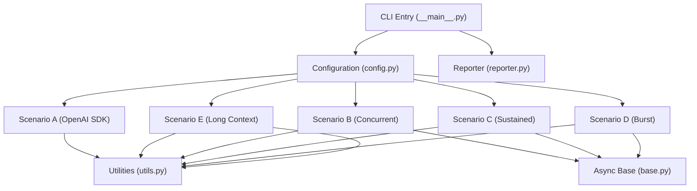
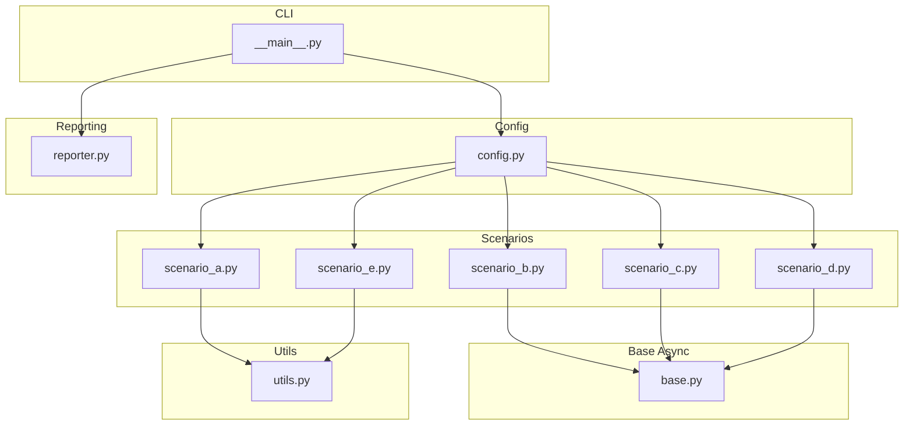
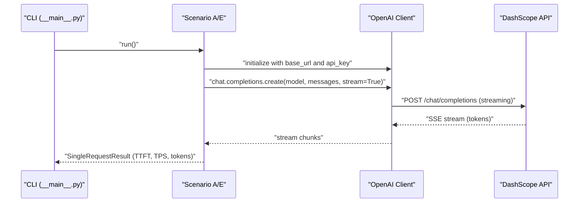
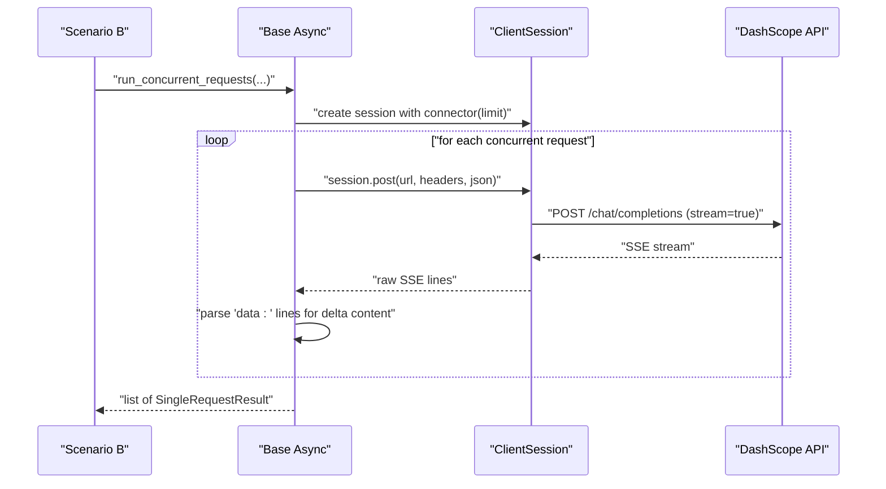
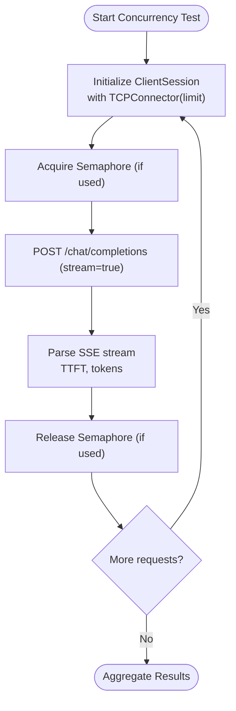
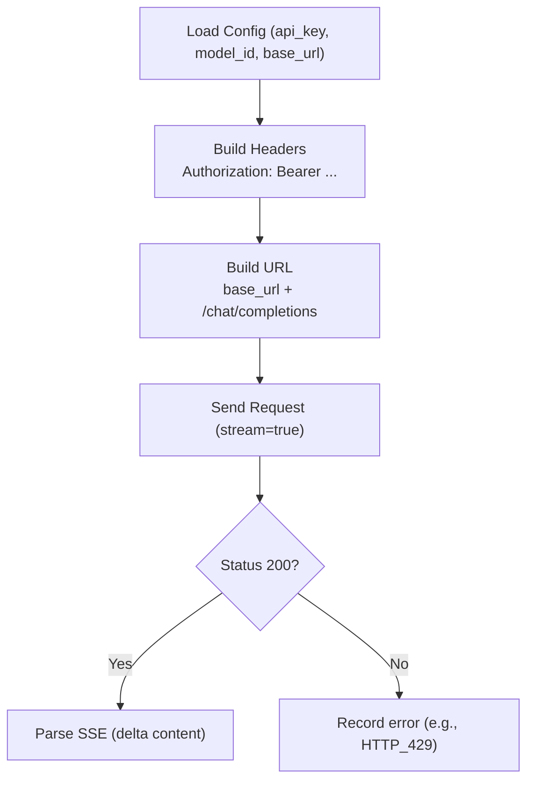
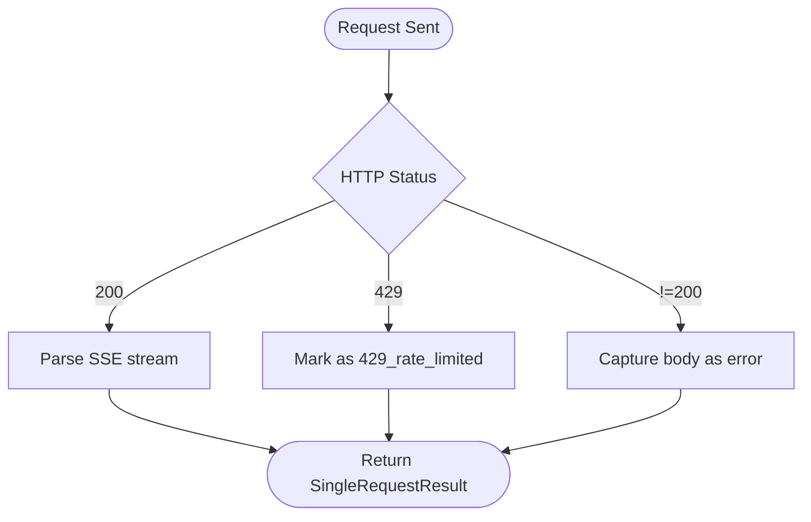
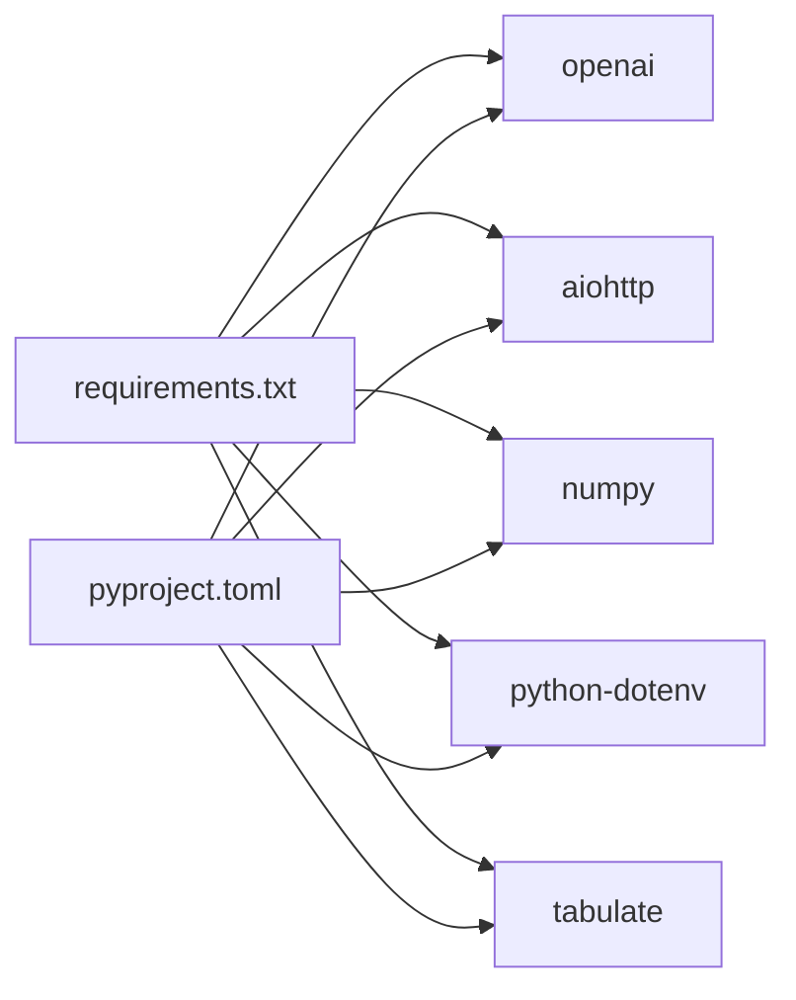

# API Integration

<cite>
**Referenced Files in This Document**
- [__main__.py](file://src/ptu_benchmark/__main__.py)
- [config.py](file://src/ptu_benchmark/config.py)
- [base.py](file://src/ptu_benchmark/scenarios/base.py)
- [scenario_a.py](file://src/ptu_benchmark/scenarios/scenario_a.py)
- [scenario_b.py](file://src/ptu_benchmark/scenarios/scenario_b.py)
- [scenario_c.py](file://src/ptu_benchmark/scenarios/scenario_c.py)
- [scenario_d.py](file://src/ptu_benchmark/scenarios/scenario_d.py)
- [scenario_e.py](file://src/ptu_benchmark/scenarios/scenario_e.py)
- [reporter.py](file://src/ptu_benchmark/reporter.py)
- [utils.py](file://src/ptu_benchmark/utils.py)
- [requirements.txt](file://requirements.txt)
- [pyproject.toml](file://pyproject.toml)
</cite>

## Table of Contents
1. [Introduction](#introduction)
2. [Project Structure](#project-structure)
3. [Core Components](#core-components)
4. [Architecture Overview](#architecture-overview)
5. [Detailed Component Analysis](#detailed-component-analysis)
6. [Dependency Analysis](#dependency-analysis)
7. [Performance Considerations](#performance-considerations)
8. [Troubleshooting Guide](#troubleshooting-guide)
9. [Conclusion](#conclusion)
10. [Appendices](#appendices)

## Introduction
This document explains how PTU-Benchmark integrates with Alibaba Cloud DashScope via an OpenAI-compatible API wrapper, streams tokens using Server-Sent Events (SSE), and manages asynchronous HTTP requests. It covers authentication, endpoint configuration, streaming infrastructure, connection pooling, concurrency controls, error handling (including rate limit detection), and the relationship between PTU deployments and API endpoints. Guidance is also provided for model ID validation, base URL configuration, and troubleshooting network connectivity, authentication failures, and API quota issues.

## Project Structure
The benchmark is organized around a CLI entry point, configuration loading, scenario implementations, shared utilities, and reporting. The OpenAI-compatible integration is implemented either via the official OpenAI SDK or direct aiohttp SSE consumption, depending on the scenario.

**Diagram sources**
- [__main__.py:121-149](file://src/ptu_benchmark/__main__.py#L121-L149)
- [config.py:47-96](file://src/ptu_benchmark/config.py#L47-L96)
- [base.py:20-41](file://src/ptu_benchmark/scenarios/base.py#L20-L41)
- [scenario_a.py:34-37](file://src/ptu_benchmark/scenarios/scenario_a.py#L34-L37)
- [scenario_b.py:31-38](file://src/ptu_benchmark/scenarios/scenario_b.py#L31-L38)
- [scenario_c.py:30-35](file://src/ptu_benchmark/scenarios/scenario_c.py#L30-L35)
- [scenario_d.py:30-37](file://src/ptu_benchmark/scenarios/scenario_d.py#L30-L37)
- [scenario_e.py:34-37](file://src/ptu_benchmark/scenarios/scenario_e.py#L34-L37)
- [reporter.py:46-83](file://src/ptu_benchmark/reporter.py#L46-L83)
- [utils.py:45-91](file://src/ptu_benchmark/utils.py#L45-L91)

**Section sources**
- [__main__.py:121-149](file://src/ptu_benchmark/__main__.py#L121-L149)
- [config.py:47-96](file://src/ptu_benchmark/config.py#L47-L96)

## Core Components
- Configuration and Environment
  - Loads API key, model ID, base URL, concurrency levels, durations, burst sizes, and context sizes from environment variables and optional .env files.
  - Validates presence of required fields and provides defaults for optional settings.
  - Reference: [config.py:47-96](file://src/ptu_benchmark/config.py#L47-L96), [config.py:98-106](file://src/ptu_benchmark/config.py#L98-L106)

- OpenAI-Compatible API Wrapper
  - Scenario A and E instantiate an OpenAI client pointing to the configured base URL and model ID, then issue streaming chat completions.
  - Reference: [scenario_a.py:34-37](file://src/ptu_benchmark/scenarios/scenario_a.py#L34-L37), [scenario_a.py:71-76](file://src/ptu_benchmark/scenarios/scenario_a.py#L71-L76), [scenario_e.py:34-37](file://src/ptu_benchmark/scenarios/scenario_e.py#L34-L37), [scenario_e.py:73-78](file://src/ptu_benchmark/scenarios/scenario_e.py#L73-L78)

- SSE Streaming Infrastructure
  - Scenario B uses shared async helpers to send streaming requests and parse SSE events.
  - Scenario C demonstrates manual SSE parsing inside an async worker with a concurrency semaphore.
  - Utilities include a synchronous SSE parser for byte streams.
  - Reference: [base.py:47-112](file://src/ptu_benchmark/scenarios/base.py#L47-L112), [base.py:115-142](file://src/ptu_benchmark/scenarios/base.py#L115-L142), [utils.py:134-155](file://src/ptu_benchmark/utils.py#L134-L155)

- Asynchronous HTTP Client and Connection Pooling
  - aiohttp ClientSession is used with a TCPConnector configured with a pool size derived from concurrency plus a buffer.
  - Scenario B and C demonstrate connector limits and concurrent task orchestration.
  - Reference: [base.py:136-137](file://src/ptu_benchmark/scenarios/base.py#L136-L137), [scenario_c.py:50-56](file://src/ptu_benchmark/scenarios/scenario_c.py#L50-L56)

- Authentication and Endpoint Configuration
  - Authorization header is set to Bearer <api_key>.
  - Base URL defaults to DashScope international compatible mode and is extended with /chat/completions.
  - Reference: [base.py:33-40](file://src/ptu_benchmark/scenarios/base.py#L33-L40), [config.py:23](file://src/ptu_benchmark/config.py#L23), [config.py:83-86](file://src/ptu_benchmark/config.py#L83-L86)

- Error Handling and Rate Limit Detection
  - HTTP 429 is detected and recorded as a rate-limited error; other non-200 responses capture textual bodies.
  - Exceptions are captured and stored as generic errors.
  - Reference: [base.py:64-78](file://src/ptu_benchmark/scenarios/base.py#L64-L78), [utils.py:77-80](file://src/ptu_benchmark/utils.py#L77-L80), [reporter.py:49-58](file://src/ptu_benchmark/reporter.py#L49-L58)

**Section sources**
- [config.py:47-106](file://src/ptu_benchmark/config.py#L47-L106)
- [scenario_a.py:34-102](file://src/ptu_benchmark/scenarios/scenario_a.py#L34-L102)
- [scenario_e.py:34-103](file://src/ptu_benchmark/scenarios/scenario_e.py#L34-L103)
- [base.py:33-142](file://src/ptu_benchmark/scenarios/base.py#L33-L142)
- [utils.py:134-155](file://src/ptu_benchmark/utils.py#L134-L155)
- [reporter.py:49-83](file://src/ptu_benchmark/reporter.py#L49-L83)

## Architecture Overview
The benchmark orchestrates scenarios that issue streaming chat completion requests to DashScope’s OpenAI-compatible API. Two integration modes co-exist:
- OpenAI SDK mode (Scenarios A and E): Uses the official OpenAI client configured with the DashScope base URL and model ID.
- Direct aiohttp SSE mode (Scenarios B, C, D): Uses a custom async request function to POST to /chat/completions and parse SSE chunks.

**Diagram sources**
- [__main__.py:121-149](file://src/ptu_benchmark/__main__.py#L121-L149)
- [config.py:47-96](file://src/ptu_benchmark/config.py#L47-L96)
- [scenario_a.py:34-102](file://src/ptu_benchmark/scenarios/scenario_a.py#L34-L102)
- [scenario_b.py:31-50](file://src/ptu_benchmark/scenarios/scenario_b.py#L31-L50)
- [scenario_c.py:30-106](file://src/ptu_benchmark/scenarios/scenario_c.py#L30-L106)
- [scenario_d.py:30-72](file://src/ptu_benchmark/scenarios/scenario_d.py#L30-L72)
- [scenario_e.py:34-103](file://src/ptu_benchmark/scenarios/scenario_e.py#L34-L103)
- [base.py:33-142](file://src/ptu_benchmark/scenarios/base.py#L33-L142)
- [reporter.py:46-83](file://src/ptu_benchmark/reporter.py#L46-L83)
- [utils.py:45-91](file://src/ptu_benchmark/utils.py#L45-L91)

## Detailed Component Analysis

### OpenAI-Compatible API Wrapper (Scenarios A and E)
- Client initialization sets the base URL and API key, enabling compatibility with DashScope’s OpenAI-compatible interface.
- Streaming is enabled via the OpenAI SDK’s stream parameter; the benchmark counts tokens and measures TTFT and TPS.
- Model ID is validated implicitly by the API call; ensure the configured model supports streaming.

**Diagram sources**
- [scenario_a.py:34-37](file://src/ptu_benchmark/scenarios/scenario_a.py#L34-L37)
- [scenario_a.py:71-76](file://src/ptu_benchmark/scenarios/scenario_a.py#L71-L76)
- [scenario_a.py:78-88](file://src/ptu_benchmark/scenarios/scenario_a.py#L78-L88)
- [scenario_e.py:34-37](file://src/ptu_benchmark/scenarios/scenario_e.py#L34-L37)
- [scenario_e.py:73-78](file://src/ptu_benchmark/scenarios/scenario_e.py#L73-L78)
- [scenario_e.py:79-89](file://src/ptu_benchmark/scenarios/scenario_e.py#L79-L89)

**Section sources**
- [scenario_a.py:34-102](file://src/ptu_benchmark/scenarios/scenario_a.py#L34-L102)
- [scenario_e.py:34-103](file://src/ptu_benchmark/scenarios/scenario_e.py#L34-L103)

### SSE Streaming Implementation (Scenarios B, C, D)
- Shared async request function posts to /chat/completions and parses SSE lines, extracting delta content to compute TTFT and token counts.
- Scenario B orchestrates multiple concurrent requests using a ClientSession with a tuned TCPConnector limit.
- Scenario C uses a semaphore to bound concurrency and prints periodic throughput metrics.

**Diagram sources**
- [scenario_b.py:31-38](file://src/ptu_benchmark/scenarios/scenario_b.py#L31-L38)
- [base.py:115-142](file://src/ptu_benchmark/scenarios/base.py#L115-L142)
- [base.py:136-137](file://src/ptu_benchmark/scenarios/base.py#L136-L137)
- [base.py:47-112](file://src/ptu_benchmark/scenarios/base.py#L47-L112)

**Section sources**
- [base.py:47-112](file://src/ptu_benchmark/scenarios/base.py#L47-L112)
- [base.py:115-142](file://src/ptu_benchmark/scenarios/base.py#L115-L142)
- [scenario_b.py:31-50](file://src/ptu_benchmark/scenarios/scenario_b.py#L31-L50)
- [scenario_c.py:56-92](file://src/ptu_benchmark/scenarios/scenario_c.py#L56-L92)

### Concurrency Control and Connection Pooling
- Connector limit is set to concurrency plus a small buffer to avoid connection exhaustion under load.
- Scenario C additionally uses an asyncio.Semaphore to cap concurrent workers and throttle request issuance.
- These controls help maintain throughput stability and reduce connection overhead.

**Diagram sources**
- [base.py:136-137](file://src/ptu_benchmark/scenarios/base.py#L136-L137)
- [scenario_c.py:50-56](file://src/ptu_benchmark/scenarios/scenario_c.py#L50-L56)
- [scenario_c.py:58-71](file://src/ptu_benchmark/scenarios/scenario_c.py#L58-L71)

**Section sources**
- [base.py:136-137](file://src/ptu_benchmark/scenarios/base.py#L136-L137)
- [scenario_c.py:50-71](file://src/ptu_benchmark/scenarios/scenario_c.py#L50-L71)

### Authentication and Endpoint Configuration
- Authentication: Authorization header set to Bearer <api_key>.
- Endpoint: Base URL defaults to DashScope international compatible mode; /chat/completions appended for completions.
- Model ID: Provided via environment variable and used in requests; ensure it matches a DashScope model supporting streaming.

**Diagram sources**
- [config.py:81-86](file://src/ptu_benchmark/config.py#L81-L86)
- [base.py:33-40](file://src/ptu_benchmark/scenarios/base.py#L33-L40)
- [base.py:64-78](file://src/ptu_benchmark/scenarios/base.py#L64-L78)
- [base.py:80-96](file://src/ptu_benchmark/scenarios/base.py#L80-L96)

**Section sources**
- [config.py:21-23](file://src/ptu_benchmark/config.py#L21-L23)
- [config.py:81-86](file://src/ptu_benchmark/config.py#L81-L86)
- [base.py:33-40](file://src/ptu_benchmark/scenarios/base.py#L33-L40)
- [base.py:64-78](file://src/ptu_benchmark/scenarios/base.py#L64-L78)

### Error Handling and Rate Limit Detection
- HTTP 429 is treated as a rate-limited error and recorded distinctly.
- Non-200 responses capture textual bodies for diagnostics.
- Exceptions are captured and reported as generic errors.

**Diagram sources**
- [base.py:64-78](file://src/ptu_benchmark/scenarios/base.py#L64-L78)
- [utils.py:77-80](file://src/ptu_benchmark/utils.py#L77-L80)

**Section sources**
- [base.py:64-78](file://src/ptu_benchmark/scenarios/base.py#L64-L78)
- [utils.py:77-80](file://src/ptu_benchmark/utils.py#L77-L80)

### Relationship Between PTU Deployments and API Endpoints
- PTU guarantees throughput capacity for provisioned models. When sustained or burst loads exceed PTU capacity, DashScope may route excess traffic to pay-as-you-go resources transparently.
- The benchmark distinguishes success from rate-limited outcomes; zero 429s indicate PTU handled the full burst without fallback.

**Section sources**
- [scenario_d.py:59-65](file://src/ptu_benchmark/scenarios/scenario_d.py#L59-L65)

## Dependency Analysis
External libraries and their roles:
- openai: Enables OpenAI-compatible SDK usage for streaming chat completions.
- aiohttp: Provides asynchronous HTTP client and SSE parsing for custom streaming.
- numpy: Aggregates percentile statistics for reporting.
- python-dotenv: Loads environment variables from .env files.
- tabulate: Formats comparison tables for console output.

**Diagram sources**
- [requirements.txt:1-6](file://requirements.txt#L1-L6)
- [pyproject.toml:14-26](file://pyproject.toml#L14-L26)

**Section sources**
- [requirements.txt:1-6](file://requirements.txt#L1-L6)
- [pyproject.toml:14-26](file://pyproject.toml#L14-L26)

## Performance Considerations
- Connection pooling: Tune TCPConnector limit based on concurrency to avoid socket exhaustion.
- Concurrency throttling: Use semaphores to bound worker goroutines and smooth request pacing.
- Streaming parsing: Prefer incremental parsing of SSE deltas to minimize memory overhead.
- Reporting overhead: Aggregation and percentile calculations are lightweight but avoid excessive logging in tight loops.

[No sources needed since this section provides general guidance]

## Troubleshooting Guide
- Network connectivity
  - Verify base URL resolves and allows outbound HTTPS to DashScope endpoints.
  - Confirm firewall/proxy settings permit connections to the configured base URL.

- Authentication failures
  - Ensure DASHSCOPE_API_KEY is set and valid.
  - Confirm Authorization header is present and formatted as Bearer <api_key>.

- API quota and rate limits
  - 429 errors indicate rate limiting; review sustained and burst scenarios to adjust concurrency.
  - Zero 429s imply PTU handled the load; observe fallback behavior for bursts exceeding capacity.

- Model ID validation
  - Ensure PTU_MODEL_ID corresponds to a DashScope model that supports streaming chat completions.

- Base URL configuration
  - Default base URL targets DashScope international compatible mode; override via BASE_URL if needed.

- Environment configuration
  - Use .env files and confirm variables are loaded by the configuration loader.

**Section sources**
- [config.py:98-106](file://src/ptu_benchmark/config.py#L98-L106)
- [base.py:33-40](file://src/ptu_benchmark/scenarios/base.py#L33-L40)
- [base.py:64-78](file://src/ptu_benchmark/scenarios/base.py#L64-L78)
- [scenario_d.py:59-65](file://src/ptu_benchmark/scenarios/scenario_d.py#L59-L65)

## Conclusion
PTU-Benchmark integrates with Alibaba Cloud DashScope through both the OpenAI SDK and direct aiohttp SSE parsing. It supports streaming, connection pooling, and robust error handling, including explicit rate limit detection. Proper configuration of credentials, model ID, and base URL ensures accurate performance measurements. The scenarios collectively validate PTU behavior under sustained load and burst conditions, providing actionable insights for capacity planning and tuning.

[No sources needed since this section summarizes without analyzing specific files]

## Appendices
- CLI usage and configuration
  - CLI prints effective model, base URL, and selected scenarios before execution.
  - Configuration validation reports missing required fields and suggests copying .env.example.

**Section sources**
- [__main__.py:99-101](file://src/ptu_benchmark/__main__.py#L99-L101)
- [__main__.py:131-139](file://src/ptu_benchmark/__main__.py#L131-L139)