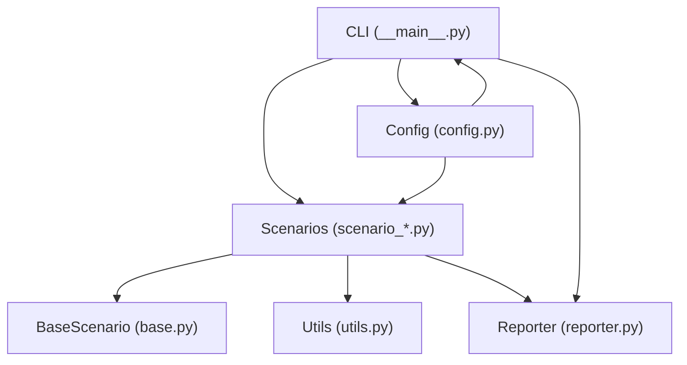
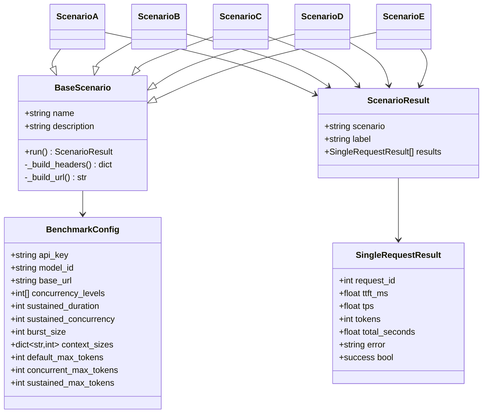
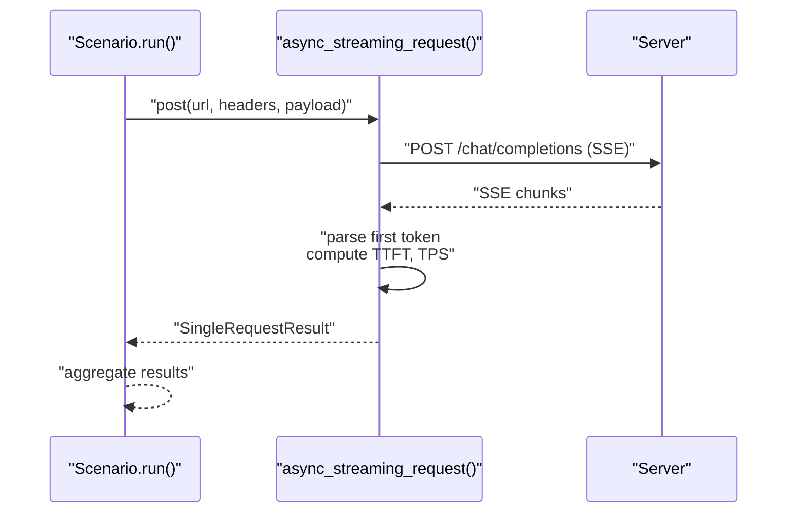
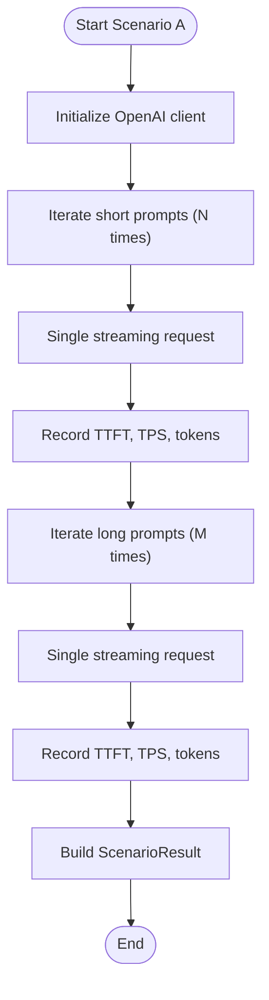
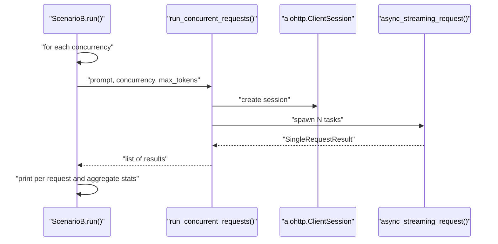
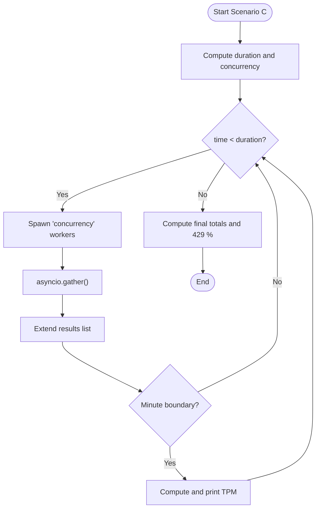
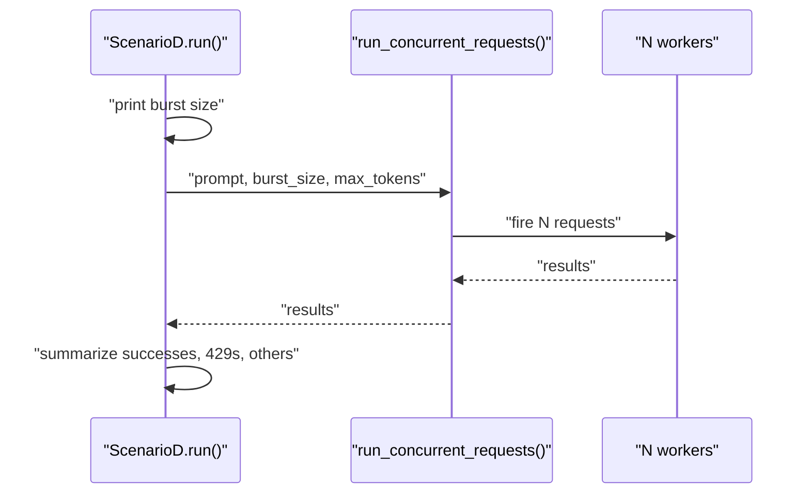
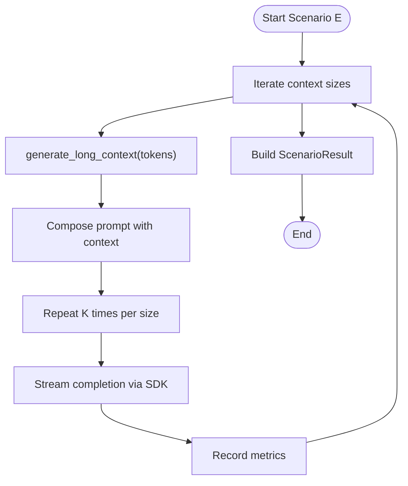
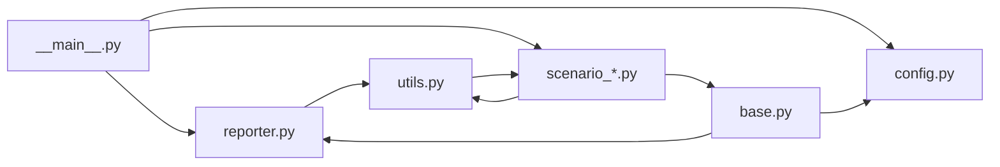

# Benchmark Scenarios

<cite>
**Referenced Files in This Document**
- [__main__.py](file://src/ptu_benchmark/__main__.py)
- [config.py](file://src/ptu_benchmark/config.py)
- [reporter.py](file://src/ptu_benchmark/reporter.py)
- [utils.py](file://src/ptu_benchmark/utils.py)
- [base.py](file://src/ptu_benchmark/scenarios/base.py)
- [scenario_a.py](file://src/ptu_benchmark/scenarios/scenario_a.py)
- [scenario_b.py](file://src/ptu_benchmark/scenarios/scenario_b.py)
- [scenario_c.py](file://src/ptu_benchmark/scenarios/scenario_c.py)
- [scenario_d.py](file://src/ptu_benchmark/scenarios/scenario_d.py)
- [scenario_e.py](file://src/ptu_benchmark/scenarios/scenario_e.py)
</cite>

## Table of Contents
1. [Introduction](#introduction)
2. [Project Structure](#project-structure)
3. [Core Components](#core-components)
4. [Architecture Overview](#architecture-overview)
5. [Detailed Component Analysis](#detailed-component-analysis)
6. [Dependency Analysis](#dependency-analysis)
7. [Performance Considerations](#performance-considerations)
8. [Troubleshooting Guide](#troubleshooting-guide)
9. [Conclusion](#conclusion)
10. [Appendices](#appendices)

## Introduction
This document explains the five PTU benchmark scenarios and the BaseScenario framework that implements a template method pattern. It covers each scenario’s purpose, methodology, duration, and measured metrics, along with expected outcomes, tuning parameters, and interpretation guidelines. The suite supports CLI-driven execution, environment-based configuration, and structured result reporting.

## Project Structure
The benchmark is organized around a small set of modules:
- CLI entry point orchestrates scenario selection, configuration loading, and result export.
- Configuration centralizes runtime parameters and environment variable parsing.
- Shared utilities define prompts, data models, timers, and long-context generation.
- BaseScenario defines the abstract interface and reusable async helpers.
- Individual scenario modules implement the template method steps for each benchmark.

**Diagram sources**
- [__main__.py:88-118](file://src/ptu_benchmark/__main__.py#L88-L118)
- [config.py:16-96](file://src/ptu_benchmark/config.py#L16-L96)
- [base.py:20-142](file://src/ptu_benchmark/scenarios/base.py#L20-L142)
- [utils.py:45-91](file://src/ptu_benchmark/utils.py#L45-L91)
- [reporter.py:25-83](file://src/ptu_benchmark/reporter.py#L25-L83)

**Section sources**
- [__main__.py:1-150](file://src/ptu_benchmark/__main__.py#L1-L150)
- [config.py:1-106](file://src/ptu_benchmark/config.py#L1-L106)
- [utils.py:1-156](file://src/ptu_benchmark/utils.py#L1-L156)
- [base.py:1-143](file://src/ptu_benchmark/scenarios/base.py#L1-L143)
- [reporter.py:1-189](file://src/ptu_benchmark/reporter.py#L1-L189)

## Core Components
- BaseScenario: Defines the abstract interface and common helpers for building HTTP requests and streaming responses.
- Async helpers: Provide a reusable streaming request executor and a concurrent runner for multiple requests.
- Scenario implementations: Specialize the template method to run specific workloads and collect metrics.
- Configuration: Centralized settings loaded from environment variables with sensible defaults.
- Utilities: Define prompts, data models for results, timing helpers, and long-context generation.
- Reporter: Prints per-request and aggregated scenario summaries and exports results to JSON and CSV.

Key metrics tracked across scenarios:
- TTFT: Time to first token in milliseconds.
- TPS: Tokens per second during generation.
- Tokens: Total number of generated tokens.
- Total time: Wall-clock time for the request.
- 429 errors: Rate limit events observed during concurrent or sustained loads.

**Section sources**
- [base.py:20-142](file://src/ptu_benchmark/scenarios/base.py#L20-L142)
- [utils.py:45-91](file://src/ptu_benchmark/utils.py#L45-L91)
- [reporter.py:32-83](file://src/ptu_benchmark/reporter.py#L32-L83)

## Architecture Overview
The framework follows a template method pattern:
- BaseScenario defines the skeleton (headers, URL, and async streaming helpers).
- Each scenario subclass implements run() to orchestrate its workload and returns ScenarioResult.
- CLI loads configuration, instantiates scenarios, executes them, prints summaries, and exports results.

**Diagram sources**
- [base.py:20-41](file://src/ptu_benchmark/scenarios/base.py#L20-L41)
- [scenario_a.py:23-57](file://src/ptu_benchmark/scenarios/scenario_a.py#L23-L57)
- [scenario_b.py:19-50](file://src/ptu_benchmark/scenarios/scenario_b.py#L19-L50)
- [scenario_c.py:22-35](file://src/ptu_benchmark/scenarios/scenario_c.py#L22-L35)
- [scenario_d.py:20-71](file://src/ptu_benchmark/scenarios/scenario_d.py#L20-L71)
- [scenario_e.py:25-60](file://src/ptu_benchmark/scenarios/scenario_e.py#L25-L60)
- [config.py:16-46](file://src/ptu_benchmark/config.py#L16-L46)
- [utils.py:45-91](file://src/ptu_benchmark/utils.py#L45-L91)

## Detailed Component Analysis

### BaseScenario Framework and Template Method Pattern
- Purpose: Provide a common interface and async infrastructure for all scenarios.
- Template method steps:
  - run(): Implemented by subclasses to execute the scenario-specific workflow.
  - _build_headers(): Compose Authorization and Content-Type headers.
  - _build_url(): Construct the chat completions endpoint.
- Shared async helpers:
  - async_streaming_request(): Executes a single streaming request, parses SSE, computes TTFT and TPS, and returns SingleRequestResult.
  - run_concurrent_requests(): Spawns N concurrent requests with tuned connection limits and returns all SingleRequestResult entries.

**Diagram sources**
- [base.py:47-112](file://src/ptu_benchmark/scenarios/base.py#L47-L112)

**Section sources**
- [base.py:20-41](file://src/ptu_benchmark/scenarios/base.py#L20-L41)
- [base.py:47-142](file://src/ptu_benchmark/scenarios/base.py#L47-L142)

### Scenario A: Single Request Baseline (TTFT + TPS)
- Purpose: Establish baseline latency and generation speed under zero contention.
- Methodology:
  - Uses the OpenAI SDK to stream completions.
  - Runs short and long prompts multiple times to capture variability.
  - Computes TTFT and TPS per run.
- Duration: Determined by request completion time; typically seconds per run.
- Metrics:
  - TTFT (milliseconds), TPS, tokens, total time, success/error.
- Expected results:
  - Consistent TTFT across runs; TPS reflects model throughput without concurrency.
- Tuning parameters:
  - default_max_tokens controls generation length.
- Interpretation:
  - Lower TTFT and higher TPS indicate better baseline performance.

**Diagram sources**
- [scenario_a.py:32-101](file://src/ptu_benchmark/scenarios/scenario_a.py#L32-L101)

**Section sources**
- [scenario_a.py:1-102](file://src/ptu_benchmark/scenarios/scenario_a.py#L1-L102)
- [utils.py:17-38](file://src/ptu_benchmark/utils.py#L17-L38)

### Scenario B: Concurrent Load (10/50/100 parallel requests)
- Purpose: Measure throughput degradation under increasing concurrency.
- Methodology:
  - Iterates configured concurrency levels and fires concurrent requests using run_concurrent_requests().
  - Aggregates per-request results and prints summary statistics.
- Duration: Determined by total execution time; depends on concurrency and request completion.
- Metrics:
  - Per-request TTFT, TPS, tokens, total time, success/error.
  - Scenario-level counts of successes, errors, and 429s.
- Expected results:
  - PTU should sustain performance up to its guaranteed capacity; 429s indicate exceeding capacity.
- Tuning parameters:
  - concurrency_levels, concurrent_max_tokens, default_max_tokens.
- Interpretation:
  - Monitor 429 error rate; acceptable performance within PTU limits.

**Diagram sources**
- [scenario_b.py:25-50](file://src/ptu_benchmark/scenarios/scenario_b.py#L25-L50)
- [base.py:115-142](file://src/ptu_benchmark/scenarios/base.py#L115-L142)

**Section sources**
- [scenario_b.py:1-51](file://src/ptu_benchmark/scenarios/scenario_b.py#L1-L51)
- [config.py:25-45](file://src/ptu_benchmark/config.py#L25-L45)

### Scenario C: Sustained Throughput (30-minute window)
- Purpose: Verify PTU maintains guaranteed throughput over extended time.
- Methodology:
  - Runs a loop for a fixed duration with a bounded concurrency using asyncio.Semaphore.
  - Emits periodic TPM summaries and final totals.
  - Uses async_streaming_request per worker.
- Duration: Configurable sustained_duration (default 30 minutes); concurrency controlled by sustained_concurrency.
- Metrics:
  - Per-request TTFT, TPS, tokens, total time, success/error.
  - Periodic TPM and final average TPM.
  - 429 error count and percentage.
- Expected results:
  - Stable TPM over time; minimal 429 errors.
- Tuning parameters:
  - sustained_duration, sustained_concurrency, sustained_max_tokens.
- Interpretation:
  - Average TPM near PTU guarantees; low rate of 429s indicates adequate headroom.

**Diagram sources**
- [scenario_c.py:37-105](file://src/ptu_benchmark/scenarios/scenario_c.py#L37-L105)

**Section sources**
- [scenario_c.py:1-106](file://src/ptu_benchmark/scenarios/scenario_c.py#L1-L106)
- [config.py:28-30](file://src/ptu_benchmark/config.py#L28-L30)

### Scenario D: Peak Burst
- Purpose: Validate handling of sudden traffic spikes without excessive 429 errors.
- Methodology:
  - Sends a burst of simultaneous requests equal to burst_size.
  - Summarizes successes, 429s, and other errors.
- Duration: Determined by burst completion time.
- Metrics:
  - Per-request outcomes and summary counts.
  - Pass/fail indicator based on 429 presence.
- Expected results:
  - Zero 429s for capacities within PTU; controlled fallback otherwise.
- Tuning parameters:
  - burst_size.
- Interpretation:
  - Zero 429s indicates PTU absorbed the burst; otherwise, traffic exceeded PTU and may fall back to PAYG.

**Diagram sources**
- [scenario_d.py:26-71](file://src/ptu_benchmark/scenarios/scenario_d.py#L26-L71)
- [base.py:115-142](file://src/ptu_benchmark/scenarios/base.py#L115-L142)

**Section sources**
- [scenario_d.py:1-72](file://src/ptu_benchmark/scenarios/scenario_d.py#L1-L72)
- [config.py:32-33](file://src/ptu_benchmark/config.py#L32-L33)

### Scenario E: Long Context
- Purpose: Evaluate performance with large input contexts (e.g., 32K–128K tokens).
- Methodology:
  - Generates long context text approximating target token counts.
  - Runs multiple trials per size to capture variability.
  - Streams completions and records metrics.
- Duration: Determined by request completion time; longer prompts increase total time.
- Metrics:
  - TTFT, TPS, tokens, total time, success/error.
- Expected results:
  - TTFT increases with context; TPS may decrease due to longer prompts.
- Tuning parameters:
  - context_sizes, default_max_tokens.
- Interpretation:
  - Monitor TTFT and TPS trends across sizes; assess memory and performance trade-offs.

**Diagram sources**
- [scenario_e.py:33-102](file://src/ptu_benchmark/scenarios/scenario_e.py#L33-L102)
- [utils.py:120-131](file://src/ptu_benchmark/utils.py#L120-L131)

**Section sources**
- [scenario_e.py:1-103](file://src/ptu_benchmark/scenarios/scenario_e.py#L1-L103)
- [config.py:35-40](file://src/ptu_benchmark/config.py#L35-L40)
- [utils.py:17-38](file://src/ptu_benchmark/utils.py#L17-L38)

## Dependency Analysis
- CLI depends on configuration, scenario registry, and reporter for export.
- Scenarios depend on BaseScenario, configuration, and utilities.
- BaseScenario depends on configuration and reporter for printing; provides async helpers.
- Reporter depends on numpy and tabulate for statistics and formatting.

**Diagram sources**
- [__main__.py:39-78](file://src/ptu_benchmark/__main__.py#L39-L78)
- [base.py:15-17](file://src/ptu_benchmark/scenarios/base.py#L15-L17)
- [reporter.py:18](file://src/ptu_benchmark/reporter.py#L18)

**Section sources**
- [__main__.py:88-118](file://src/ptu_benchmark/__main__.py#L88-L118)
- [base.py:15-17](file://src/ptu_benchmark/scenarios/base.py#L15-L17)
- [reporter.py:18](file://src/ptu_benchmark/reporter.py#L18)

## Performance Considerations
- Concurrency and connection limits: run_concurrent_requests sets TCPConnector limits to manage resource usage.
- Streaming parsing: async_streaming_request decodes SSE and computes TTFT and TPS efficiently.
- Sustained load: Scenario C uses a semaphore to bound concurrency and periodically reports TPM.
- Memory and context: Scenario E generates long inputs; monitor memory usage and adjust prompt lengths accordingly.
- Export overhead: JSON/CSV export writes files to disk; ensure sufficient storage and permissions.

[No sources needed since this section provides general guidance]

## Troubleshooting Guide
- Configuration errors:
  - Validate API key and model ID; the CLI checks and prints missing fields.
- Rate limiting:
  - 429 errors indicate exceeding PTU capacity; reduce concurrency or burst size.
- Empty or partial results:
  - Check network connectivity, base URL, and model availability.
- Export failures:
  - Confirm write permissions for the output directory.

**Section sources**
- [config.py:98-105](file://src/ptu_benchmark/config.py#L98-L105)
- [reporter.py:125-148](file://src/ptu_benchmark/reporter.py#L125-L148)
- [scenario_c.py:84-103](file://src/ptu_benchmark/scenarios/scenario_c.py#L84-L103)
- [scenario_d.py:59-65](file://src/ptu_benchmark/scenarios/scenario_d.py#L59-L65)

## Conclusion
The PTU benchmark suite provides a consistent, extensible framework for evaluating throughput, latency, and stability across diverse workloads. By leveraging the BaseScenario template method and shared async helpers, each scenario focuses on its specific objective while maintaining uniform metrics and reporting. Use the provided configuration parameters to tailor experiments to your deployment characteristics and interpret results against PTU guarantees.

[No sources needed since this section summarizes without analyzing specific files]

## Appendices

### CLI Usage and Options
- Run all scenarios or a subset by specifying scenario keys.
- List available scenarios.
- Export results to JSON and CSV in the results/ directory.

**Section sources**
- [__main__.py:4, 56-77:4-77](file://src/ptu_benchmark/__main__.py#L4-L77)

### Environment Variables and Defaults
- Required: DASHSCOPE_API_KEY, PTU_MODEL_ID.
- Optional overrides for concurrency, duration, burst size, and context sizes.

**Section sources**
- [config.py:47-96](file://src/ptu_benchmark/config.py#L47-L96)