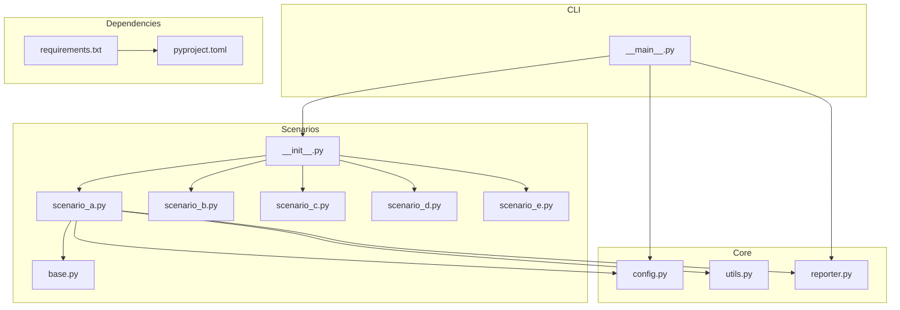
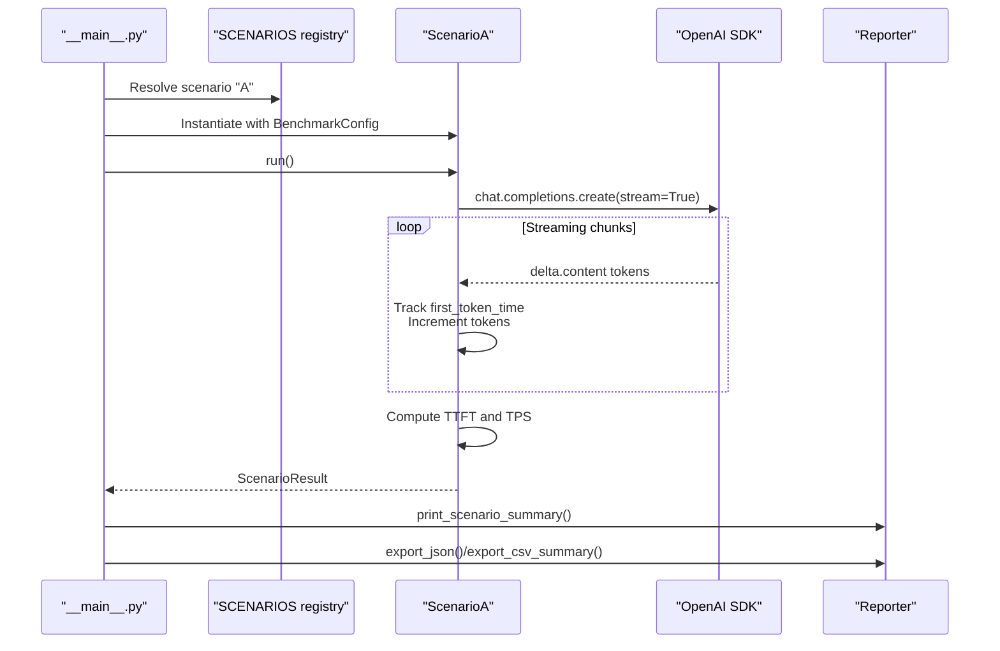
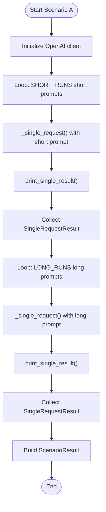
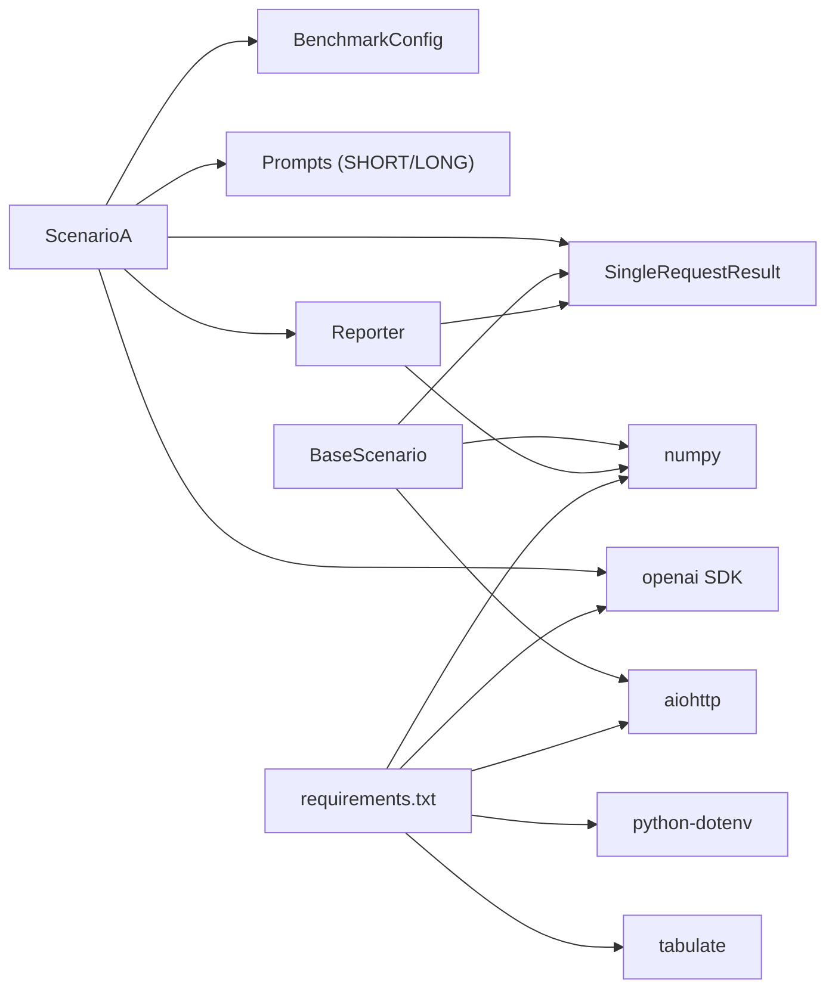

# Scenario A: Single Request Baseline

<cite>
**Referenced Files in This Document**
- [scenario_a.py](file://src/ptu_benchmark/scenarios/scenario_a.py)
- [base.py](file://src/ptu_benchmark/scenarios/base.py)
- [config.py](file://src/ptu_benchmark/config.py)
- [utils.py](file://src/ptu_benchmark/utils.py)
- [reporter.py](file://src/ptu_benchmark/reporter.py)
- [__main__.py](file://src/ptu_benchmark/__main__.py)
- [__init__.py](file://src/ptu_benchmark/scenarios/__init__.py)
- [requirements.txt](file://requirements.txt)
- [pyproject.toml](file://pyproject.toml)
- [test_config.py](file://tests/test_config.py)
- [test_utils.py](file://tests/test_utils.py)
</cite>

## Table of Contents
1. [Introduction](#introduction)
2. [Project Structure](#project-structure)
3. [Core Components](#core-components)
4. [Architecture Overview](#architecture-overview)
5. [Detailed Component Analysis](#detailed-component-analysis)
6. [Dependency Analysis](#dependency-analysis)
7. [Performance Considerations](#performance-considerations)
8. [Troubleshooting Guide](#troubleshooting-guide)
9. [Conclusion](#conclusion)
10. [Appendices](#appendices)

## Introduction
Scenario A establishes a single-request baseline under zero contention conditions. It measures two primary metrics:
- Time To First Token (TTFT): the elapsed time from request initiation until the first token is emitted.
- Tokens Per Second (TPS): the sustained generation throughput during the request.

By running multiple iterations with short and long prompts, Scenario A provides a stable baseline against which higher-concurrency scenarios can be compared. This baseline informs expectations for latency and throughput when concurrency increases, helping quantify degradation due to resource contention.

## Project Structure
The benchmark suite is organized around a modular scenario framework. Scenario A resides in the scenarios package and inherits behavior from the shared BaseScenario. Configuration is centralized, utilities define prompts and result data structures, and the CLI orchestrates execution and exports.

**Diagram sources**
- [__main__.py:1-150](file://src/ptu_benchmark/__main__.py#L1-L150)
- [__init__.py:1-30](file://src/ptu_benchmark/scenarios/__init__.py#L1-L30)
- [scenario_a.py:1-102](file://src/ptu_benchmark/scenarios/scenario_a.py#L1-L102)
- [base.py:1-143](file://src/ptu_benchmark/scenarios/base.py#L1-L143)
- [config.py:1-106](file://src/ptu_benchmark/config.py#L1-L106)
- [utils.py:1-156](file://src/ptu_benchmark/utils.py#L1-L156)
- [reporter.py:1-189](file://src/ptu_benchmark/reporter.py#L1-L189)
- [requirements.txt:1-6](file://requirements.txt#L1-L6)
- [pyproject.toml:1-37](file://pyproject.toml#L1-L37)

**Section sources**
- [__main__.py:1-150](file://src/ptu_benchmark/__main__.py#L1-L150)
- [__init__.py:1-30](file://src/ptu_benchmark/scenarios/__init__.py#L1-L30)

## Core Components
- Scenario A: Executes a single streaming request using the OpenAI SDK, capturing TTFT and TPS for short and long prompts.
- BaseScenario: Provides shared infrastructure for building headers and URLs, and includes async helpers for concurrent scenarios.
- Configuration: Centralized settings loaded from environment variables, including API credentials, model identifier, base URL, and defaults.
- Utilities: Defines prompt templates, result data structures, timing helpers, and SSE parsing utilities.
- Reporter: Prints per-run results, scenario summaries, and exports results to JSON and CSV.

Key responsibilities:
- Scenario A orchestrates request execution, timing, and metric computation.
- Configuration validates presence of required environment variables.
- Reporter aggregates and formats results for human-readable and machine-readable outputs.

**Section sources**
- [scenario_a.py:23-102](file://src/ptu_benchmark/scenarios/scenario_a.py#L23-L102)
- [base.py:20-143](file://src/ptu_benchmark/scenarios/base.py#L20-L143)
- [config.py:16-106](file://src/ptu_benchmark/config.py#L16-L106)
- [utils.py:45-91](file://src/ptu_benchmark/utils.py#L45-L91)
- [reporter.py:32-83](file://src/ptu_benchmark/reporter.py#L32-L83)

## Architecture Overview
Scenario A follows a straightforward request-response flow with streaming token parsing. The CLI loads configuration, instantiates Scenario A, executes runs, prints summaries, and optionally exports results.

**Diagram sources**
- [__main__.py:88-118](file://src/ptu_benchmark/__main__.py#L88-L118)
- [scenario_a.py:32-102](file://src/ptu_benchmark/scenarios/scenario_a.py#L32-L102)
- [reporter.py:46-83](file://src/ptu_benchmark/reporter.py#L46-L83)

## Detailed Component Analysis

### Scenario A: Single Request Baseline
Purpose:
- Establish baseline latency and throughput under zero contention.
- Measure TTFT and TPS across short and long prompts to capture both cold-start and sustained generation characteristics.

Methodology:
- Initializes an OpenAI client using configured API key and base URL.
- Runs a fixed number of short and long prompt iterations.
- Streams tokens, records first-token time, counts tokens, and computes elapsed durations.
- Aggregates results into a ScenarioResult containing per-run SingleRequestResult entries.

Metrics computed:
- TTFT: milliseconds from request start to first token emission.
- TPS: tokens per second during generation (computed only when tokens and generation time are available).
- Tokens: total output tokens per run.
- Total time: wall-clock duration of the request.

**Diagram sources**
- [scenario_a.py:32-57](file://src/ptu_benchmark/scenarios/scenario_a.py#L32-L57)
- [scenario_a.py:59-102](file://src/ptu_benchmark/scenarios/scenario_a.py#L59-L102)
- [reporter.py:32-44](file://src/ptu_benchmark/reporter.py#L32-L44)

**Section sources**
- [scenario_a.py:23-102](file://src/ptu_benchmark/scenarios/scenario_a.py#L23-L102)
- [utils.py:45-58](file://src/ptu_benchmark/utils.py#L45-L58)

### BaseScenario and Async Helpers
Role:
- Provides shared HTTP/SSE infrastructure for concurrent scenarios.
- Includes async streaming request parsing and concurrent request orchestration.

Key utilities:
- async_streaming_request: Parses SSE stream, tracks first token time, counts tokens, and returns SingleRequestResult.
- run_concurrent_requests: Fires N concurrent requests and aggregates results.

These helpers are used by higher-concurrency scenarios but demonstrate the same TTFT/TPS computation logic.

**Section sources**
- [base.py:47-143](file://src/ptu_benchmark/scenarios/base.py#L47-L143)

### Configuration Management
Responsibilities:
- Loads environment variables for API key, model ID, base URL, and scenario-specific settings.
- Validates required fields and provides defaults for optional settings.

Environment variables:
- DASHSCOPE_API_KEY: API key for the provider.
- PTU_MODEL_ID: Model identifier to benchmark.
- BASE_URL: Provider base URL (with a default value).
- CONCURRENCY_LEVELS: Used by Scenario B.
- SUSTAINED_DURATION, SUSTAINED_CONCURRENCY: Used by Scenario C.
- BURST_SIZE: Used by Scenario D.
- CONTEXT_SIZES: Used by Scenario E.

Validation ensures both API key and model ID are present before running benchmarks.

**Section sources**
- [config.py:47-106](file://src/ptu_benchmark/config.py#L47-L106)
- [test_config.py:8-42](file://tests/test_config.py#L8-L42)

### Utilities and Data Structures
Prompt library:
- Short and long prompt templates used by Scenario A.
- Additional prompts for other scenarios.

Result data structures:
- SingleRequestResult: encapsulates TTFT, TPS, tokens, total time, and error.
- ScenarioResult: aggregates multiple SingleRequestResult entries with convenience filters.

Timing helpers:
- Timer: simple context manager for wall-clock timing.

SSE parsing:
- parse_sse_tokens: synchronous helper to extract first token time and token count from SSE bodies.

**Section sources**
- [utils.py:17-38](file://src/ptu_benchmark/utils.py#L17-L38)
- [utils.py:45-91](file://src/ptu_benchmark/utils.py#L45-L91)
- [utils.py:97-118](file://src/ptu_benchmark/utils.py#L97-L118)
- [utils.py:134-156](file://src/ptu_benchmark/utils.py#L134-L156)

### Reporting and Export
Console output:
- print_single_result: prints per-run metrics in a readable format.
- print_scenario_summary: prints aggregated statistics including TTFT percentiles and TPS averages.

Exports:
- export_json: writes a timestamped JSON file containing scenario results.
- export_csv_summary: writes a CSV summary with aggregated metrics.

These outputs enable baseline comparisons across scenarios and facilitate automated analysis.

**Section sources**
- [reporter.py:32-83](file://src/ptu_benchmark/reporter.py#L32-L83)
- [reporter.py:125-189](file://src/ptu_benchmark/reporter.py#L125-L189)

## Dependency Analysis
External dependencies:
- openai: SDK for interacting with the provider’s API.
- aiohttp: asynchronous HTTP client used by concurrent scenarios.
- numpy: statistical computations for percentiles and averages.
- python-dotenv: loading environment variables from .env files.
- tabulate: formatting comparison tables.

Internal dependencies:
- Scenario A depends on BaseScenario, BenchmarkConfig, SingleRequestResult, and prompt constants.
- Reporter depends on ScenarioResult and SingleRequestResult for formatting and exporting.

**Diagram sources**
- [scenario_a.py:17-20](file://src/ptu_benchmark/scenarios/scenario_a.py#L17-L20)
- [base.py:13-17](file://src/ptu_benchmark/scenarios/base.py#L13-L17)
- [reporter.py:15-18](file://src/ptu_benchmark/reporter.py#L15-L18)
- [requirements.txt:1-6](file://requirements.txt#L1-L6)

**Section sources**
- [requirements.txt:1-6](file://requirements.txt#L1-L6)
- [pyproject.toml:14-26](file://pyproject.toml#L14-L26)

## Performance Considerations
- Zero contention baseline: Scenario A intentionally avoids concurrency to establish a stable baseline. Higher concurrency will increase latency and reduce TPS due to resource contention.
- Prompt length impact: Longer prompts generally increase TTFT and may reduce TPS due to larger generation windows.
- Provider limits: Rate limits (e.g., 429) are captured as errors and influence baseline reliability; ensure sufficient capacity for baseline runs.
- Token estimation: TPS is computed only when tokens are generated and generation time is measurable; otherwise, TPS is reported as zero.

[No sources needed since this section provides general guidance]

## Troubleshooting Guide
Common issues and resolutions:
- Missing configuration:
  - Symptom: Configuration validation fails with missing API key or model ID.
  - Resolution: Set DASHSCOPE_API_KEY and PTU_MODEL_ID in your environment or .env file.
- Network or provider errors:
  - Symptom: Single-run results show error messages (e.g., HTTP status codes).
  - Resolution: Verify base URL, model availability, and network connectivity.
- Rate limiting:
  - Symptom: Requests return 429 errors.
  - Resolution: Reduce concurrency or wait for quota replenishment; baseline runs should avoid 429s.
- No tokens generated:
  - Symptom: TPS is zero despite successful requests.
  - Resolution: Confirm streaming is enabled and the model supports streaming; verify token counting logic.

**Section sources**
- [config.py:98-106](file://src/ptu_benchmark/config.py#L98-L106)
- [reporter.py:32-44](file://src/ptu_benchmark/reporter.py#L32-L44)
- [base.py:66-78](file://src/ptu_benchmark/scenarios/base.py#L66-L78)

## Conclusion
Scenario A provides a critical baseline for understanding single-request performance under zero contention. By measuring TTFT and TPS across short and long prompts, it establishes realistic expectations for latency and throughput. These metrics serve as anchors for interpreting higher-concurrency scenarios, enabling quantification of contention effects and informed capacity planning.

[No sources needed since this section summarizes without analyzing specific files]

## Appendices

### Methodology Details
- TTFT measurement:
  - Captured as the elapsed time from request start until the first token delta is received.
  - Reported in milliseconds.
- TPS calculation:
  - Computed as tokens divided by the generation duration (time from first token to completion).
  - Zero when generation time or tokens are unavailable.
- Runs:
  - SHORT_RUNS: 5 iterations with a short prompt.
  - LONG_RUNS: 3 iterations with a long prompt.

**Section sources**
- [scenario_a.py:59-102](file://src/ptu_benchmark/scenarios/scenario_a.py#L59-L102)
- [utils.py:45-58](file://src/ptu_benchmark/utils.py#L45-L58)

### Expected Output Format
Console output per run:
- Tagged line indicating TTFT, TPS, total time, and token count.
- Error lines when exceptions occur.

Aggregated scenario summary:
- Total, success, error, and rate-limited counts.
- TTFT percentiles (P50, P95, P99).
- TPS average, min, and max.
- Estimated tokens per minute.

JSON export:
- Timestamped payload containing scenario metadata and per-run results.

CSV export:
- Aggregated metrics per scenario including counts and percentile values.

**Section sources**
- [reporter.py:32-83](file://src/ptu_benchmark/reporter.py#L32-L83)
- [reporter.py:125-189](file://src/ptu_benchmark/reporter.py#L125-L189)

### Configuration Parameters
Required:
- DASHSCOPE_API_KEY: API key for the provider.
- PTU_MODEL_ID: Model identifier to benchmark.

Optional defaults:
- BASE_URL: Provider base URL with a built-in default.
- CONCURRENCY_LEVELS: Used by Scenario B.
- SUSTAINED_DURATION, SUSTAINED_CONCURRENCY: Used by Scenario C.
- BURST_SIZE: Used by Scenario D.
- CONTEXT_SIZES: Used by Scenario E.

Validation:
- Ensures both API key and model ID are present before execution.

**Section sources**
- [config.py:47-106](file://src/ptu_benchmark/config.py#L47-L106)
- [test_config.py:8-42](file://tests/test_config.py#L8-L42)

### Result Interpretation Guidelines
- TTFT:
  - Lower values indicate faster initial response; baseline helps detect regressions.
  - P50/P95/P99 provide insight into tail latency behavior.
- TPS:
  - Higher values indicate more efficient generation throughput.
  - Compare TPS across short and long prompts to assess stability under varying generation lengths.
- Tokens:
  - Reflect generation length; useful for estimating sustained throughput.
- TPM:
  - Estimated tokens per minute derived from total tokens and maximum runtime.

Baseline as a foundation:
- Use Scenario A as the reference point for evaluating higher-concurrency scenarios.
- Track deviations in TTFT and TPS to quantify contention effects and resource saturation.

**Section sources**
- [reporter.py:64-82](file://src/ptu_benchmark/reporter.py#L64-L82)
- [utils.py:69-91](file://src/ptu_benchmark/utils.py#L69-L91)