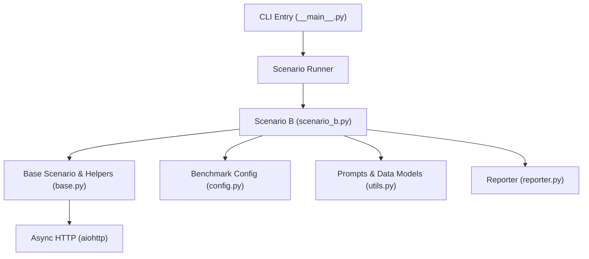
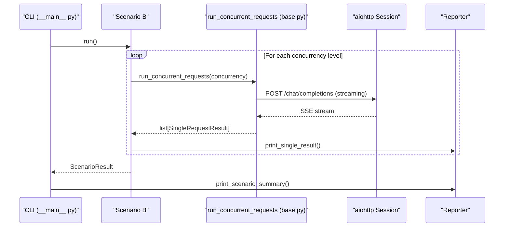
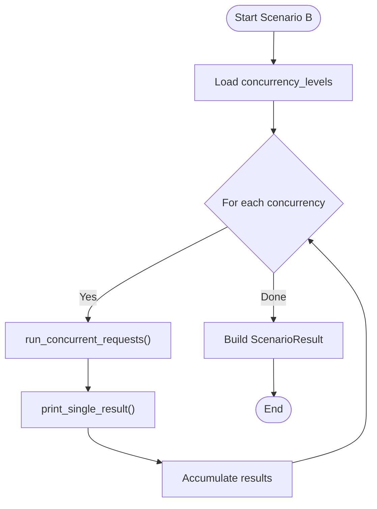
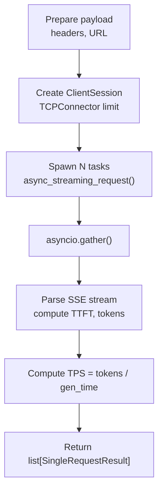
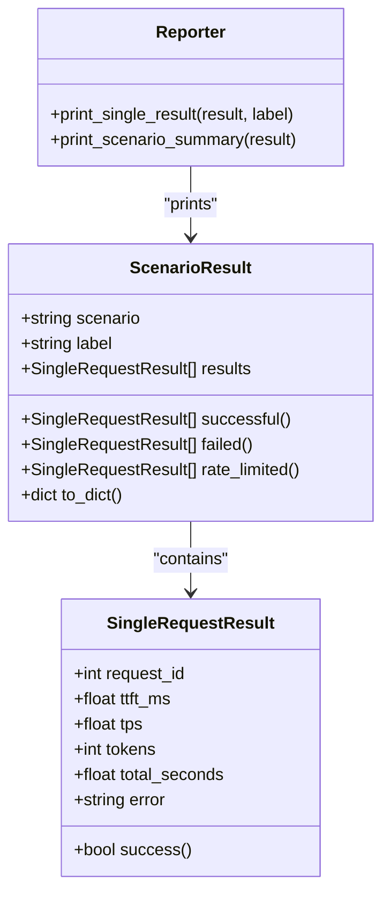
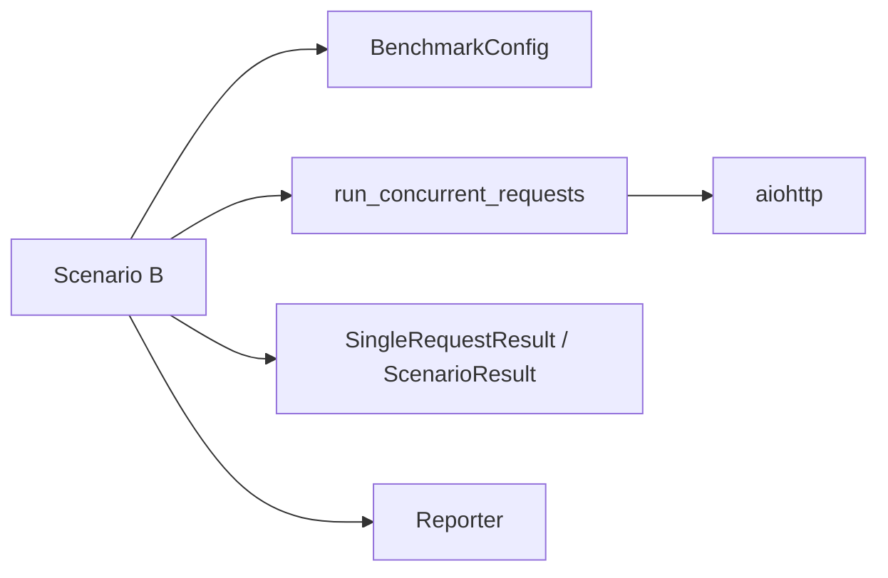

# Scenario B: Concurrent Load Test

<cite>
**Referenced Files in This Document**
- [scenario_b.py](file://src/ptu_benchmark/scenarios/scenario_b.py)
- [base.py](file://src/ptu_benchmark/scenarios/base.py)
- [config.py](file://src/ptu_benchmark/config.py)
- [utils.py](file://src/ptu_benchmark/utils.py)
- [reporter.py](file://src/ptu_benchmark/reporter.py)
- [__main__.py](file://src/ptu_benchmark/__main__.py)
</cite>

## Table of Contents
1. [Introduction](#introduction)
2. [Project Structure](#project-structure)
3. [Core Components](#core-components)
4. [Architecture Overview](#architecture-overview)
5. [Detailed Component Analysis](#detailed-component-analysis)
6. [Dependency Analysis](#dependency-analysis)
7. [Performance Considerations](#performance-considerations)
8. [Troubleshooting Guide](#troubleshooting-guide)
9. [Conclusion](#conclusion)
10. [Appendices](#appendices)

## Introduction
This document explains Scenario B: Concurrent Load Test, which evaluates PTU performance under increasing concurrency levels (10, 50, and 100 parallel requests). The scenario measures throughput degradation, identifies saturation points, and reports latency increases and throughput drops as concurrency rises. It also documents configuration options, metrics collection, result interpretation, and how to use findings to size PTU capacity.

## Project Structure
Scenario B is implemented as a scenario class that orchestrates concurrent request execution, aggregates per-request results, and prints scenario-level summaries. Supporting components include configuration loading, shared async request helpers, result data models, and reporting utilities.

**Diagram sources**
- [__main__.py:88-118](file://src/ptu_benchmark/__main__.py#L88-L118)
- [scenario_b.py:19-51](file://src/ptu_benchmark/scenarios/scenario_b.py#L19-L51)
- [base.py:20-41](file://src/ptu_benchmark/scenarios/base.py#L20-L41)
- [config.py:16-106](file://src/ptu_benchmark/config.py#L16-L106)
- [utils.py:45-91](file://src/ptu_benchmark/utils.py#L45-L91)
- [reporter.py:46-83](file://src/ptu_benchmark/reporter.py#L46-L83)

**Section sources**
- [__main__.py:88-118](file://src/ptu_benchmark/__main__.py#L88-L118)
- [scenario_b.py:19-51](file://src/ptu_benchmark/scenarios/scenario_b.py#L19-L51)
- [base.py:20-41](file://src/ptu_benchmark/scenarios/base.py#L20-L41)
- [config.py:16-106](file://src/ptu_benchmark/config.py#L16-L106)
- [utils.py:45-91](file://src/ptu_benchmark/utils.py#L45-L91)
- [reporter.py:46-83](file://src/ptu_benchmark/reporter.py#L46-L83)

## Core Components
- Scenario B orchestrator: Executes concurrent runs at 10, 50, and 100, aggregates all results, and returns a scenario-level result container.
- Async request engine: Issues multiple streaming requests concurrently, parses SSE tokens, computes TTFT and TPS, and records total time and token counts.
- Configuration: Provides concurrency levels, model ID, base URL, and token limits for concurrent workloads.
- Data models: Define per-request and scenario-level results, including success/error states and derived metrics.
- Reporting: Prints per-request details, scenario summaries, and exports JSON/CSV for downstream analysis.

Key responsibilities:
- Concurrency orchestration and iteration
- Streaming request execution and token parsing
- Metrics computation (TTFT, TPS, tokens, total time)
- Aggregation and export of results

**Section sources**
- [scenario_b.py:25-51](file://src/ptu_benchmark/scenarios/scenario_b.py#L25-L51)
- [base.py:115-143](file://src/ptu_benchmark/scenarios/base.py#L115-L143)
- [config.py:25-46](file://src/ptu_benchmark/config.py#L25-L46)
- [utils.py:45-91](file://src/ptu_benchmark/utils.py#L45-L91)
- [reporter.py:32-83](file://src/ptu_benchmark/reporter.py#L32-L83)

## Architecture Overview
The Scenario B pipeline executes a loop over configured concurrency levels, dispatches simultaneous streaming requests, and collects per-request metrics. The reporter summarizes success rates, latency percentiles, and throughput statistics.

**Diagram sources**
- [__main__.py:103-109](file://src/ptu_benchmark/__main__.py#L103-L109)
- [scenario_b.py:25-51](file://src/ptu_benchmark/scenarios/scenario_b.py#L25-L51)
- [base.py:115-143](file://src/ptu_benchmark/scenarios/base.py#L115-L143)
- [reporter.py:32-44](file://src/ptu_benchmark/reporter.py#L32-L44)

## Detailed Component Analysis

### Scenario B Orchestration
- Iterates over concurrency_levels from configuration.
- For each concurrency level, executes run_concurrent_requests and prints individual results.
- Aggregates all SingleRequestResult entries into a ScenarioResult.

**Diagram sources**
- [scenario_b.py:25-51](file://src/ptu_benchmark/scenarios/scenario_b.py#L25-L51)
- [reporter.py:32-44](file://src/ptu_benchmark/reporter.py#L32-L44)

**Section sources**
- [scenario_b.py:25-51](file://src/ptu_benchmark/scenarios/scenario_b.py#L25-L51)

### Async Request Execution and Metrics
- Builds a streaming payload with model, messages, max_tokens, and stream enabled.
- Creates an aiohttp ClientSession with a TCPConnector limit tuned for concurrency plus headroom.
- Dispatches N concurrent tasks and awaits completion.
- Parses SSE stream to compute TTFT (first token time), token count, generation duration, and TPS.

**Diagram sources**
- [base.py:115-143](file://src/ptu_benchmark/scenarios/base.py#L115-L143)
- [base.py:47-113](file://src/ptu_benchmark/scenarios/base.py#L47-L113)

**Section sources**
- [base.py:115-143](file://src/ptu_benchmark/scenarios/base.py#L115-L143)
- [base.py:47-113](file://src/ptu_benchmark/scenarios/base.py#L47-L113)

### Data Models and Metrics
- SingleRequestResult captures request_id, TTFT (milliseconds), TPS, tokens, total_seconds, and error.
- ScenarioResult aggregates all SingleRequestResult entries and exposes helpers for successful, failed, and rate-limited subsets.
- Reporter prints per-request details and scenario-level percentiles and averages.

**Diagram sources**
- [utils.py:45-91](file://src/ptu_benchmark/utils.py#L45-L91)
- [reporter.py:32-83](file://src/ptu_benchmark/reporter.py#L32-L83)

**Section sources**
- [utils.py:45-91](file://src/ptu_benchmark/utils.py#L45-L91)
- [reporter.py:32-83](file://src/ptu_benchmark/reporter.py#L32-L83)

### Configuration Options for Scenario B
- concurrency_levels: List of concurrency targets to test (default: [10, 50, 100]).
- concurrent_max_tokens: Maximum tokens for concurrent requests (default: 512).
- model_id, base_url, api_key: Endpoint and credentials for the chat completions API.

Environment variables:
- DASHSCOPE_API_KEY, PTU_MODEL_ID, BASE_URL
- CONCURRENCY_LEVELS (comma-separated integers)
- Other scenario-specific settings (not used in Scenario B)

**Section sources**
- [config.py:25-46](file://src/ptu_benchmark/config.py#L25-L46)
- [config.py:80-96](file://src/ptu_benchmark/config.py#L80-L96)

### Expected Performance Patterns and Metrics
- Latency behavior:
  - TTFT (Time To First Token) is expected to increase with higher concurrency due to queueing and resource contention.
  - Latency percentiles (P50, P95, P99) will rise progressively across concurrency levels.
- Throughput behavior:
  - TPS (tokens per second) may decrease or flatten as concurrency exceeds PTU capacity.
  - Total tokens per unit time (estimated TPM) will reflect sustained generation capacity.
- Error and saturation indicators:
  - Rate-limiting (429) signals saturation; higher concurrency increases likelihood.
  - Increased error counts indicate overload conditions.

Metrics collected per concurrency level:
- Per-request: TTFT (ms), TPS, tokens, total time (seconds), error.
- Scenario-level: success/error counts, 429 counts, TTFT percentiles, TPS average/min/max, estimated TPM.

**Section sources**
- [reporter.py:64-82](file://src/ptu_benchmark/reporter.py#L64-L82)
- [utils.py:45-58](file://src/ptu_benchmark/utils.py#L45-L58)

### Result Interpretation Guidelines
- Compare TTFT percentiles across concurrency levels to detect saturation onset.
- Track TPS average and min to identify throughput degradation.
- Monitor rate-limited counts; persistent 429s indicate concurrency exceeding capacity.
- Use estimated TPM to assess effective throughput scaling.

Capacity sizing tips:
- Identify the concurrency level where TPS starts dropping or TTFT spikes sharply.
- Choose a target concurrency below the saturation threshold for production stability.
- Account for headroom (e.g., reserve 20–30%) to handle bursts and variability.

**Section sources**
- [reporter.py:64-82](file://src/ptu_benchmark/reporter.py#L64-L82)
- [reporter.py:89-118](file://src/ptu_benchmark/reporter.py#L89-L118)

### Exporting Results for Further Analysis
- JSON export: Full scenario results with per-request details for downstream analysis.
- CSV summary: Aggregated scenario-level stats for comparative reporting.

**Section sources**
- [reporter.py:125-148](file://src/ptu_benchmark/reporter.py#L125-L148)
- [reporter.py:151-188](file://src/ptu_benchmark/reporter.py#L151-L188)

## Dependency Analysis
Scenario B depends on:
- Configuration for concurrency levels and token limits.
- Async helpers for concurrent request execution and SSE parsing.
- Data models for structured results.
- Reporter for console output and exports.

**Diagram sources**
- [scenario_b.py:19-51](file://src/ptu_benchmark/scenarios/scenario_b.py#L19-L51)
- [base.py:115-143](file://src/ptu_benchmark/scenarios/base.py#L115-L143)
- [utils.py:45-91](file://src/ptu_benchmark/utils.py#L45-L91)
- [reporter.py:46-83](file://src/ptu_benchmark/reporter.py#L46-L83)

**Section sources**
- [scenario_b.py:19-51](file://src/ptu_benchmark/scenarios/scenario_b.py#L19-L51)
- [base.py:115-143](file://src/ptu_benchmark/scenarios/base.py#L115-L143)
- [utils.py:45-91](file://src/ptu_benchmark/utils.py#L45-L91)
- [reporter.py:46-83](file://src/ptu_benchmark/reporter.py#L46-L83)

## Performance Considerations
- Concurrency tuning:
  - Start with the default levels and adjust CONCURRENCY_LEVELS via environment variable for custom targets.
  - Increase max_tokens cautiously; higher values can increase latency and memory pressure.
- Network and connection limits:
  - Connector limit is set to concurrency + 10; ensure system ulimit supports high connection counts.
- Token limits:
  - concurrent_max_tokens controls output length; larger values increase compute time and may trigger rate limits.
- Stability:
  - Monitor 429 responses; reduce concurrency if saturation occurs consistently.

[No sources needed since this section provides general guidance]

## Troubleshooting Guide
Common issues and resolutions:
- Missing configuration:
  - Ensure DASHSCOPE_API_KEY and PTU_MODEL_ID are set; otherwise, validation fails and the program exits with guidance.
- Rate limiting:
  - 429 responses indicate saturation; lower concurrency or reduce max_tokens.
- Unexpected errors:
  - Inspect per-request error strings printed for each result; network or server-side failures will surface here.
- Export failures:
  - Verify write permissions in the output directory; JSON/CSV exports are written under results/.

**Section sources**
- [config.py:98-106](file://src/ptu_benchmark/config.py#L98-L106)
- [base.py:64-78](file://src/ptu_benchmark/scenarios/base.py#L64-L78)
- [reporter.py:32-44](file://src/ptu_benchmark/reporter.py#L32-L44)
- [reporter.py:125-148](file://src/ptu_benchmark/reporter.py#L125-L148)

## Conclusion
Scenario B systematically evaluates PTU behavior under increasing concurrency, exposing latency growth and throughput degradation. By interpreting TTFT percentiles, TPS trends, and rate-limiting events, teams can identify saturation points and size PTU capacity with confidence. Use the provided configuration, metrics, and export capabilities to derive actionable insights for production deployments.

[No sources needed since this section summarizes without analyzing specific files]

## Appendices

### How to Run Scenario B
- Execute the CLI entry point to run all scenarios or specify Scenario B.
- Optionally export results to JSON and CSV for further analysis.

**Section sources**
- [__main__.py:121-145](file://src/ptu_benchmark/__main__.py#L121-L145)

### Environment Variables for Scenario B
- DASHSCOPE_API_KEY: API key for authentication.
- PTU_MODEL_ID: Target model identifier.
- BASE_URL: API base URL for chat completions.
- CONCURRENCY_LEVELS: Comma-separated concurrency targets (default: 10,50,100).
- Other scenario-specific variables (not used in Scenario B).

**Section sources**
- [config.py:80-96](file://src/ptu_benchmark/config.py#L80-L96)