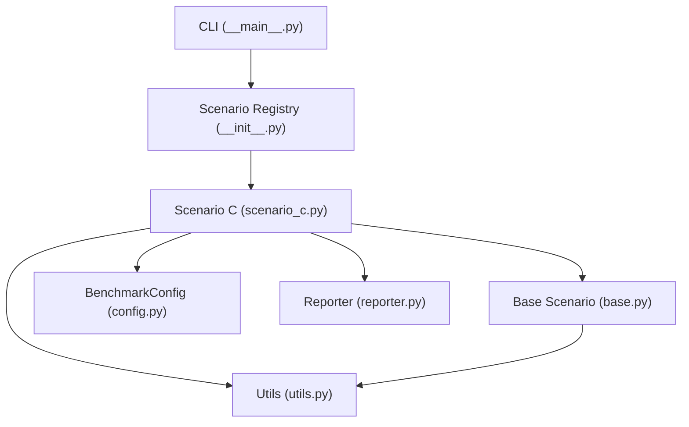
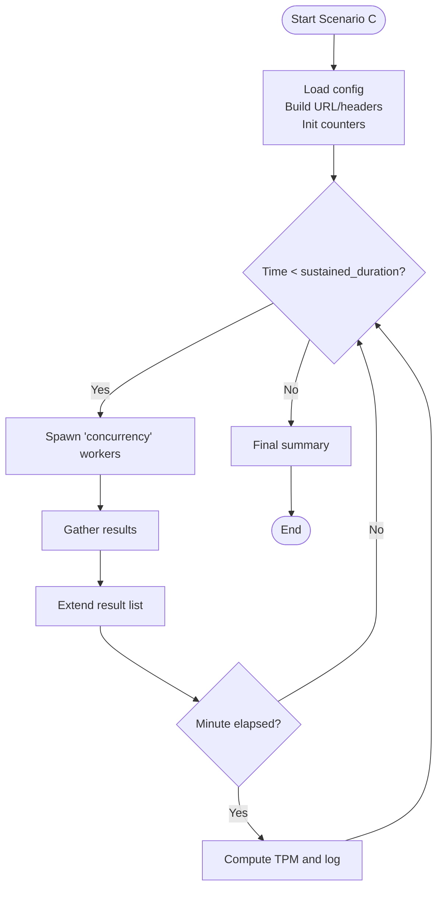
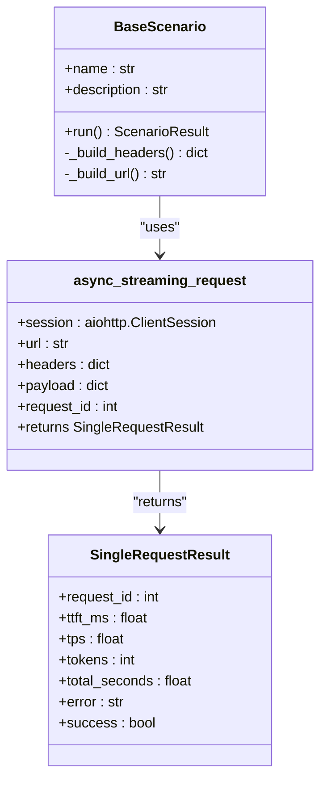
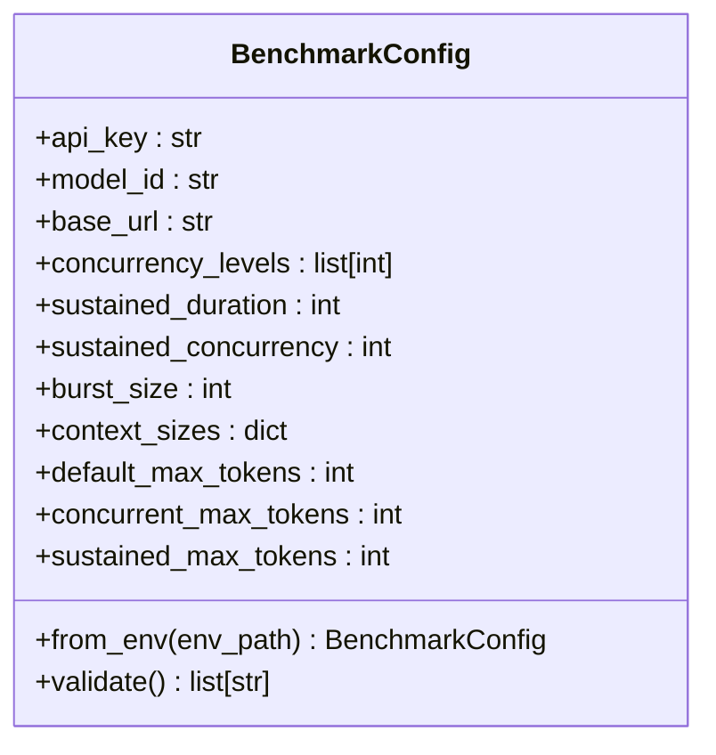
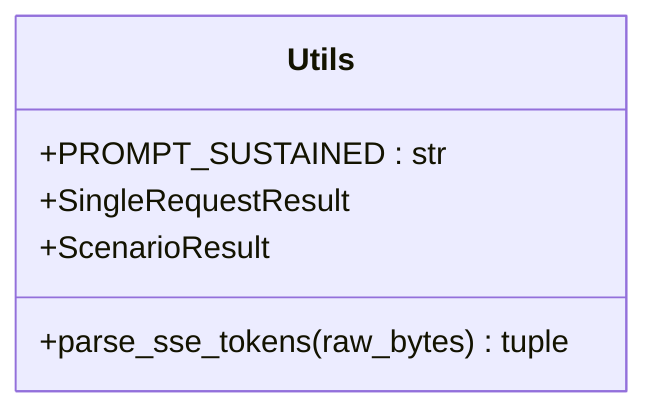
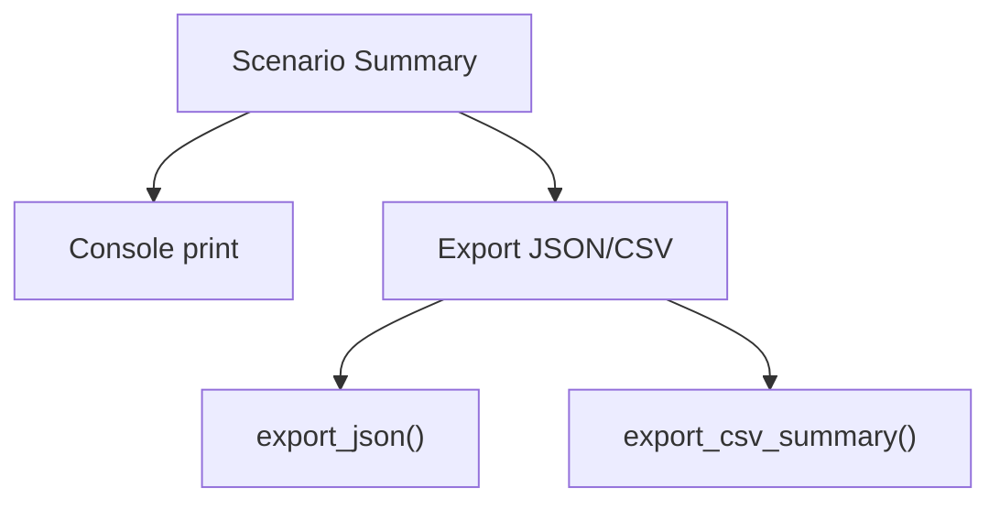
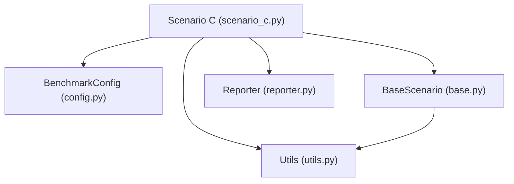

# Scenario C: Sustained Throughput Test

<cite>
**Referenced Files in This Document**
- [scenario_c.py](file://src/ptu_benchmark/scenarios/scenario_c.py)
- [base.py](file://src/ptu_benchmark/scenarios/base.py)
- [config.py](file://src/ptu_benchmark/config.py)
- [utils.py](file://src/ptu_benchmark/utils.py)
- [reporter.py](file://src/ptu_benchmark/reporter.py)
- [__main__.py](file://src/ptu_benchmark/__main__.py)
- [__init__.py](file://src/ptu_benchmark/scenarios/__init__.py)
</cite>

## Table of Contents
1. [Introduction](#introduction)
2. [Project Structure](#project-structure)
3. [Core Components](#core-components)
4. [Architecture Overview](#architecture-overview)
5. [Detailed Component Analysis](#detailed-component-analysis)
6. [Dependency Analysis](#dependency-analysis)
7. [Performance Considerations](#performance-considerations)
8. [Troubleshooting Guide](#troubleshooting-guide)
9. [Conclusion](#conclusion)
10. [Appendices](#appendices)

## Introduction
Scenario C measures sustained throughput over a long time window to validate whether the Provisioned Throughput Unit (PTU) can maintain its guaranteed throughput consistently. It runs for a configurable duration (default 30 minutes) at a fixed concurrency level, continuously issuing streaming requests and aggregating token counts to compute tokens per minute (TPM). The scenario reports minute-by-minute progress and a final summary, capturing long-term stability, identifying rate limiting events, and exposing steady-state performance characteristics.

## Project Structure
The benchmark suite is organized around a scenario registry and modular scenario implementations. Scenario C resides under the scenarios package and inherits shared infrastructure from the base scenario class. Configuration is centralized in a configuration dataclass that loads environment variables and exposes scenario-specific parameters. Utilities define prompts, result data models, and SSE parsing helpers. Reporting utilities produce console summaries and export results to JSON and CSV.



**Diagram sources**
- [__main__.py:88-118](file://src/ptu_benchmark/__main__.py#L88-L118)
- [__init__.py:12-19](file://src/ptu_benchmark/scenarios/__init__.py#L12-L19)
- [scenario_c.py:22-35](file://src/ptu_benchmark/scenarios/scenario_c.py#L22-L35)
- [base.py:20-41](file://src/ptu_benchmark/scenarios/base.py#L20-L41)
- [config.py:16-96](file://src/ptu_benchmark/config.py#L16-L96)
- [utils.py:45-91](file://src/ptu_benchmark/utils.py#L45-L91)
- [reporter.py:46-83](file://src/ptu_benchmark/reporter.py#L46-L83)

**Section sources**
- [__main__.py:88-118](file://src/ptu_benchmark/__main__.py#L88-L118)
- [__init__.py:12-19](file://src/ptu_benchmark/scenarios/__init__.py#L12-L19)
- [scenario_c.py:22-35](file://src/ptu_benchmark/scenarios/scenario_c.py#L22-L35)
- [base.py:20-41](file://src/ptu_benchmark/scenarios/base.py#L20-L41)
- [config.py:16-96](file://src/ptu_benchmark/config.py#L16-L96)
- [utils.py:45-91](file://src/ptu_benchmark/utils.py#L45-L91)
- [reporter.py:46-83](file://src/ptu_benchmark/reporter.py#L46-L83)

## Core Components
- Scenario C implementation: Orchestrates sustained throughput execution, concurrency control, and periodic reporting.
- Base scenario utilities: Provides shared async request helpers and URL/header construction.
- Configuration: Centralizes environment-driven settings, including sustained duration and concurrency.
- Utilities: Defines prompts, result data models, and SSE parsing helpers.
- Reporter: Prints scenario summaries and exports results to JSON and CSV.

Key responsibilities:
- Continuous request generation at a fixed concurrency for the configured duration.
- Streaming response parsing to compute tokens per request and aggregate totals.
- Periodic minute-by-minute reporting of TPM and rate limiting events.
- Final summary aggregation and export support.

**Section sources**
- [scenario_c.py:28-105](file://src/ptu_benchmark/scenarios/scenario_c.py#L28-L105)
- [base.py:47-142](file://src/ptu_benchmark/scenarios/base.py#L47-L142)
- [config.py:28-45](file://src/ptu_benchmark/config.py#L28-L45)
- [utils.py:30-38](file://src/ptu_benchmark/utils.py#L30-L38)
- [utils.py:45-91](file://src/ptu_benchmark/utils.py#L45-L91)
- [reporter.py:125-188](file://src/ptu_benchmark/reporter.py#L125-L188)

## Architecture Overview
Scenario C executes a loop that continuously spawns a fixed number of concurrent workers. Each worker issues a single streaming request and returns a structured result. The scenario aggregates results, computes TPM, and prints periodic updates. The base class provides the async streaming request helper and shared HTTP utilities.

```mermaid
sequenceDiagram
participant Runner as "ScenarioC.run()"
participant Loop as "Main Loop"
participant Worker as "_worker()"
participant Helper as "async_streaming_request()"
participant Session as "aiohttp.ClientSession"
participant API as "Model API"
Runner->>Loop : "Start sustained run"
Loop->>Worker : "Spawn concurrency workers"
Worker->>Helper : "Issue streaming request"
Helper->>Session : "POST /chat/completions"
Session->>API : "Send request"
API-->>Session : "SSE stream"
Session-->>Helper : "Stream chunks"
Helper-->>Worker : "SingleRequestResult"
Worker-->>Loop : "Append result"
Loop->>Runner : "Compute TPM and report"
Loop->>Loop : "Continue until duration"
Runner-->>Runner : "Final summary"
```

**Diagram sources**
- [scenario_c.py:37-105](file://src/ptu_benchmark/scenarios/scenario_c.py#L37-L105)
- [base.py:47-112](file://src/ptu_benchmark/scenarios/base.py#L47-L112)

## Detailed Component Analysis

### Scenario C: Sustained Throughput Execution
- Initialization: Reads sustained duration and concurrency from configuration and constructs URL and headers.
- Concurrency control: Uses an asyncio semaphore to cap concurrent workers.
- Request loop: Spawns a fixed number of workers each iteration; gathers results and extends the global list.
- Periodic reporting: Computes total tokens and TPM every minute and logs 429 rate limit events.
- Final summary: Prints totals, average TPM, and error percentages.



**Diagram sources**
- [scenario_c.py:37-105](file://src/ptu_benchmark/scenarios/scenario_c.py#L37-L105)

**Section sources**
- [scenario_c.py:28-105](file://src/ptu_benchmark/scenarios/scenario_c.py#L28-L105)

### Base Scenario: Async Streaming Request
- Validates HTTP status and parses SSE stream lines.
- Extracts delta content to count tokens and records time-to-first-token.
- Handles 429 and other non-200 responses by returning structured error results.
- Produces a SingleRequestResult with TTFT, TPS, and token counts.



**Diagram sources**
- [base.py:20-41](file://src/ptu_benchmark/scenarios/base.py#L20-L41)
- [base.py:47-112](file://src/ptu_benchmark/scenarios/base.py#L47-L112)
- [utils.py:45-58](file://src/ptu_benchmark/utils.py#L45-L58)

**Section sources**
- [base.py:47-112](file://src/ptu_benchmark/scenarios/base.py#L47-L112)
- [utils.py:45-58](file://src/ptu_benchmark/utils.py#L45-L58)

### Configuration: Sustained Duration and Concurrency
- Scenario C parameters are defined in the configuration dataclass with defaults for sustained duration (seconds) and sustained concurrency.
- Environment variables override defaults at runtime.
- Shared defaults include sustained_max_tokens and other scenario-specific token limits.



**Diagram sources**
- [config.py:16-96](file://src/ptu_benchmark/config.py#L16-L96)

**Section sources**
- [config.py:28-45](file://src/ptu_benchmark/config.py#L28-L45)
- [config.py:88-90](file://src/ptu_benchmark/config.py#L88-L90)

### Utilities: Prompts and Result Models
- Prompt library includes a sustained prompt used by Scenario C.
- Result dataclasses encapsulate per-request and scenario-level outcomes.
- SSE parsing helpers support both synchronous and asynchronous streaming.



**Diagram sources**
- [utils.py:30-38](file://src/ptu_benchmark/utils.py#L30-L38)
- [utils.py:45-91](file://src/ptu_benchmark/utils.py#L45-L91)
- [utils.py:134-155](file://src/ptu_benchmark/utils.py#L134-L155)

**Section sources**
- [utils.py:30-38](file://src/ptu_benchmark/utils.py#L30-L38)
- [utils.py:45-91](file://src/ptu_benchmark/utils.py#L45-L91)
- [utils.py:134-155](file://src/ptu_benchmark/utils.py#L134-L155)

### Reporter: Console and Export
- Prints scenario summaries with percentiles and estimated TPM.
- Exports detailed results to JSON and CSV for downstream analysis.



**Diagram sources**
- [reporter.py:46-83](file://src/ptu_benchmark/reporter.py#L46-L83)
- [reporter.py:125-188](file://src/ptu_benchmark/reporter.py#L125-L188)

**Section sources**
- [reporter.py:46-83](file://src/ptu_benchmark/reporter.py#L46-L83)
- [reporter.py:125-188](file://src/ptu_benchmark/reporter.py#L125-L188)

## Dependency Analysis
Scenario C depends on:
- Configuration for sustained duration and concurrency.
- Base scenario utilities for HTTP request orchestration and SSE parsing.
- Utilities for prompts and result models.
- Reporter for console output and export.



**Diagram sources**
- [scenario_c.py:17-19](file://src/ptu_benchmark/scenarios/scenario_c.py#L17-L19)
- [config.py:16-96](file://src/ptu_benchmark/config.py#L16-L96)
- [base.py:15-17](file://src/ptu_benchmark/scenarios/base.py#L15-L17)
- [utils.py:9-10](file://src/ptu_benchmark/utils.py#L9-L10)
- [reporter.py:18](file://src/ptu_benchmark/reporter.py#L18)

**Section sources**
- [scenario_c.py:17-19](file://src/ptu_benchmark/scenarios/scenario_c.py#L17-L19)
- [config.py:16-96](file://src/ptu_benchmark/config.py#L16-L96)
- [base.py:15-17](file://src/ptu_benchmark/scenarios/base.py#L15-L17)
- [utils.py:9-10](file://src/ptu_benchmark/utils.py#L9-L10)
- [reporter.py:18](file://src/ptu_benchmark/reporter.py#L18)

## Performance Considerations
- Sustained duration and concurrency: Tune sustained_duration and sustained_concurrency to match operational targets. Higher concurrency increases token throughput but may trigger rate limiting.
- Token limits: sustained_max_tokens controls per-request token generation to keep streams responsive during sustained load.
- Rate limiting: Monitor 429 error counts; excessive 429s indicate throttling and require reducing concurrency or increasing provisioned capacity.
- Thermal effects: Extended runs can reveal throttling due to heat; observe TPM decay over time as a sign of thermal throttling.
- Steady-state identification: Focus on the final 10–20 minutes for steady-state TPM; transient startup effects can skew early measurements.

[No sources needed since this section provides general guidance]

## Troubleshooting Guide
Common issues and remedies:
- Missing configuration: Ensure required environment variables are set; the CLI validates configuration and exits with guidance if missing.
- Rate limiting: If 429 errors dominate, reduce sustained_concurrency or increase provisioned capacity.
- Network connectivity: Verify base_url and API key; non-200 responses are captured with error labels.
- Export failures: Confirm output directory permissions and disk space for JSON/CSV exports.

**Section sources**
- [config.py:98-105](file://src/ptu_benchmark/config.py#L98-L105)
- [base.py:64-78](file://src/ptu_benchmark/scenarios/base.py#L64-L78)
- [reporter.py:125-148](file://src/ptu_benchmark/reporter.py#L125-L148)

## Conclusion
Scenario C provides a robust methodology for validating sustained throughput over 30 minutes, measuring TPM, and uncovering long-term stability and throttling behavior. By adjusting concurrency and monitoring 429 rates, operators can confirm whether the PTU maintains guaranteed throughput and identify operational capacity needs. The included reporting and export capabilities enable repeatable, data-driven capacity planning.

[No sources needed since this section summarizes without analyzing specific files]

## Appendices

### Methodology: 30-Minute Continuous Operation
- Configure sustained_duration and sustained_concurrency to align with target workload.
- Run Scenario C and monitor minute-by-minute TPM and 429 counts.
- Interpret sustained TPM as the average over the entire run; use final 10–20 minutes for steady-state estimates.
- If 429s appear frequently, reduce concurrency or provision more capacity.

**Section sources**
- [config.py:28-45](file://src/ptu_benchmark/config.py#L28-L45)
- [scenario_c.py:78-91](file://src/ptu_benchmark/scenarios/scenario_c.py#L78-L91)

### Metrics Collection Strategy
- Per-minute TPM: Aggregated from total tokens divided by elapsed minutes.
- 429 error tracking: Count of rate-limited requests to quantify throttling.
- Final summary: Total requests, tokens, average TPM, and error percentages.

**Section sources**
- [scenario_c.py:82-103](file://src/ptu_benchmark/scenarios/scenario_c.py#L82-L103)
- [reporter.py:46-83](file://src/ptu_benchmark/reporter.py#L46-L83)

### Interpreting Sustained vs. Burst Performance
- Sustained performance: Reflects long-term capability under continuous load; TPM should remain stable if provisioned correctly.
- Burst performance: Demonstrates peak capability under short bursts; sustained TPM often lower than burst due to resource contention and thermal effects.

[No sources needed since this section provides general guidance]

### Extended Runtime Configuration
- Adjust SUSTAINED_DURATION and SUSTAINED_CONCURRENCY via environment variables to simulate longer or heavier workloads.
- Use sustained_max_tokens to balance responsiveness and throughput.

**Section sources**
- [config.py:88-90](file://src/ptu_benchmark/config.py#L88-L90)
- [config.py:44](file://src/ptu_benchmark/config.py#L44)

### Monitoring Requirements
- Observe console output for minute-by-minute TPM and 429 counts.
- Export results to JSON/CSV for external dashboards and trend analysis.

**Section sources**
- [scenario_c.py:82-103](file://src/ptu_benchmark/scenarios/scenario_c.py#L82-L103)
- [reporter.py:125-188](file://src/ptu_benchmark/reporter.py#L125-L188)

### Operational Capacity Planning
- Use sustained TPM as the baseline for capacity planning; account for 429s and potential thermal throttling.
- Compare sustained results against burst performance to size headroom for traffic spikes.

[No sources needed since this section provides general guidance]