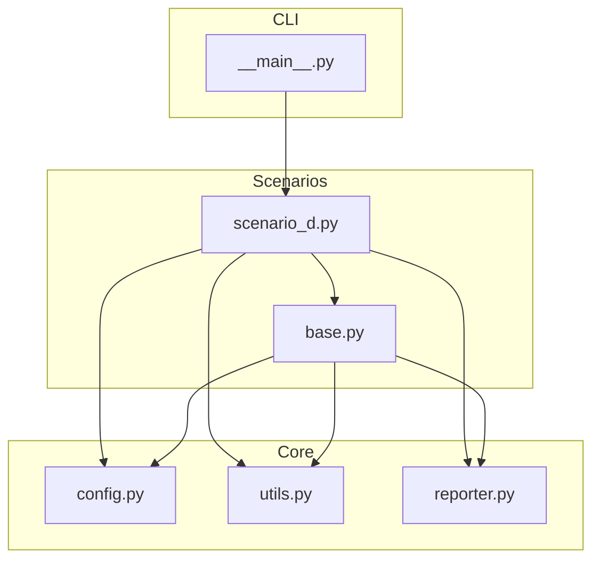
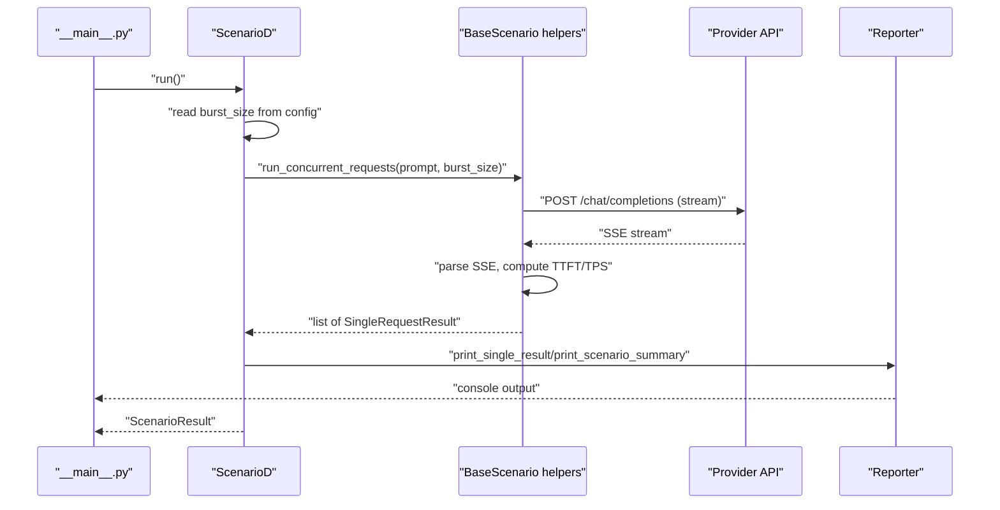
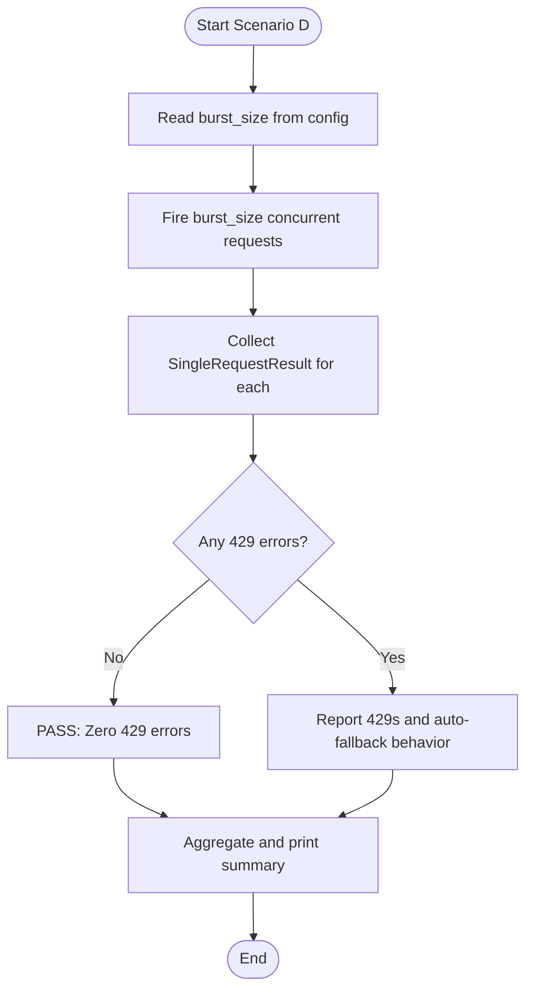
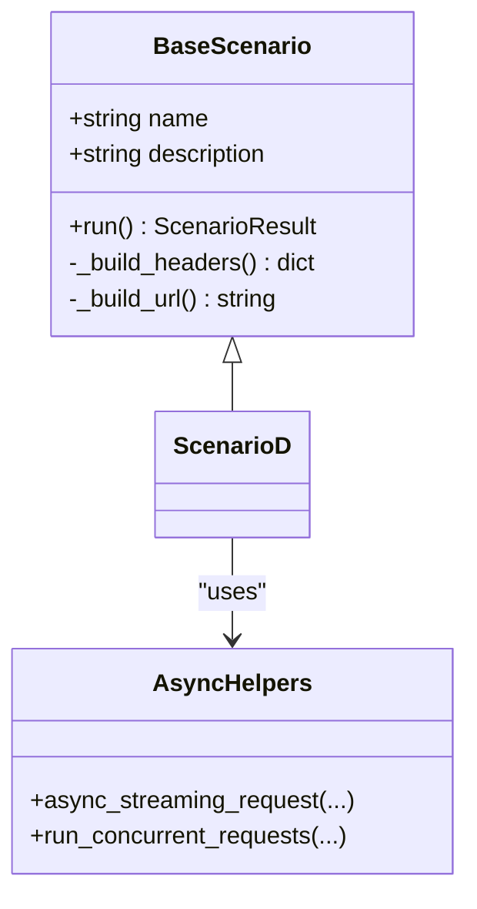
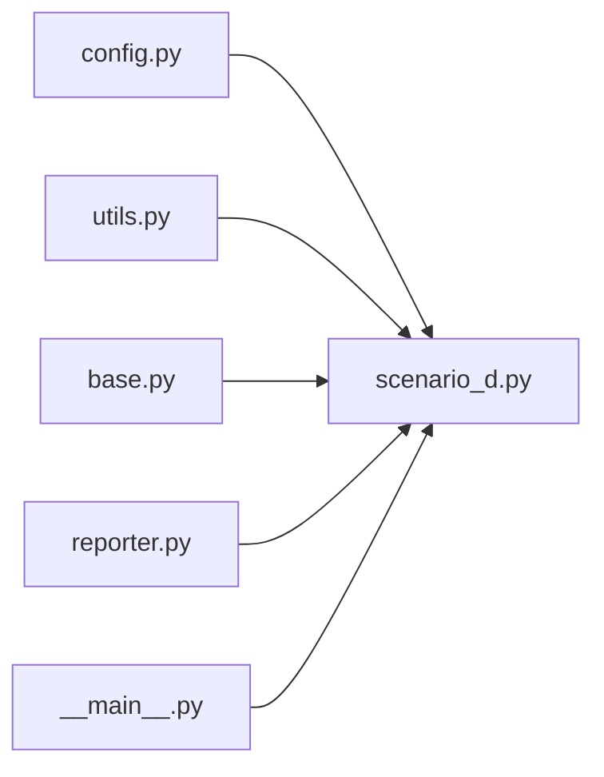

# Scenario D: Peak Burst Test

<cite>
**Referenced Files in This Document**
- [scenario_d.py](file://src/ptu_benchmark/scenarios/scenario_d.py)
- [base.py](file://src/ptu_benchmark/scenarios/base.py)
- [config.py](file://src/ptu_benchmark/config.py)
- [utils.py](file://src/ptu_benchmark/utils.py)
- [reporter.py](file://src/ptu_benchmark/reporter.py)
- [__main__.py](file://src/ptu_benchmark/__main__.py)
- [SCENARIOS.md](file://docs/SCENARIOS.md)
- [README.md](file://README.md)
</cite>

## Table of Contents
1. [Introduction](#introduction)
2. [Project Structure](#project-structure)
3. [Core Components](#core-components)
4. [Architecture Overview](#architecture-overview)
5. [Detailed Component Analysis](#detailed-component-analysis)
6. [Dependency Analysis](#dependency-analysis)
7. [Performance Considerations](#performance-considerations)
8. [Troubleshooting Guide](#troubleshooting-guide)
9. [Conclusion](#conclusion)
10. [Appendices](#appendices)

## Introduction
Scenario D validates how PTU responds to a sudden traffic spike by sending a large number of requests simultaneously. The scenario measures burst capacity, rate limiting behavior (429 responses), and recovery characteristics after the burst. It also compares PTU behavior against a shared Token API pool, where rate limiting is common under burst traffic. The test uses a fixed prompt optimized for measuring throughput under pressure and reports pass/fail outcomes based on whether any 429 errors occur.

## Project Structure
The Scenario D implementation resides within the scenarios package and integrates with shared utilities for configuration, asynchronous request execution, and reporting.

**Diagram sources**
- [__main__.py:88-118](file://src/ptu_benchmark/__main__.py#L88-L118)
- [scenario_d.py:20-72](file://src/ptu_benchmark/scenarios/scenario_d.py#L20-L72)
- [base.py:20-143](file://src/ptu_benchmark/scenarios/base.py#L20-L143)
- [config.py:16-106](file://src/ptu_benchmark/config.py#L16-L106)
- [utils.py:45-156](file://src/ptu_benchmark/utils.py#L45-L156)
- [reporter.py:25-189](file://src/ptu_benchmark/reporter.py#L25-L189)

**Section sources**
- [README.md:24-52](file://README.md#L24-L52)
- [__main__.py:39-78](file://src/ptu_benchmark/__main__.py#L39-L78)
- [scenario_d.py:1-72](file://src/ptu_benchmark/scenarios/scenario_d.py#L1-L72)
- [base.py:1-143](file://src/ptu_benchmark/scenarios/base.py#L1-L143)
- [config.py:16-106](file://src/ptu_benchmark/config.py#L16-L106)
- [utils.py:1-156](file://src/ptu_benchmark/utils.py#L1-L156)
- [reporter.py:1-189](file://src/ptu_benchmark/reporter.py#L1-L189)

## Core Components
- ScenarioD: Implements the peak burst test by firing a configured number of concurrent requests simultaneously and aggregating results.
- BaseScenario and async helpers: Provide shared infrastructure for building requests, streaming responses, and collecting timing metrics.
- Configuration: Centralizes environment-driven settings, including burst_size and token limits.
- Utilities: Define result data structures, prompts, and parsing helpers.
- Reporter: Formats and prints per-scenario summaries and exports results to JSON/CSV.

Key responsibilities:
- ScenarioD orchestrates the burst test, collects per-request results, and computes pass/fail criteria based on 429 errors.
- BaseScenario and async helpers handle HTTP streaming, error detection (including 429), and token throughput calculation.
- Reporter aggregates and prints statistics, enabling quick interpretation of results.

**Section sources**
- [scenario_d.py:20-72](file://src/ptu_benchmark/scenarios/scenario_d.py#L20-L72)
- [base.py:20-143](file://src/ptu_benchmark/scenarios/base.py#L20-L143)
- [config.py:16-106](file://src/ptu_benchmark/config.py#L16-L106)
- [utils.py:45-156](file://src/ptu_benchmark/utils.py#L45-L156)
- [reporter.py:46-83](file://src/ptu_benchmark/reporter.py#L46-L83)

## Architecture Overview
The burst test executes a controlled experiment: all requests are sent at once, and the system’s response is recorded. The flow includes request construction, asynchronous streaming, error classification, and summary reporting.

**Diagram sources**
- [__main__.py:88-118](file://src/ptu_benchmark/__main__.py#L88-L118)
- [scenario_d.py:26-71](file://src/ptu_benchmark/scenarios/scenario_d.py#L26-L71)
- [base.py:115-143](file://src/ptu_benchmark/scenarios/base.py#L115-L143)
- [reporter.py:46-83](file://src/ptu_benchmark/reporter.py#L46-L83)

## Detailed Component Analysis

### ScenarioD: Peak Burst Test
Purpose:
- Validate PTU’s ability to absorb a sudden traffic spike without excessive 429 errors.
- Demonstrate burst capacity and auto-fallback behavior when provisioned capacity is exceeded.

Methodology:
- Reads burst_size from configuration.
- Launches all requests concurrently using shared async helpers.
- Prints per-request details for small bursts and summarizes outcomes.
- Classifies results into successful, 429-limited, and other-error categories.
- Declares PASS when zero 429 errors; otherwise, notes auto-fallback behavior.

Expected outcomes:
- Zero 429s indicates the burst is within PTU capacity.
- Non-zero 429s indicate traffic exceeded provisioned capacity; the system auto-falls back to PAYG without service interruption.

**Diagram sources**
- [scenario_d.py:26-71](file://src/ptu_benchmark/scenarios/scenario_d.py#L26-L71)

**Section sources**
- [scenario_d.py:20-72](file://src/ptu_benchmark/scenarios/scenario_d.py#L20-L72)
- [SCENARIOS.md:172-222](file://docs/SCENARIOS.md#L172-L222)

### BaseScenario and Async Helpers
Responsibilities:
- Build HTTP headers and URL for chat completions.
- Execute concurrent requests using aiohttp with a connector tuned to the concurrency level.
- Stream SSE responses, parse tokens, and compute TTFT and TPS.
- Detect 429 responses and mark them distinctly for analysis.

Key behaviors:
- 429 responses are captured as a specific error type to differentiate from other failures.
- Token throughput is calculated from the SSE stream, ensuring accurate measurement under burst conditions.

**Diagram sources**
- [base.py:20-143](file://src/ptu_benchmark/scenarios/base.py#L20-L143)
- [scenario_d.py:20-72](file://src/ptu_benchmark/scenarios/scenario_d.py#L20-L72)

**Section sources**
- [base.py:20-143](file://src/ptu_benchmark/scenarios/base.py#L20-L143)
- [utils.py:45-156](file://src/ptu_benchmark/utils.py#L45-L156)

### Configuration and Environment
Configuration highlights:
- burst_size controls the number of concurrent requests in Scenario D.
- concurrent_max_tokens sets the maximum tokens returned per request during concurrent tests.
- Environment variables are loaded from .env and validated before execution.

Operational impact:
- Increasing BURST_SIZE allows stress-testing larger PTU capacities.
- Proper validation prevents runtime failures due to missing credentials or model identifiers.

**Section sources**
- [config.py:16-106](file://src/ptu_benchmark/config.py#L16-L106)
- [__main__.py:121-145](file://src/ptu_benchmark/__main__.py#L121-L145)

### Reporting and Result Interpretation
Reporting features:
- Per-request printing for small bursts.
- Aggregated scenario summary with counts of successes, errors, and 429s.
- Export to JSON and CSV for further analysis.

Interpretation guidelines:
- Zero 429s: PASS — PTU handled the full burst within provisioned capacity.
- Non-zero 429s: Indicates traffic exceeded capacity; auto-fallback to PAYG occurs without service interruption.
- Use exported results to compare PTU versus Token API behavior and document recovery characteristics.

**Section sources**
- [reporter.py:32-83](file://src/ptu_benchmark/reporter.py#L32-L83)
- [reporter.py:125-189](file://src/ptu_benchmark/reporter.py#L125-L189)
- [scenario_d.py:40-71](file://src/ptu_benchmark/scenarios/scenario_d.py#L40-L71)

## Dependency Analysis
Scenario D depends on:
- Configuration for burst_size and token limits.
- Shared async helpers for request execution and streaming.
- Utilities for result data structures and prompts.
- Reporter for console output and exports.

**Diagram sources**
- [scenario_d.py:14-17](file://src/ptu_benchmark/scenarios/scenario_d.py#L14-L17)
- [config.py:16-106](file://src/ptu_benchmark/config.py#L16-L106)
- [utils.py:45-156](file://src/ptu_benchmark/utils.py#L45-L156)
- [base.py:115-143](file://src/ptu_benchmark/scenarios/base.py#L115-L143)
- [reporter.py:25-83](file://src/ptu_benchmark/reporter.py#L25-L83)
- [__main__.py:88-118](file://src/ptu_benchmark/__main__.py#L88-L118)

**Section sources**
- [scenario_d.py:14-17](file://src/ptu_benchmark/scenarios/scenario_d.py#L14-L17)
- [base.py:115-143](file://src/ptu_benchmark/scenarios/base.py#L115-L143)
- [config.py:16-106](file://src/ptu_benchmark/config.py#L16-L106)
- [utils.py:45-156](file://src/ptu_benchmark/utils.py#L45-L156)
- [reporter.py:25-83](file://src/ptu_benchmark/reporter.py#L25-L83)
- [__main__.py:88-118](file://src/ptu_benchmark/__main__.py#L88-L118)

## Performance Considerations
- Concurrency and connection limits: The connector limit is set to accommodate burst_size plus a buffer to prevent connection exhaustion.
- Streaming overhead: SSE parsing adds minimal overhead while providing accurate TTFT and TPS metrics.
- Token limits: concurrent_max_tokens constrains response size to keep tests focused on throughput under pressure.
- Environment tuning: Adjust BURST_SIZE to reflect PTU capacity and desired stress level.

[No sources needed since this section provides general guidance]

## Troubleshooting Guide
Common issues and resolutions:
- Missing configuration: Ensure DASHSCOPE_API_KEY and PTU_MODEL_ID are set; validation will fail otherwise.
- Network errors: Inspect per-request error messages and retry with reduced burst_size.
- 429 errors: Expected when traffic exceeds provisioned capacity; verify auto-fallback behavior and adjust load accordingly.
- Export failures: Confirm write permissions in results/ and that the output directory exists.

**Section sources**
- [config.py:98-106](file://src/ptu_benchmark/config.py#L98-L106)
- [reporter.py:125-189](file://src/ptu_benchmark/reporter.py#L125-L189)
- [scenario_d.py:40-71](file://src/ptu_benchmark/scenarios/scenario_d.py#L40-L71)

## Conclusion
Scenario D provides a concise, high-stakes validation of PTU’s burst handling capabilities. By simulating a sudden traffic spike, it reveals whether the system maintains responsiveness and throughput under pressure, and how it behaves when capacity is exceeded. The results inform architectural decisions around burst-resistant designs, capacity planning, and auto-scaling strategies.

[No sources needed since this section summarizes without analyzing specific files]

## Appendices

### Configuration for Burst Testing
- BURST_SIZE: Controls the number of concurrent requests in Scenario D. Increase for larger PTUs; decrease for smaller ones.
- concurrent_max_tokens: Limits response size during concurrent tests to focus on throughput.
- Environment variables: Loaded from .env; validated before execution.

**Section sources**
- [config.py:32-45](file://src/ptu_benchmark/config.py#L32-L45)
- [config.py:98-106](file://src/ptu_benchmark/config.py#L98-L106)
- [README.md:85-106](file://README.md#L85-L106)

### Safety Considerations
- Start with conservative burst_size and gradually increase to avoid overwhelming the system.
- Monitor 429 error rates; their presence indicates the need to reduce load or provision more capacity.
- Use exports to capture data for post-test analysis and capacity planning.

**Section sources**
- [SCENARIOS.md:211-221](file://docs/SCENARIOS.md#L211-L221)

### Result Interpretation Guidelines
- PASS: Zero 429s; PTU handled the full burst within provisioned capacity.
- Auto-fallback observed: Some 429s occurred, indicating traffic exceeded capacity; system auto-fell back to PAYG without service interruption.
- Recovery: After the burst, monitor TPM and latency to confirm stabilization.

**Section sources**
- [scenario_d.py:59-65](file://src/ptu_benchmark/scenarios/scenario_d.py#L59-L65)
- [reporter.py:46-83](file://src/ptu_benchmark/reporter.py#L46-L83)

### How Findings Help Design Burst-Resistant Architectures
- Use Scenario D to establish the practical burst ceiling of PTU deployments.
- Combine with Scenario B to identify the knee point where Token API begins rate limiting.
- Plan auto-scaling triggers and buffer capacity to absorb unexpected spikes.
- Document recovery behavior to set realistic SLAs and customer expectations.

**Section sources**
- [SCENARIOS.md:172-222](file://docs/SCENARIOS.md#L172-L222)