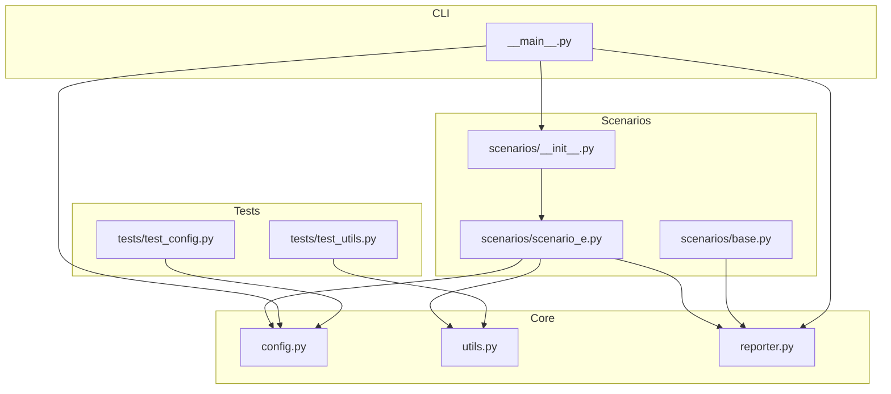
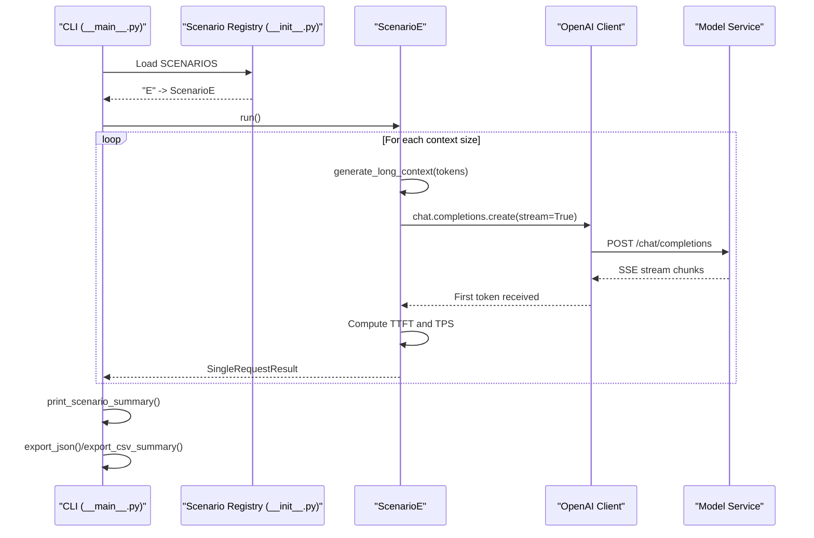
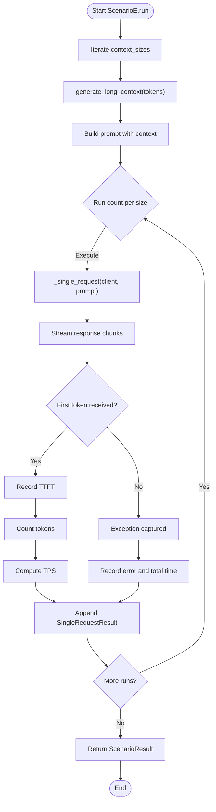
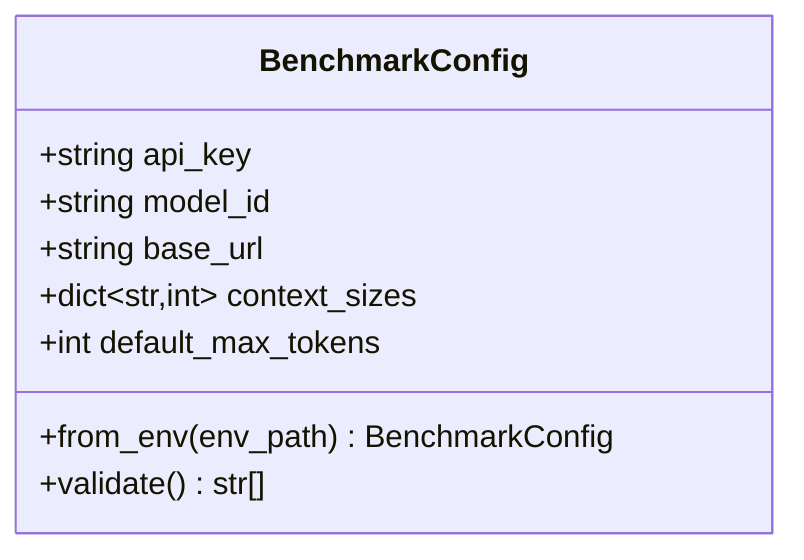
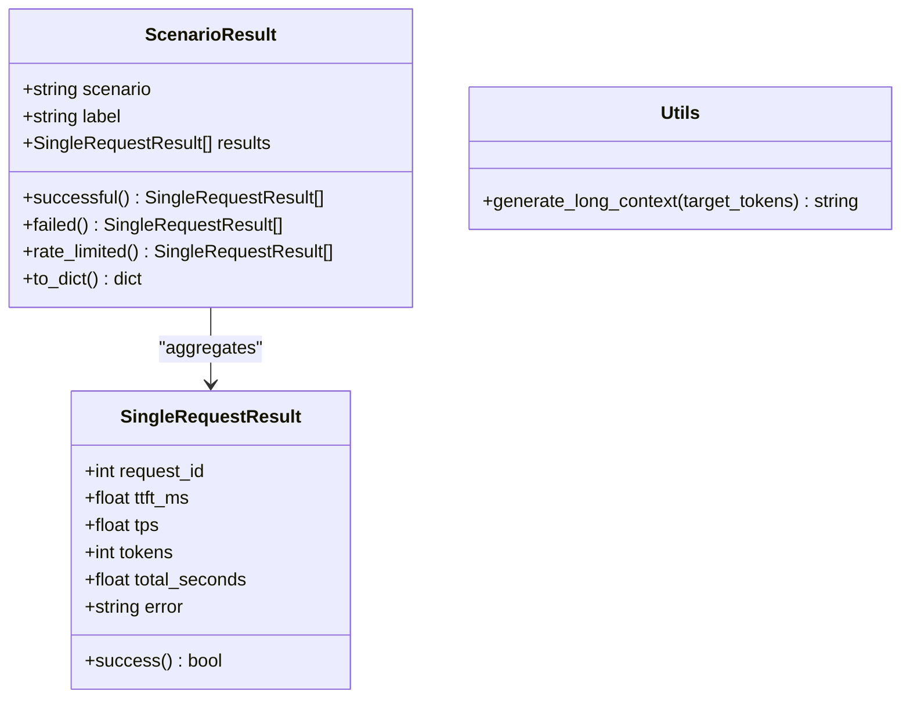
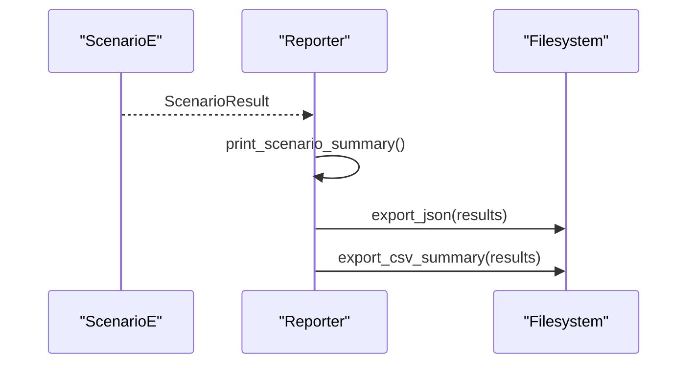
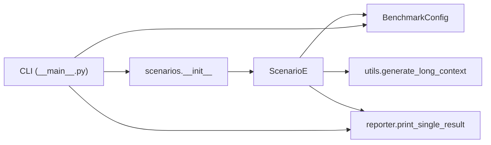

# Scenario E: Long Context Test

<cite>
**Referenced Files in This Document**
- [scenario_e.py](file://src/ptu_benchmark/scenarios/scenario_e.py)
- [config.py](file://src/ptu_benchmark/config.py)
- [utils.py](file://src/ptu_benchmark/utils.py)
- [base.py](file://src/ptu_benchmark/scenarios/base.py)
- [reporter.py](file://src/ptu_benchmark/reporter.py)
- [__main__.py](file://src/ptu_benchmark/__main__.py)
- [__init__.py](file://src/ptu_benchmark/scenarios/__init__.py)
- [pyproject.toml](file://pyproject.toml)
- [test_config.py](file://tests/test_config.py)
- [test_utils.py](file://tests/test_utils.py)
</cite>

## Table of Contents
1. [Introduction](#introduction)
2. [Project Structure](#project-structure)
3. [Core Components](#core-components)
4. [Architecture Overview](#architecture-overview)
5. [Detailed Component Analysis](#detailed-component-analysis)
6. [Dependency Analysis](#dependency-analysis)
7. [Performance Considerations](#performance-considerations)
8. [Troubleshooting Guide](#troubleshooting-guide)
9. [Conclusion](#conclusion)
10. [Appendices](#appendices)

## Introduction
Scenario E evaluates PTU performance under long input contexts commonly used in Retrieval-Augmented Generation (RAG), document processing, and summarization workloads. It systematically measures throughput and latency characteristics across three context sizes: 32K, 64K, and 128K tokens. The scenario focuses on:
- Memory usage patterns during long-context decoding
- Processing time scaling with increasing context length
- Potential performance degradation as context grows
- Impact on time-to-first-token (TTFT) and tokens-per-second (TPS)
- Practical guidance for selecting optimal context sizes in production

This document explains the methodology, metrics, configuration, and interpretation of results to support informed decisions about context sizing for real-world deployments.

## Project Structure
The benchmark suite is organized around modular scenarios, shared utilities, configuration, and reporting. Scenario E resides in the scenarios package and integrates with the shared utilities and configuration system.

**Diagram sources**
- [__main__.py:121-149](file://src/ptu_benchmark/__main__.py#L121-L149)
- [__init__.py:13-19](file://src/ptu_benchmark/scenarios/__init__.py#L13-L19)
- [scenario_e.py:25-60](file://src/ptu_benchmark/scenarios/scenario_e.py#L25-L60)
- [base.py:20-41](file://src/ptu_benchmark/scenarios/base.py#L20-L41)
- [config.py:16-46](file://src/ptu_benchmark/config.py#L16-L46)
- [utils.py:45-91](file://src/ptu_benchmark/utils.py#L45-L91)
- [reporter.py:25-83](file://src/ptu_benchmark/reporter.py#L25-L83)

**Section sources**
- [__main__.py:39-78](file://src/ptu_benchmark/__main__.py#L39-L78)
- [__init__.py:1-29](file://src/ptu_benchmark/scenarios/__init__.py#L1-L29)

## Core Components
- ScenarioE: Implements the long-context evaluation workflow, iterating over configured context sizes and issuing streaming chat completions.
- BenchmarkConfig: Centralized configuration including context sizes, defaults for token limits, and environment-based loading.
- Utilities: Data structures for results, timing helpers, and long-context text generation.
- Reporter: Console output and export utilities for results aggregation and comparison.
- CLI: Entry point orchestrating scenario execution and result export.

Key responsibilities:
- ScenarioE constructs prompts with generated long contexts, streams responses, and computes TTFT and TPS.
- BenchmarkConfig exposes context_sizes and default token limits used across scenarios.
- Utilities encapsulate result data models and helper functions for token counting and SSE parsing.
- Reporter aggregates and prints scenario-level statistics and exports results to JSON and CSV.

**Section sources**
- [scenario_e.py:25-103](file://src/ptu_benchmark/scenarios/scenario_e.py#L25-L103)
- [config.py:16-106](file://src/ptu_benchmark/config.py#L16-L106)
- [utils.py:45-156](file://src/ptu_benchmark/utils.py#L45-L156)
- [reporter.py:25-189](file://src/ptu_benchmark/reporter.py#L25-L189)

## Architecture Overview
The long-context scenario executes a synchronous OpenAI-compatible streaming API call for each context size and run. It measures:
- Time-to-first-token (TTFT) as the elapsed time from request start to receiving the first token.
- Tokens-per-second (TPS) as the output token throughput during generation.
- Total wall-clock time for the entire request lifecycle.
- Error conditions including rate limiting and HTTP failures.

**Diagram sources**
- [__main__.py:88-118](file://src/ptu_benchmark/__main__.py#L88-L118)
- [__init__.py:13-19](file://src/ptu_benchmark/scenarios/__init__.py#L13-L19)
- [scenario_e.py:33-103](file://src/ptu_benchmark/scenarios/scenario_e.py#L33-L103)
- [utils.py:120-132](file://src/ptu_benchmark/utils.py#L120-L132)

## Detailed Component Analysis

### ScenarioE: Long Context Test
- Purpose: Evaluate PTU performance across 32K, 64K, and 128K token contexts.
- Methodology:
  - Iterates over context_sizes from configuration.
  - Generates long-context text using a simple repetition strategy.
  - Prepares a fixed prompt instructing a summary response.
  - Executes multiple runs per size (RUNS_PER_SIZE) to capture variability.
  - Streams responses, records TTFT and TPS, and aggregates results.
- Metrics:
  - TTFT: Milliseconds from request start to first token.
  - TPS: Output tokens per second during generation.
  - Tokens: Total output tokens produced.
  - Total time: Wall-clock duration of the request.
  - Error: Captures exceptions and HTTP/rate-limit outcomes.

**Diagram sources**
- [scenario_e.py:33-103](file://src/ptu_benchmark/scenarios/scenario_e.py#L33-L103)
- [utils.py:120-132](file://src/ptu_benchmark/utils.py#L120-L132)

**Section sources**
- [scenario_e.py:25-103](file://src/ptu_benchmark/scenarios/scenario_e.py#L25-L103)

### Configuration: Context Sizes and Defaults
- Context sizes: Configurable via environment variable CONTEXT_SIZES with entries like "32K", "64K", "128K" or numeric values. Defaults to the three standard sizes.
- Token limits: default_max_tokens controls output token budget for long-context runs.
- Environment loading: from_env loads API credentials, base URL, and context sizes from .env or environment variables.

**Diagram sources**
- [config.py:16-106](file://src/ptu_benchmark/config.py#L16-L106)

**Section sources**
- [config.py:35-40](file://src/ptu_benchmark/config.py#L35-L40)
- [config.py:66-78](file://src/ptu_benchmark/config.py#L66-L78)
- [config.py:80-96](file://src/ptu_benchmark/config.py#L80-L96)

### Utilities: Data Models and Helpers
- SingleRequestResult: Encapsulates TTFT, TPS, tokens, total time, and error state with a success property.
- ScenarioResult: Aggregates per-scenario results with filtering helpers (successful, failed, rate_limited) and serialization to dictionary.
- generate_long_context: Produces approximate-length text by repeating a base phrase; scales with target_tokens.

**Diagram sources**
- [utils.py:45-91](file://src/ptu_benchmark/utils.py#L45-L91)
- [utils.py:120-132](file://src/ptu_benchmark/utils.py#L120-L132)

**Section sources**
- [utils.py:45-91](file://src/ptu_benchmark/utils.py#L45-L91)
- [utils.py:120-132](file://src/ptu_benchmark/utils.py#L120-L132)

### Reporting and Export
- Console output: print_single_result prints per-run metrics; print_scenario_summary prints aggregated TTFT percentiles and TPS statistics.
- Export: export_json writes a timestamped JSON file; export_csv_summary writes a CSV summary with scenario-level aggregations.

**Diagram sources**
- [reporter.py:46-83](file://src/ptu_benchmark/reporter.py#L46-L83)
- [reporter.py:125-189](file://src/ptu_benchmark/reporter.py#L125-L189)

**Section sources**
- [reporter.py:32-83](file://src/ptu_benchmark/reporter.py#L32-L83)
- [reporter.py:125-189](file://src/ptu_benchmark/reporter.py#L125-L189)

## Dependency Analysis
- ScenarioE depends on:
  - BenchmarkConfig for context sizes and defaults
  - utils.generate_long_context for prompt construction
  - reporter.print_single_result for console output
- CLI orchestrates scenario execution and result export.
- Tests validate configuration parsing and utility behavior.

**Diagram sources**
- [scenario_e.py:15-22](file://src/ptu_benchmark/scenarios/scenario_e.py#L15-L22)
- [__main__.py:88-118](file://src/ptu_benchmark/__main__.py#L88-L118)
- [__init__.py:13-19](file://src/ptu_benchmark/scenarios/__init__.py#L13-L19)

**Section sources**
- [pyproject.toml:14-20](file://pyproject.toml#L14-L20)
- [test_config.py:31-42](file://tests/test_config.py#L31-L42)
- [test_utils.py:64-80](file://tests/test_utils.py#L64-L80)

## Performance Considerations
Expected performance characteristics and interpretation:
- Memory usage: As context length increases, memory footprint for KV-cache and intermediate tensors grows proportionally. Expect higher GPU/CPU memory utilization for 128K compared to 32K.
- Processing time scaling: Latency and throughput typically degrade with larger contexts due to increased compute and memory bandwidth pressure. TTFT may increase, and TPS may decrease.
- Degradation indicators: Look for rising TTFT percentiles (P50/P95/P99) and declining TPS averages. Rate limiting (429s) signals capacity saturation.
- Optimal context sizing: Choose the smallest context that maintains acceptable quality and performance. Use Scenario E results to compare trade-offs between context length and throughput.

Resource monitoring recommendations:
- Track GPU/CPU memory usage, utilization, and temperature.
- Monitor network latency and connection pooling metrics.
- Observe rate-limiting events and retry/backoff behavior.
- Record wall-clock time per request to detect systemic slowdowns.

Interpretation guidelines:
- Compare TTFT distributions across context sizes to identify saturation points.
- Examine TPS variability and stability; consistent drops indicate resource contention.
- Use exported JSON/CSV for statistical analysis and trend visualization.

[No sources needed since this section provides general guidance]

## Troubleshooting Guide
Common issues and resolutions:
- Missing configuration:
  - Symptoms: Validation errors indicating missing API key or model ID.
  - Resolution: Set DASHSCOPE_API_KEY and PTU_MODEL_ID in .env or environment.
- Rate limiting:
  - Symptoms: SingleRequestResult with error "429_rate_limited".
  - Resolution: Reduce concurrency or request rate; observe backoff behavior.
- Streaming errors:
  - Symptoms: Exceptions captured and recorded in SingleRequestResult.error.
  - Resolution: Verify base_url and model_id; check network connectivity and service availability.
- Context size parsing:
  - Symptoms: Unexpected context sizes or mislabeling.
  - Resolution: Ensure CONTEXT_SIZES environment variable entries are comma-separated integers or labeled forms like "32K".

**Section sources**
- [config.py:98-106](file://src/ptu_benchmark/config.py#L98-L106)
- [base.py:66-78](file://src/ptu_benchmark/scenarios/base.py#L66-L78)
- [reporter.py:32-43](file://src/ptu_benchmark/reporter.py#L32-L43)
- [test_config.py:16-29](file://tests/test_config.py#L16-L29)

## Conclusion
Scenario E provides a structured methodology to evaluate PTU performance under long input contexts. By measuring TTFT and TPS across 32K, 64K, and 128K tokens, teams can understand memory and throughput trade-offs, identify saturation points, and select optimal context sizes for production workloads. Combine these results with resource monitoring and exportable metrics to drive informed deployment decisions.

[No sources needed since this section summarizes without analyzing specific files]

## Appendices

### A. Configuration Reference
- CONTEXT_SIZES: Comma-separated context sizes (e.g., "32K,64K,128K" or numeric values).
- DASHSCOPE_API_KEY: Provider API key.
- PTU_MODEL_ID: Target model identifier.
- BASE_URL: Provider base URL for compatible-mode endpoints.
- default_max_tokens: Output token limit for long-context runs.

**Section sources**
- [config.py:66-78](file://src/ptu_benchmark/config.py#L66-L78)
- [config.py:80-96](file://src/ptu_benchmark/config.py#L80-L96)

### B. Metrics and Interpretation
- TTFT: Lower is better; rising TTFT indicates increased latency or resource contention.
- TPS: Higher is better; decreasing TPS suggests throughput saturation or memory pressure.
- Tokens: Reflects output length; ensure max_tokens aligns with workload requirements.
- Errors: Investigate rate limiting and HTTP failures to adjust concurrency and request patterns.

**Section sources**
- [utils.py:45-58](file://src/ptu_benchmark/utils.py#L45-L58)
- [reporter.py:64-78](file://src/ptu_benchmark/reporter.py#L64-L78)

### C. CLI Usage
- Run all scenarios: python -m ptu_benchmark
- Run specific scenario E: python -m ptu_benchmark --scenarios E
- Export results: python -m ptu_benchmark --export
- Use custom .env: python -m ptu_benchmark --env /path/to/.env

**Section sources**
- [__main__.py:39-78](file://src/ptu_benchmark/__main__.py#L39-L78)
- [__main__.py:121-149](file://src/ptu_benchmark/__main__.py#L121-L149)