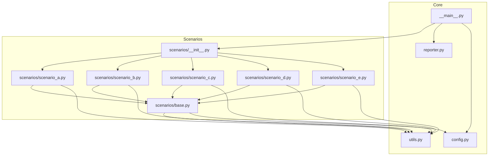
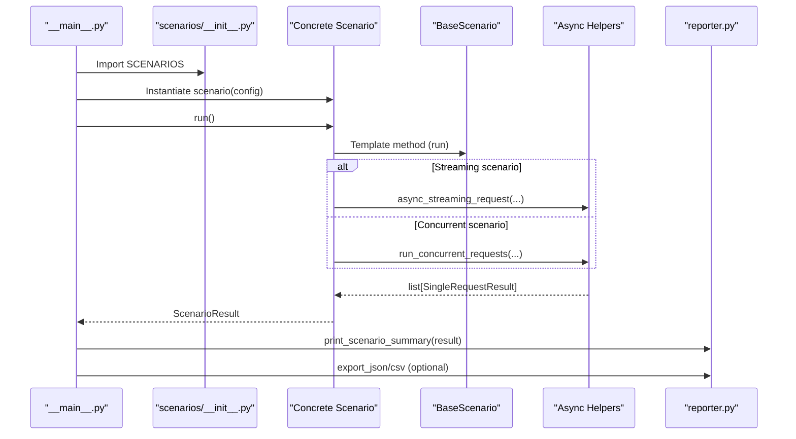
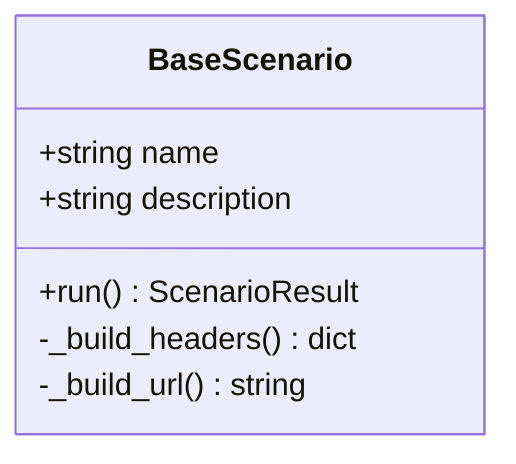
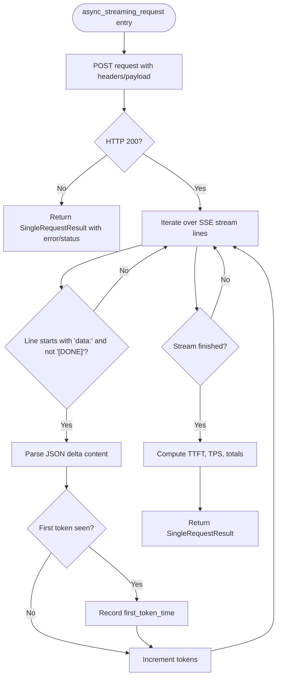
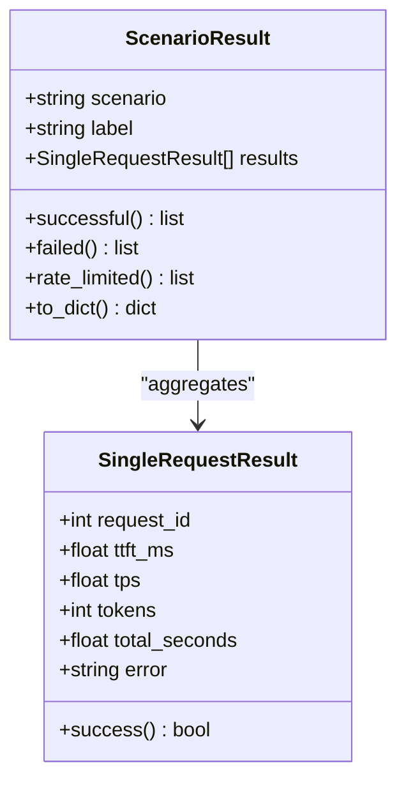
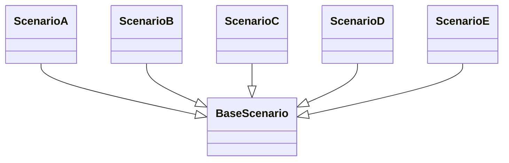
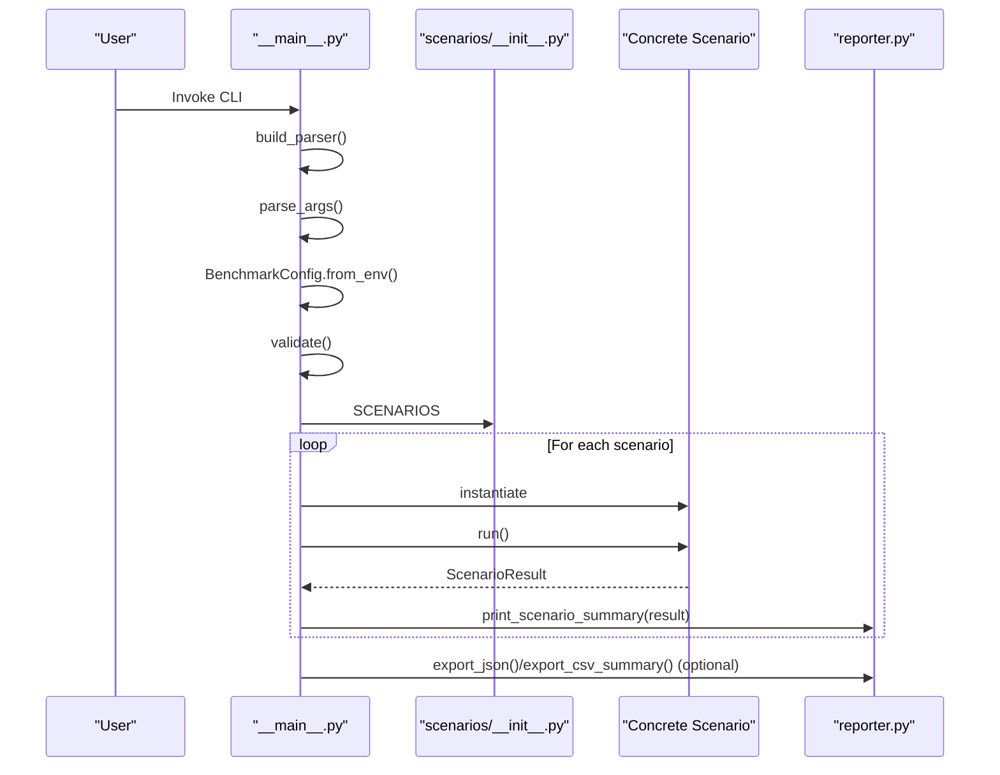
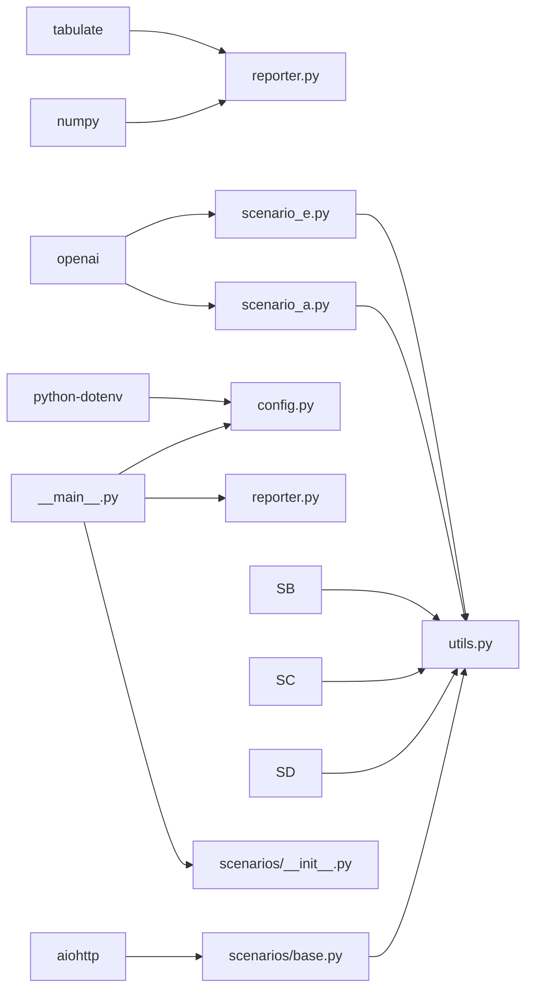

# Scenario Framework

<cite>
**Referenced Files in This Document**
- [base.py](file://src/ptu_benchmark/scenarios/base.py)
- [utils.py](file://src/ptu_benchmark/utils.py)
- [__main__.py](file://src/ptu_benchmark/__main__.py)
- [config.py](file://src/ptu_benchmark/config.py)
- [reporter.py](file://src/ptu_benchmark/reporter.py)
- [scenario_a.py](file://src/ptu_benchmark/scenarios/scenario_a.py)
- [scenario_b.py](file://src/ptu_benchmark/scenarios/scenario_b.py)
- [scenario_c.py](file://src/ptu_benchmark/scenarios/scenario_c.py)
- [scenario_d.py](file://src/ptu_benchmark/scenarios/scenario_d.py)
- [scenario_e.py](file://src/ptu_benchmark/scenarios/scenario_e.py)
- [__init__.py](file://src/ptu_benchmark/scenarios/__init__.py)
- [pyproject.toml](file://pyproject.toml)
</cite>

## Table of Contents
1. [Introduction](#introduction)
2. [Project Structure](#project-structure)
3. [Core Components](#core-components)
4. [Architecture Overview](#architecture-overview)
5. [Detailed Component Analysis](#detailed-component-analysis)
6. [Dependency Analysis](#dependency-analysis)
7. [Performance Considerations](#performance-considerations)
8. [Troubleshooting Guide](#troubleshooting-guide)
9. [Conclusion](#conclusion)
10. [Appendices](#appendices)

## Introduction
This document explains the BaseScenario framework architecture used to implement extensible, asynchronous benchmark scenarios for evaluating throughput and latency characteristics of AI inference APIs. It covers the abstract base class design, the template method pattern for scenario execution, shared async infrastructure for streaming and concurrent requests, and the data models used to represent results. It also documents error handling, connection pooling strategies, and how the framework enables developers to add new scenarios with minimal boilerplate.

## Project Structure
The benchmark suite is organized around a small set of core modules:
- scenarios/base.py defines the BaseScenario abstract class and shared async helpers
- scenarios/* implement concrete scenarios that inherit from BaseScenario
- utils.py defines data models and timing helpers
- config.py manages environment-driven configuration
- reporter.py prints summaries and exports results
- __main__.py is the CLI entry point orchestrating scenario execution
- scenarios/__init__.py registers available scenarios

**Diagram sources**
- [__main__.py:1-150](file://src/ptu_benchmark/__main__.py#L1-L150)
- [scenarios/__init__.py:1-30](file://src/ptu_benchmark/scenarios/__init__.py#L1-L30)
- [scenarios/base.py:1-143](file://src/ptu_benchmark/scenarios/base.py#L1-L143)
- [scenarios/scenario_a.py:1-102](file://src/ptu_benchmark/scenarios/scenario_a.py#L1-L102)
- [scenarios/scenario_b.py:1-51](file://src/ptu_benchmark/scenarios/scenario_b.py#L1-L51)
- [scenarios/scenario_c.py:1-106](file://src/ptu_benchmark/scenarios/scenario_c.py#L1-L106)
- [scenarios/scenario_d.py:1-72](file://src/ptu_benchmark/scenarios/scenario_d.py#L1-L72)
- [scenarios/scenario_e.py:1-103](file://src/ptu_benchmark/scenarios/scenario_e.py#L1-L103)
- [utils.py:1-156](file://src/ptu_benchmark/utils.py#L1-L156)
- [config.py:1-106](file://src/ptu_benchmark/config.py#L1-L106)
- [reporter.py:1-189](file://src/ptu_benchmark/reporter.py#L1-L189)

**Section sources**
- [pyproject.toml:1-37](file://pyproject.toml#L1-L37)
- [scenarios/__init__.py:1-30](file://src/ptu_benchmark/scenarios/__init__.py#L1-L30)

## Core Components
- BaseScenario: Abstract base class defining the template method pattern for scenario execution and providing shared helpers for URL/header construction.
- Shared async helpers:
  - async_streaming_request: Executes a single streaming request and parses SSE stream to compute TTFT, TPS, and token counts.
  - run_concurrent_requests: Spawns multiple concurrent requests using a shared aiohttp session and TCP connector.
- Data models:
  - SingleRequestResult: Captures metrics and error state for a single request.
  - ScenarioResult: Aggregates results for a scenario run and exposes convenience filters and serialization.
- Configuration: BenchmarkConfig loads environment variables and provides scenario-specific defaults.
- Reporter: Prints per-request and aggregated scenario summaries and exports results to JSON and CSV.

**Section sources**
- [base.py:20-143](file://src/ptu_benchmark/scenarios/base.py#L20-L143)
- [utils.py:45-91](file://src/ptu_benchmark/utils.py#L45-L91)
- [config.py:16-106](file://src/ptu_benchmark/config.py#L16-L106)
- [reporter.py:25-189](file://src/ptu_benchmark/reporter.py#L25-L189)

## Architecture Overview
The framework follows a layered design:
- CLI layer (__main__.py) parses arguments, validates configuration, and orchestrates scenario execution.
- Scenario layer (scenarios/*) implements concrete benchmarks inheriting from BaseScenario.
- Infrastructure layer (base.py) provides shared async helpers and base utilities.
- Data layer (utils.py) defines data models and timing helpers.
- Output layer (reporter.py) formats results and exports artifacts.

**Diagram sources**
- [__main__.py:88-118](file://src/ptu_benchmark/__main__.py#L88-L118)
- [scenarios/__init__.py:13-19](file://src/ptu_benchmark/scenarios/__init__.py#L13-L19)
- [scenario_b.py:25-50](file://src/ptu_benchmark/scenarios/scenario_b.py#L25-L50)
- [scenario_c.py:28-105](file://src/ptu_benchmark/scenarios/scenario_c.py#L28-L105)
- [base.py:47-142](file://src/ptu_benchmark/scenarios/base.py#L47-L142)
- [reporter.py:46-83](file://src/ptu_benchmark/reporter.py#L46-L83)

## Detailed Component Analysis

### BaseScenario: Abstract Base Class and Template Method Pattern
- Purpose: Define a common interface and shared behavior for all scenarios.
- Attributes:
  - name: Short identifier for the scenario.
  - description: Human-readable description printed in CLI output.
- Template method:
  - run(): Abstract method that subclasses implement to define their execution logic.
- Shared helpers:
  - _build_headers(): Builds Authorization and Content-Type headers using BenchmarkConfig.api_key.
  - _build_url(): Constructs the endpoint URL using BenchmarkConfig.base_url.

**Diagram sources**
- [base.py:20-41](file://src/ptu_benchmark/scenarios/base.py#L20-L41)

**Section sources**
- [base.py:20-41](file://src/ptu_benchmark/scenarios/base.py#L20-L41)

### Shared Async Infrastructure
- async_streaming_request(session, url, headers, payload, request_id):
  - Issues a streaming POST request and parses SSE lines.
  - Computes TTFT (milliseconds), TPS (tokens per second), total time, and token count.
  - Handles HTTP 429 and other non-200 responses by returning SingleRequestResult with error metadata.
  - Converts exceptions to error strings for robustness.
- run_concurrent_requests(config, prompt, concurrency, max_tokens):
  - Builds a shared aiohttp.ClientSession with a TCPConnector tuned to concurrency.
  - Creates tasks for concurrent requests and awaits them with asyncio.gather.
  - Returns a list of SingleRequestResult.

**Diagram sources**
- [base.py:47-112](file://src/ptu_benchmark/scenarios/base.py#L47-L112)

**Section sources**
- [base.py:47-142](file://src/ptu_benchmark/scenarios/base.py#L47-L142)

### Data Models: SingleRequestResult and ScenarioResult
- SingleRequestResult:
  - Fields: request_id, ttft_ms, tps, tokens, total_seconds, error.
  - Properties: success indicates whether the request was successful.
- ScenarioResult:
  - Fields: scenario, label, results.
  - Properties: successful, failed, rate_limited for filtering.
  - Methods: to_dict() for exporting.

**Diagram sources**
- [utils.py:45-91](file://src/ptu_benchmark/utils.py#L45-L91)

**Section sources**
- [utils.py:45-91](file://src/ptu_benchmark/utils.py#L45-L91)

### Scenario Implementations
- ScenarioA: Single-request baseline using OpenAI SDK streaming.
- ScenarioB: Concurrent load test invoking run_concurrent_requests.
- ScenarioC: Sustained throughput over time with manual worker loop and semaphore.
- ScenarioD: Burst test sending a large number of concurrent requests.
- ScenarioE: Long-context test generating synthetic prompts of varying token counts.

**Diagram sources**
- [scenario_a.py:23-102](file://src/ptu_benchmark/scenarios/scenario_a.py#L23-L102)
- [scenario_b.py:19-51](file://src/ptu_benchmark/scenarios/scenario_b.py#L19-L51)
- [scenario_c.py:22-106](file://src/ptu_benchmark/scenarios/scenario_c.py#L22-L106)
- [scenario_d.py:20-72](file://src/ptu_benchmark/scenarios/scenario_d.py#L20-L72)
- [scenario_e.py:25-103](file://src/ptu_benchmark/scenarios/scenario_e.py#L25-L103)
- [base.py:20-41](file://src/ptu_benchmark/scenarios/base.py#L20-L41)

**Section sources**
- [scenario_a.py:23-102](file://src/ptu_benchmark/scenarios/scenario_a.py#L23-L102)
- [scenario_b.py:19-51](file://src/ptu_benchmark/scenarios/scenario_b.py#L19-L51)
- [scenario_c.py:22-106](file://src/ptu_benchmark/scenarios/scenario_c.py#L22-L106)
- [scenario_d.py:20-72](file://src/ptu_benchmark/scenarios/scenario_d.py#L20-L72)
- [scenario_e.py:25-103](file://src/ptu_benchmark/scenarios/scenario_e.py#L25-L103)

### CLI Orchestration and Reporting
- CLI entry point builds argument parser, loads configuration, validates it, and runs selected scenarios.
- Reporter prints per-scenario summaries and exports JSON and CSV.

**Diagram sources**
- [__main__.py:39-146](file://src/ptu_benchmark/__main__.py#L39-L146)
- [reporter.py:46-83](file://src/ptu_benchmark/reporter.py#L46-L83)
- [scenarios/__init__.py:13-19](file://src/ptu_benchmark/scenarios/__init__.py#L13-L19)

**Section sources**
- [__main__.py:39-146](file://src/ptu_benchmark/__main__.py#L39-L146)
- [reporter.py:46-83](file://src/ptu_benchmark/reporter.py#L46-L83)

## Dependency Analysis
- External libraries:
  - aiohttp: Asynchronous HTTP client and TCPConnector for connection pooling.
  - openai: OpenAI SDK used by ScenarioA and ScenarioE for streaming.
  - numpy: Used for percentile and aggregation computations in reporter.
  - python-dotenv: Loads environment variables from .env files.
  - tabulate: Formats comparison tables in reporter.
- Internal dependencies:
  - scenarios/__init__.py registers concrete scenarios.
  - BaseScenario depends on BenchmarkConfig and utils data models.
  - ScenarioB/C/D rely on shared async helpers from base.py.
  - Reporter depends on utils data models.

**Diagram sources**
- [pyproject.toml:14-20](file://pyproject.toml#L14-L20)
- [base.py:13-17](file://src/ptu_benchmark/scenarios/base.py#L13-L17)
- [scenario_a.py:15-20](file://src/ptu_benchmark/scenarios/scenario_a.py#L15-L20)
- [scenario_e.py:13-22](file://src/ptu_benchmark/scenarios/scenario_e.py#L13-L22)
- [reporter.py:15-16](file://src/ptu_benchmark/reporter.py#L15-L16)
- [config.py:13](file://src/ptu_benchmark/config.py#L13)
- [scenarios/__init__.py:6-10](file://src/ptu_benchmark/scenarios/__init__.py#L6-L10)

**Section sources**
- [pyproject.toml:14-20](file://pyproject.toml#L14-L20)
- [base.py:13-17](file://src/ptu_benchmark/scenarios/base.py#L13-L17)

## Performance Considerations
- Connection pooling:
  - run_concurrent_requests and ScenarioC create a TCPConnector with limit tuned to concurrency plus a buffer to handle keep-alive overhead.
  - Using a single ClientSession per scenario reduces overhead and improves reuse.
- Concurrency control:
  - ScenarioC uses an asyncio.Semaphore to cap concurrent workers, preventing resource exhaustion.
  - ScenarioB uses asyncio.gather to spawn tasks equal to concurrency level.
- Streaming parsing:
  - async_streaming_request decodes SSE lines incrementally and computes metrics without buffering entire streams.
- Memory footprint:
  - Results are aggregated in memory; for very large concurrency levels, consider batching or streaming exports to reduce peak memory usage.
- Latency measurement:
  - TTFT is computed from request start to first token; ensure monotonic clock usage avoids negative durations.

[No sources needed since this section provides general guidance]

## Troubleshooting Guide
- Configuration errors:
  - Missing required environment variables (API key or model ID) cause validation failures; the CLI prints a list of errors and exits.
- HTTP errors:
  - Non-200 responses are captured and reported as SingleRequestResult with an error status; HTTP 429 is treated specially and recorded as a rate-limited error.
- Exceptions:
  - Unexpected exceptions during streaming are caught and surfaced as error strings in SingleRequestResult.
- Export issues:
  - JSON/CSV export directories are created automatically; ensure write permissions in the output directory.

**Section sources**
- [config.py:98-106](file://src/ptu_benchmark/config.py#L98-L106)
- [base.py:64-112](file://src/ptu_benchmark/scenarios/base.py#L64-L112)
- [reporter.py:125-189](file://src/ptu_benchmark/reporter.py#L125-L189)

## Conclusion
The BaseScenario framework provides a clean, extensible foundation for building benchmark scenarios around streaming completions. By leveraging the template method pattern, shared async infrastructure, and standardized data models, it enables rapid development of new scenarios while maintaining consistent measurement semantics and reporting. The design balances simplicity for newcomers with flexibility for advanced use cases such as sustained throughput and burst testing.

## Appendices

### How to Add a New Scenario
- Create a new file under scenarios/ with a class extending BaseScenario.
- Set name and description attributes.
- Implement run() to construct prompts, configure concurrency/max tokens, and return a ScenarioResult.
- Use async_streaming_request for single-streaming requests or run_concurrent_requests for parallelism.
- Register the scenario in scenarios/__init__.py under SCENARIOS.

**Section sources**
- [base.py:20-41](file://src/ptu_benchmark/scenarios/base.py#L20-L41)
- [scenarios/__init__.py:13-19](file://src/ptu_benchmark/scenarios/__init__.py#L13-L19)