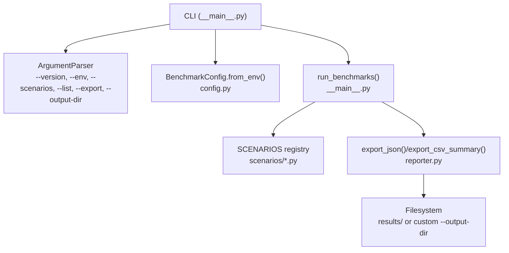
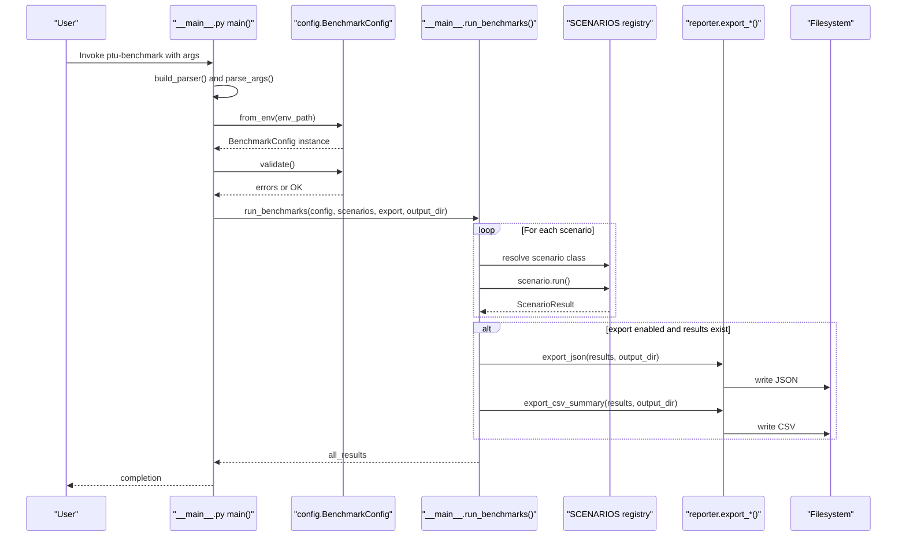
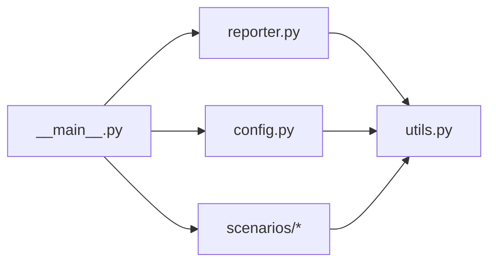

# CLI Reference and Usage

<cite>
**Referenced Files in This Document**
- [README.md](file://README.md)
- [Makefile](file://Makefile)
- [pyproject.toml](file://pyproject.toml)
- [src/ptu_benchmark/__main__.py](file://src/ptu_benchmark/__main__.py)
- [src/ptu_benchmark/config.py](file://src/ptu_benchmark/config.py)
- [src/ptu_benchmark/reporter.py](file://src/ptu_benchmark/reporter.py)
- [src/ptu_benchmark/scenarios/base.py](file://src/ptu_benchmark/scenarios/base.py)
- [src/ptu_benchmark/scenarios/scenario_a.py](file://src/ptu_benchmark/scenarios/scenario_a.py)
- [src/ptu_benchmark/scenarios/scenario_b.py](file://src/ptu_benchmark/scenarios/scenario_b.py)
- [src/ptu_benchmark/scenarios/scenario_c.py](file://src/ptu_benchmark/scenarios/scenario_c.py)
- [src/ptu_benchmark/scenarios/scenario_d.py](file://src/ptu_benchmark/scenarios/scenario_d.py)
- [src/ptu_benchmark/scenarios/scenario_e.py](file://src/ptu_benchmark/scenarios/scenario_e.py)
- [src/ptu_benchmark/utils.py](file://src/ptu_benchmark/utils.py)
</cite>

## Table of Contents
1. [Introduction](#introduction)
2. [Project Structure](#project-structure)
3. [Core Components](#core-components)
4. [Architecture Overview](#architecture-overview)
5. [Detailed Component Analysis](#detailed-component-analysis)
6. [Dependency Analysis](#dependency-analysis)
7. [Performance Considerations](#performance-considerations)
8. [Troubleshooting Guide](#troubleshooting-guide)
9. [Conclusion](#conclusion)
10. [Appendices](#appendices)

## Introduction
This document provides a comprehensive CLI reference and usage guide for PTU-Benchmark. It explains all command-line arguments, their purposes, default values, and usage examples. It also covers scenario selection syntax, export functionality, output directory management, practical workflows, Makefile shortcuts, and troubleshooting guidance.

## Project Structure
The CLI entry point is implemented in the package’s main module. The CLI parses arguments, loads configuration from environment or a specified .env file, validates required settings, runs selected scenarios, and optionally exports results to JSON and CSV.

**Diagram sources**
- [src/ptu_benchmark/__main__.py:39-78](file://src/ptu_benchmark/__main__.py#L39-L78)
- [src/ptu_benchmark/config.py:47-96](file://src/ptu_benchmark/config.py#L47-L96)
- [src/ptu_benchmark/reporter.py:125-188](file://src/ptu_benchmark/reporter.py#L125-L188)

**Section sources**
- [src/ptu_benchmark/__main__.py:1-150](file://src/ptu_benchmark/__main__.py#L1-L150)
- [src/ptu_benchmark/config.py:1-106](file://src/ptu_benchmark/config.py#L1-L106)
- [src/ptu_benchmark/reporter.py:1-189](file://src/ptu_benchmark/reporter.py#L1-L189)

## Core Components
- CLI entry point and argument parsing
- Configuration loader and validator
- Scenario runner and exporters
- Makefile shortcuts

Key CLI arguments:
- --version: Print version and exit.
- --env PATH: Path to a .env configuration file (default: auto-detected).
- --scenarios {A,B,C,D,E} ...: Select specific scenarios to run (default: all).
- --list: List available scenarios and exit.
- --export: Export results to JSON and CSV in results/ or custom --output-dir.
- --output-dir DIR: Directory for exported result files (default: results/).

**Section sources**
- [src/ptu_benchmark/__main__.py:39-78](file://src/ptu_benchmark/__main__.py#L39-L78)
- [src/ptu_benchmark/__main__.py:121-145](file://src/ptu_benchmark/__main__.py#L121-L145)
- [src/ptu_benchmark/reporter.py:125-188](file://src/ptu_benchmark/reporter.py#L125-L188)
- [README.md:142-282](file://README.md#L142-L282)

## Architecture Overview
The CLI orchestrates configuration loading, scenario execution, and optional export. The following sequence diagram maps the end-to-end flow for a typical run with export.

**Diagram sources**
- [src/ptu_benchmark/__main__.py:121-145](file://src/ptu_benchmark/__main__.py#L121-L145)
- [src/ptu_benchmark/config.py:47-106](file://src/ptu_benchmark/config.py#L47-L106)
- [src/ptu_benchmark/reporter.py:125-188](file://src/ptu_benchmark/reporter.py#L125-L188)

## Detailed Component Analysis

### Argument Definitions and Defaults
- --version
  - Type: Flag
  - Purpose: Print program name and version, then exit.
  - Default: None (handled by argparse action).
  - Example: ptu-benchmark --version
- --env PATH
  - Type: String
  - Purpose: Specify path to a .env file; when omitted, the loader searches the current directory and parents.
  - Default: None (auto-detect).
  - Example: ptu-benchmark --env /path/to/.env
- --scenarios {A,B,C,D,E} ...
  - Type: Multiple values (nargs=+)
  - Purpose: Choose which scenarios to run; default is all if unspecified.
  - Choices: A, B, C, D, E.
  - Example: ptu-benchmark --scenarios A B D
- --list
  - Type: Flag
  - Purpose: Print available scenarios and exit.
  - Default: False.
  - Example: ptu-benchmark --list
- --export
  - Type: Flag
  - Purpose: Export results to JSON and CSV after running scenarios.
  - Default: False.
  - Example: ptu-benchmark --export
- --output-dir DIR
  - Type: String
  - Purpose: Directory for exported result files.
  - Default: results/.
  - Example: ptu-benchmark --export --output-dir ./out

Notes:
- Scenario selection supports multiple values; order determines execution order.
- Export writes two files: a timestamped JSON and a CSV summary.

**Section sources**
- [src/ptu_benchmark/__main__.py:39-78](file://src/ptu_benchmark/__main__.py#L39-L78)
- [src/ptu_benchmark/reporter.py:125-188](file://src/ptu_benchmark/reporter.py#L125-L188)

### Scenario Selection Syntax
- Use --scenarios followed by one or more scenario letters: A, B, C, D, E.
- Example: --scenarios A B D
- Omitting --scenarios runs all scenarios in registry order.

**Section sources**
- [src/ptu_benchmark/__main__.py:55-61](file://src/ptu_benchmark/__main__.py#L55-L61)

### Export Functionality
- Enabling --export triggers JSON and CSV exports after scenario execution.
- JSON file naming uses a UTC timestamp suffix.
- CSV summary aggregates counts and percentiles per scenario.
- Output directory defaults to results/, but can be overridden with --output-dir.

Files produced:
- benchmark_results_<UTC timestamp>.json
- benchmark_summary.csv

**Section sources**
- [src/ptu_benchmark/__main__.py:111-117](file://src/ptu_benchmark/__main__.py#L111-L117)
- [src/ptu_benchmark/reporter.py:125-188](file://src/ptu_benchmark/reporter.py#L125-L188)

### Output Directory Management
- Default: results/
- Behavior: Directory is created if it does not exist.
- Customization: Use --output-dir to change location.

**Section sources**
- [src/ptu_benchmark/__main__.py:72-77](file://src/ptu_benchmark/__main__.py#L72-L77)
- [src/ptu_benchmark/reporter.py:125-188](file://src/ptu_benchmark/reporter.py#L125-L188)

### Practical Workflows

- Run all scenarios and export results
  - ptu-benchmark --export
  - Make shortcut: make run

- Run specific scenarios
  - ptu-benchmark --scenarios A B D
  - Make shortcuts:
    - make run-a (Scenario A)
    - make run-b (Scenario B)
    - make run-c (Scenario C)
    - make run-d (Scenario D)
    - make run-e (Scenario E)

- List available scenarios
  - ptu-benchmark --list
  - Make shortcut: make list

- Use a custom .env file
  - ptu-benchmark --env /path/to/.env

- Change output directory for exports
  - ptu-benchmark --export --output-dir ./out

Automation integration tips:
- Combine with CI steps to run a fixed set of scenarios and publish artifacts.
- Use --output-dir to separate runs by job or branch.

**Section sources**
- [README.md:108-124](file://README.md#L108-L124)
- [Makefile:31-52](file://Makefile#L31-L52)
- [src/ptu_benchmark/__main__.py:121-145](file://src/ptu_benchmark/__main__.py#L121-L145)

### Makefile Shortcuts and CLI Equivalents
- make run → ptu-benchmark --export
- make run-all → ptu-benchmark --export
- make run-a → ptu-benchmark --scenarios A
- make run-b → ptu-benchmark --scenarios B
- make run-c → ptu-benchmark --scenarios C
- make run-d → ptu-benchmark --scenarios D
- make run-e → ptu-benchmark --scenarios E
- make list → ptu-benchmark --list

**Section sources**
- [Makefile:31-52](file://Makefile#L31-L52)

## Dependency Analysis
The CLI depends on configuration, scenario registry, and reporter modules. The reporter module depends on filesystem and external libraries for statistics and pretty printing.

**Diagram sources**
- [src/ptu_benchmark/__main__.py:28-36](file://src/ptu_benchmark/__main__.py#L28-L36)
- [src/ptu_benchmark/reporter.py:18](file://src/ptu_benchmark/reporter.py#L18)
- [src/ptu_benchmark/config.py:16-46](file://src/ptu_benchmark/config.py#L16-L46)
- [src/ptu_benchmark/utils.py:45-91](file://src/ptu_benchmark/utils.py#L45-L91)

**Section sources**
- [src/ptu_benchmark/__main__.py:28-36](file://src/ptu_benchmark/__main__.py#L28-L36)
- [src/ptu_benchmark/reporter.py:18](file://src/ptu_benchmark/reporter.py#L18)
- [src/ptu_benchmark/config.py:16-46](file://src/ptu_benchmark/config.py#L16-L46)
- [src/ptu_benchmark/utils.py:45-91](file://src/ptu_benchmark/utils.py#L45-L91)

## Performance Considerations
- Exporting results adds I/O overhead; enable only when needed.
- Scenario C runs for extended durations; ensure adequate resources and network stability.
- Scenario D sends large bursts; monitor for rate limiting indicators.

[No sources needed since this section provides general guidance]

## Troubleshooting Guide

Common issues and resolutions:
- Missing required configuration
  - Symptom: Validation errors printed and process exits.
  - Cause: Missing DASHSCOPE_API_KEY or PTU_MODEL_ID.
  - Fix: Copy .env.example to .env and set required variables.
  - Evidence: Configuration validation and setup guidance.
  
  **Section sources**
  - [src/ptu_benchmark/config.py:98-106](file://src/ptu_benchmark/config.py#L98-L106)
  - [src/ptu_benchmark/__main__.py:131-138](file://src/ptu_benchmark/__main__.py#L131-L138)
  - [README.md:85-106](file://README.md#L85-L106)

- Argument parsing errors
  - Symptom: Help text printed with usage error.
  - Causes:
    - Unknown option or misplaced argument.
    - Invalid scenario choice.
  - Fix: Review --help output and ensure choices are among A, B, C, D, E.
  
  **Section sources**
  - [src/ptu_benchmark/__main__.py:39-78](file://src/ptu_benchmark/__main__.py#L39-L78)

- Export path issues
  - Symptom: Permission denied or path not found.
  - Fix: Ensure write permissions to target directory; use absolute paths if needed.
  
  **Section sources**
  - [src/ptu_benchmark/reporter.py:125-188](file://src/ptu_benchmark/reporter.py#L125-L188)

- Rate limiting during sustained or burst scenarios
  - Symptom: Non-zero 429 errors observed in scenario output.
  - Cause: Traffic exceeds PTU capacity; excess falls back to pay-as-you-go.
  - Mitigation: Reduce concurrency or burst size; tune scenario parameters.
  
  **Section sources**
  - [src/ptu_benchmark/scenarios/scenario_c.py:96-103](file://src/ptu_benchmark/scenarios/scenario_c.py#L96-L103)
  - [src/ptu_benchmark/scenarios/scenario_d.py:59-65](file://src/ptu_benchmark/scenarios/scenario_d.py#L59-L65)

## Conclusion
PTU-Benchmark offers a concise CLI for running standardized performance scenarios against Alibaba Cloud Model Studio PTU. Use --scenarios to target specific workloads, --export to persist results, and --output-dir to control artifact locations. Makefile shortcuts streamline common tasks for quick iteration and automation.

[No sources needed since this section summarizes without analyzing specific files]

## Appendices

### CLI Reference Summary
- ptu-benchmark [--version] [--env PATH] [--scenarios {A,B,C,D,E} ...] [--list] [--export] [--output-dir DIR]

Defaults:
- --version: Print version and exit.
- --env: Auto-detect .env file.
- --scenarios: All scenarios.
- --list: False.
- --export: False.
- --output-dir: results/.

**Section sources**
- [src/ptu_benchmark/__main__.py:39-78](file://src/ptu_benchmark/__main__.py#L39-L78)
- [README.md:142-157](file://README.md#L142-L157)

### Scenario Overview
- A: Single Request Baseline (TTFT + TPS)
- B: Concurrent Load (10/50/100 parallel requests)
- C: Sustained Throughput (30-minute window)
- D: Peak Burst Test
- E: Long Context Test

**Section sources**
- [src/ptu_benchmark/scenarios/scenario_a.py:23-57](file://src/ptu_benchmark/scenarios/scenario_a.py#L23-L57)
- [src/ptu_benchmark/scenarios/scenario_b.py:19-50](file://src/ptu_benchmark/scenarios/scenario_b.py#L19-L50)
- [src/ptu_benchmark/scenarios/scenario_c.py:22-35](file://src/ptu_benchmark/scenarios/scenario_c.py#L22-L35)
- [src/ptu_benchmark/scenarios/scenario_d.py:20-71](file://src/ptu_benchmark/scenarios/scenario_d.py#L20-L71)
- [src/ptu_benchmark/scenarios/scenario_e.py:25-60](file://src/ptu_benchmark/scenarios/scenario_e.py#L25-L60)

### Exported Artifacts
- JSON: benchmark_results_<UTC timestamp>.json
- CSV: benchmark_summary.csv

**Section sources**
- [src/ptu_benchmark/reporter.py:125-188](file://src/ptu_benchmark/reporter.py#L125-L188)
- [README.md:192-207](file://README.md#L192-L207)