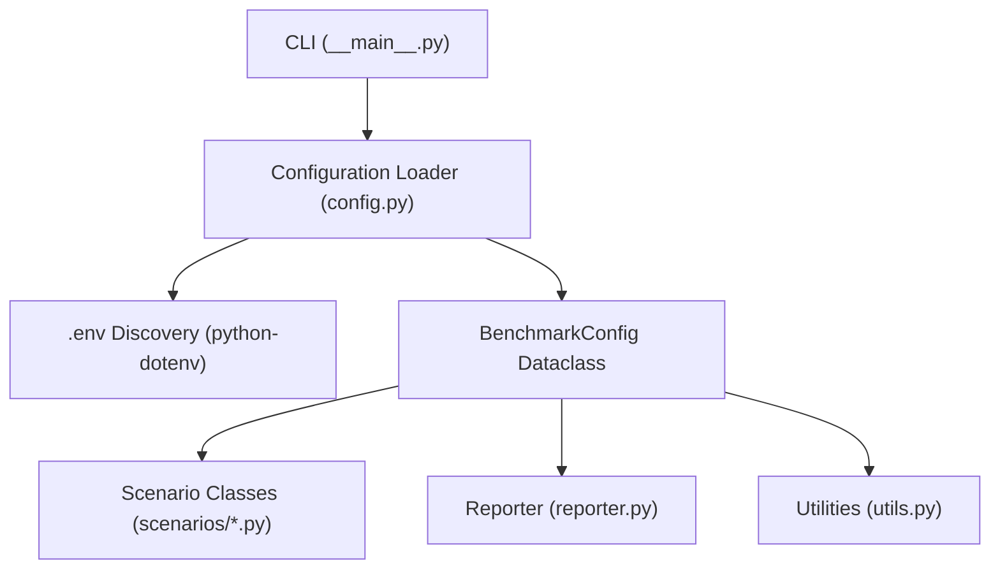
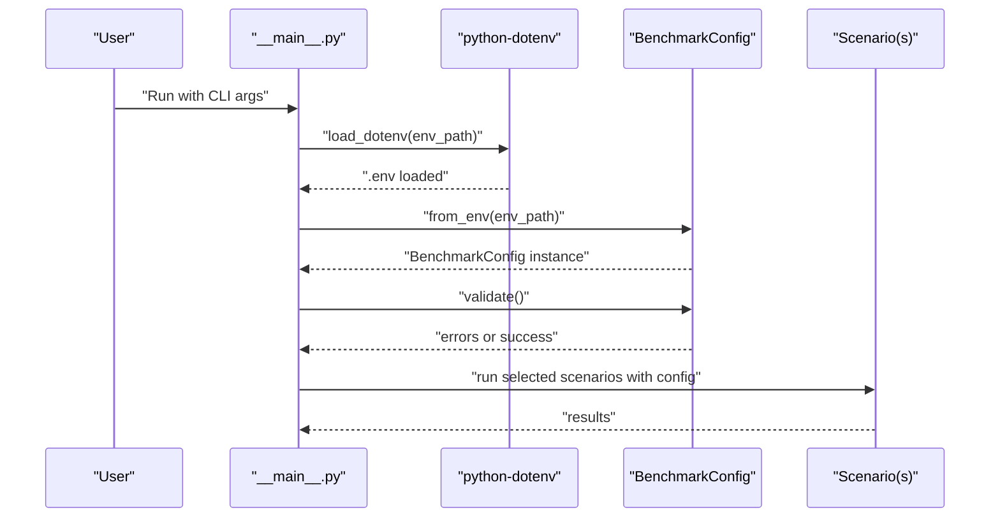
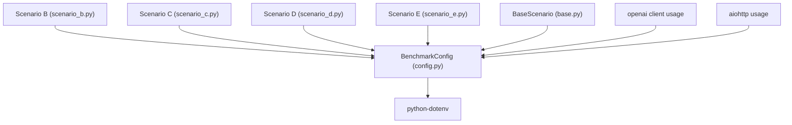

# Configuration Management

<cite>
**Referenced Files in This Document**
- [config.py](file://src/ptu_benchmark/config.py)
- [__main__.py](file://src/ptu_benchmark/__main__.py)
- [test_config.py](file://tests/test_config.py)
- [pyproject.toml](file://pyproject.toml)
- [requirements.txt](file://requirements.txt)
- [scenarios/base.py](file://src/ptu_benchmark/scenarios/base.py)
- [scenarios/scenario_b.py](file://src/ptu_benchmark/scenarios/scenario_b.py)
- [scenarios/scenario_c.py](file://src/ptu_benchmark/scenarios/scenario_c.py)
- [scenarios/scenario_d.py](file://src/ptu_benchmark/scenarios/scenario_d.py)
- [scenarios/scenario_e.py](file://src/ptu_benchmark/scenarios/scenario_e.py)
- [reporter.py](file://src/ptu_benchmark/reporter.py)
- [utils.py](file://src/ptu_benchmark/utils.py)
</cite>

## Table of Contents
1. [Introduction](#introduction)
2. [Project Structure](#project-structure)
3. [Core Components](#core-components)
4. [Architecture Overview](#architecture-overview)
5. [Detailed Component Analysis](#detailed-component-analysis)
6. [Dependency Analysis](#dependency-analysis)
7. [Performance Considerations](#performance-considerations)
8. [Troubleshooting Guide](#troubleshooting-guide)
9. [Conclusion](#conclusion)
10. [Appendices](#appendices)

## Introduction
This document explains the configuration management system used by PTU-Benchmark. It covers how environment variables and optional .env files are loaded, how configuration is validated, and how CLI arguments influence configuration loading. It also documents all supported environment variables, their types, defaults, and validation rules, along with precedence, error handling, and practical guidance for secure and reliable usage.

## Project Structure
Configuration is centralized in a single dataclass that loads values from environment variables and .env files, then validates required fields before the benchmark runs. CLI arguments control .env discovery and scenario selection.

**Diagram sources**
- [__main__.py:121-149](file://src/ptu_benchmark/__main__.py#L121-L149)
- [config.py:47-96](file://src/ptu_benchmark/config.py#L47-L96)
- [scenarios/base.py:26-41](file://src/ptu_benchmark/scenarios/base.py#L26-L41)

**Section sources**
- [__main__.py:39-78](file://src/ptu_benchmark/__main__.py#L39-L78)
- [config.py:16-46](file://src/ptu_benchmark/config.py#L16-L46)

## Core Components
- BenchmarkConfig: Centralized configuration dataclass with typed fields and environment-based initialization.
- CLI entry point: Parses CLI arguments, discovers .env, constructs BenchmarkConfig, validates it, and runs selected scenarios.
- Environment loading: Uses python-dotenv to load .env files from explicit path or auto-discovery.
- Validation: Ensures required fields are present before running benchmarks.

Key behaviors:
- Environment variable loading occurs before constructing the configuration object.
- Defaults are embedded in the dataclass fields and used when environment variables are absent.
- Validation enforces required credentials and identifiers.

**Section sources**
- [config.py:16-46](file://src/ptu_benchmark/config.py#L16-L46)
- [config.py:47-96](file://src/ptu_benchmark/config.py#L47-L96)
- [config.py:98-106](file://src/ptu_benchmark/config.py#L98-L106)
- [__main__.py:121-149](file://src/ptu_benchmark/__main__.py#L121-L149)

## Architecture Overview
The configuration pipeline is straightforward: CLI parses arguments, .env is loaded, configuration is built from environment variables, validated, and passed to scenarios.

**Diagram sources**
- [__main__.py:121-149](file://src/ptu_benchmark/__main__.py#L121-L149)
- [config.py:47-96](file://src/ptu_benchmark/config.py#L47-L96)
- [config.py:98-106](file://src/ptu_benchmark/config.py#L98-L106)

## Detailed Component Analysis

### Environment-Based Configuration System
- .env discovery: The loader uses python-dotenv to load variables from a specified path or automatically from the current working directory and parent directories.
- Variable mapping: The configuration builder reads environment variables and converts them to appropriate types.
- Defaults: When environment variables are missing, defaults from the dataclass fields are used.

Supported environment variables and their types, defaults, and conversion rules:
- DASHSCOPE_API_KEY: string; required; no default value; used for Authorization header.
- PTU_MODEL_ID: string; required; no default value; identifies the model to benchmark.
- BASE_URL: string; optional; default is a specific HTTPS URL; used as the base for chat completions.
- CONCURRENCY_LEVELS: comma-separated integers; optional; default [10, 50, 100]; parsed into a list of ints.
- SUSTAINED_DURATION: integer seconds; optional; default 1800 (30 minutes); used in sustained throughput scenario.
- SUSTAINED_CONCURRENCY: integer; optional; default 20; used in sustained throughput scenario.
- BURST_SIZE: integer; optional; default 200; used in peak burst scenario.
- CONTEXT_SIZES: comma-separated integers; optional; default {"32K": 32000, "64K": 64000, "128K": 128000}; parsed into a dict mapping labels to token counts.

Validation rules:
- Missing DASHSCOPE_API_KEY produces an error.
- Missing PTU_MODEL_ID produces an error.
- No validation is performed on optional fields; defaults are applied.

Precedence:
- Explicit env_path argument overrides auto-discovery.
- Environment variables override .env file values when both are present.
- Defaults apply when neither is provided.

Error handling:
- On validation failure, the program prints errors and exits with a non-zero status after instructing the user to copy a template .env file.

Security note:
- API keys are read from environment variables and used in headers. Keep .env files out of version control and restrict filesystem permissions.

**Section sources**
- [config.py:47-96](file://src/ptu_benchmark/config.py#L47-L96)
- [config.py:98-106](file://src/ptu_benchmark/config.py#L98-L106)
- [__main__.py:121-149](file://src/ptu_benchmark/__main__.py#L121-L149)
- [test_config.py:31-41](file://tests/test_config.py#L31-L41)

### Type Conversion Mechanisms
- Integer lists: Comma-separated strings are split and converted to integers; whitespace is stripped; empty entries are ignored.
- Context sizes: Comma-separated integers are parsed into a dictionary. Each number becomes both a key and a label; labels are normalized to human-friendly forms (e.g., thousands grouped as K).
- Integers: Direct conversion with defaults when empty.

Edge cases:
- Empty or whitespace-only values fall back to defaults.
- Non-integer values in lists cause conversion errors; callers should ensure correct formatting.

**Section sources**
- [config.py:60-78](file://src/ptu_benchmark/config.py#L60-L78)

### Relationship Between Environment Variables and CLI Arguments
- --env: Accepts a path to a .env file. Passing this argument ensures the loader uses the specified file rather than auto-discovering.
- --scenarios: Selects which scenarios to run; does not affect configuration loading.
- --list: Lists scenarios and exits; does not affect configuration loading.
- --export and --output-dir: Control result export; do not affect configuration loading.

**Section sources**
- [__main__.py:39-78](file://src/ptu_benchmark/__main__.py#L39-L78)
- [__main__.py:121-149](file://src/ptu_benchmark/__main__.py#L121-L149)

### Configuration Usage Across Scenarios
- Scenario B (concurrent load): Reads concurrency_levels to iterate over multiple concurrency values.
- Scenario C (sustained throughput): Reads sustained_duration and sustained_concurrency to run a long test window.
- Scenario D (peak burst): Reads burst_size to send a large burst of requests.
- Scenario E (long context): Reads context_sizes to run tests with varying input token counts.
- Base scenario and shared helpers: Use base_url and api_key for request construction.

**Section sources**
- [scenarios/scenario_b.py:25-44](file://src/ptu_benchmark/scenarios/scenario_b.py#L25-L44)
- [scenarios/scenario_c.py:37-105](file://src/ptu_benchmark/scenarios/scenario_c.py#L37-L105)
- [scenarios/scenario_d.py:26-71](file://src/ptu_benchmark/scenarios/scenario_d.py#L26-L71)
- [scenarios/scenario_e.py:42-60](file://src/ptu_benchmark/scenarios/scenario_e.py#L42-L60)
- [scenarios/base.py:33-40](file://src/ptu_benchmark/scenarios/base.py#L33-L40)
- [scenarios/base.py:115-142](file://src/ptu_benchmark/scenarios/base.py#L115-L142)

## Dependency Analysis
External dependencies relevant to configuration:
- python-dotenv: Loads .env files.
- openai: Uses api_key and base_url to construct client instances in some scenarios.
- aiohttp: Used for streaming requests and connection pooling in shared helpers.

**Diagram sources**
- [config.py:13](file://src/ptu_benchmark/config.py#L13)
- [pyproject.toml:18](file://pyproject.toml#L18)
- [requirements.txt:4](file://requirements.txt#L4)
- [scenarios/base.py:33-40](file://src/ptu_benchmark/scenarios/base.py#L33-L40)
- [scenarios/base.py:115-142](file://src/ptu_benchmark/scenarios/base.py#L115-L142)
- [scenarios/scenario_b.py:25-44](file://src/ptu_benchmark/scenarios/scenario_b.py#L25-L44)
- [scenarios/scenario_c.py:37-105](file://src/ptu_benchmark/scenarios/scenario_c.py#L37-L105)
- [scenarios/scenario_d.py:26-71](file://src/ptu_benchmark/scenarios/scenario_d.py#L26-L71)
- [scenarios/scenario_e.py:42-60](file://src/ptu_benchmark/scenarios/scenario_e.py#L42-L60)

**Section sources**
- [pyproject.toml:14-20](file://pyproject.toml#L14-L20)
- [requirements.txt:1-6](file://requirements.txt#L1-L6)

## Performance Considerations
- Connection limits: Streaming helpers configure TCP connectors with limits derived from concurrency to avoid resource exhaustion.
- Token limits: Scenario-specific max_tokens are applied to bound request sizes and reduce overhead.
- Sustained load: The sustained scenario uses semaphores and a fixed concurrency to maintain steady throughput over time.

**Section sources**
- [scenarios/base.py:136-142](file://src/ptu_benchmark/scenarios/base.py#L136-L142)
- [scenarios/scenario_c.py:48-76](file://src/ptu_benchmark/scenarios/scenario_c.py#L48-L76)

## Troubleshooting Guide
Common configuration issues and resolutions:
- Missing required variables:
  - Symptom: Validation errors indicating missing API key or model ID.
  - Resolution: Set DASHSCOPE_API_KEY and PTU_MODEL_ID in your environment or .env file.
- Incorrect list format:
  - Symptom: Unexpected list values for concurrency levels or context sizes.
  - Resolution: Ensure comma-separated integers with optional whitespace; avoid empty entries.
- .env not loaded:
  - Symptom: Configuration falls back to defaults unexpectedly.
  - Resolution: Provide --env with the correct path or ensure the .env file is placed in the working directory or a parent directory.
- Validation failure halts execution:
  - Symptom: Program exits after printing configuration errors.
  - Resolution: Fix the environment variables and rerun.

**Section sources**
- [config.py:98-106](file://src/ptu_benchmark/config.py#L98-L106)
- [__main__.py:131-138](file://src/ptu_benchmark/__main__.py#L131-L138)
- [test_config.py:16-29](file://tests/test_config.py#L16-L29)

## Conclusion
PTU-Benchmark’s configuration system is minimal, robust, and explicit. Environment variables and .env files provide a flexible way to configure all aspects of the benchmark, with clear defaults and validation to prevent runtime surprises. By following the guidance here, you can reliably configure, validate, and run benchmarks across diverse scenarios.

## Appendices

### Supported Environment Variables and Defaults
- DASHSCOPE_API_KEY: string; required; no default.
- PTU_MODEL_ID: string; required; no default.
- BASE_URL: string; optional; default value embedded in configuration.
- CONCURRENCY_LEVELS: comma-separated integers; optional; default list embedded in configuration.
- SUSTAINED_DURATION: integer seconds; optional; default value embedded in configuration.
- SUSTAINED_CONCURRENCY: integer; optional; default value embedded in configuration.
- BURST_SIZE: integer; optional; default value embedded in configuration.
- CONTEXT_SIZES: comma-separated integers; optional; default dict embedded in configuration.

**Section sources**
- [config.py:21-45](file://src/ptu_benchmark/config.py#L21-L45)
- [config.py:60-78](file://src/ptu_benchmark/config.py#L60-L78)

### Optimal Configuration Examples by Scenario
- Scenario A (baseline):
  - Focus on correctness and small payloads.
  - Typical values: default max_tokens for generation.
- Scenario B (concurrent load):
  - Vary CONCURRENCY_LEVELS to explore throughput degradation.
  - Typical values: [10, 50, 100] or larger steps depending on resources.
- Scenario C (sustained throughput):
  - Tune SUSTAINED_DURATION and SUSTAINED_CONCURRENCY for desired workload length and intensity.
  - Typical values: duration around 1800 seconds with moderate concurrency.
- Scenario D (peak burst):
  - Set BURST_SIZE to the largest acceptable burst for your PTU capacity.
  - Typical values: 200 or higher to stress limits.
- Scenario E (long context):
  - Adjust CONTEXT_SIZES to match expected input sizes (e.g., 32K, 64K, 128K).
  - Typical values: defaults cover common sizes.

**Section sources**
- [config.py:25-45](file://src/ptu_benchmark/config.py#L25-L45)
- [scenarios/scenario_b.py:29-38](file://src/ptu_benchmark/scenarios/scenario_b.py#L29-L38)
- [scenarios/scenario_c.py:38-44](file://src/ptu_benchmark/scenarios/scenario_c.py#L38-L44)
- [scenarios/scenario_d.py:27-37](file://src/ptu_benchmark/scenarios/scenario_d.py#L27-L37)
- [scenarios/scenario_e.py:42-54](file://src/ptu_benchmark/scenarios/scenario_e.py#L42-L54)

### Security Best Practices for API Keys
- Store API keys in environment variables or .env files with restricted filesystem permissions.
- Exclude .env files from version control.
- Rotate keys periodically and revoke compromised keys promptly.
- Limit the scope of keys to the minimum required access.

[No sources needed since this section provides general guidance]