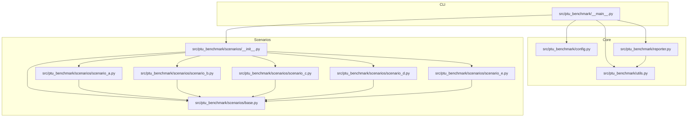
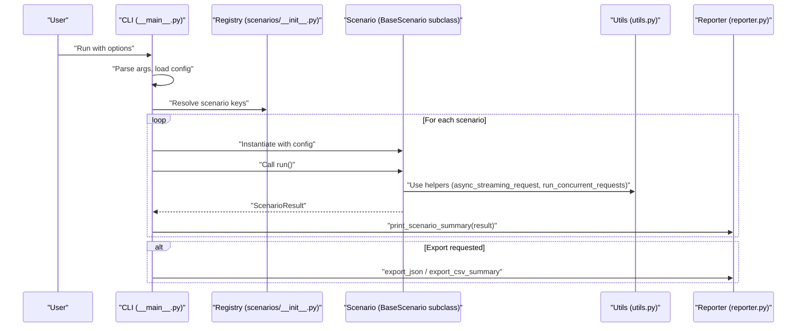
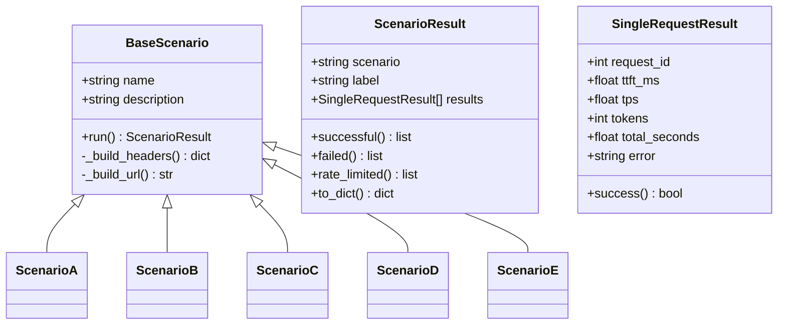
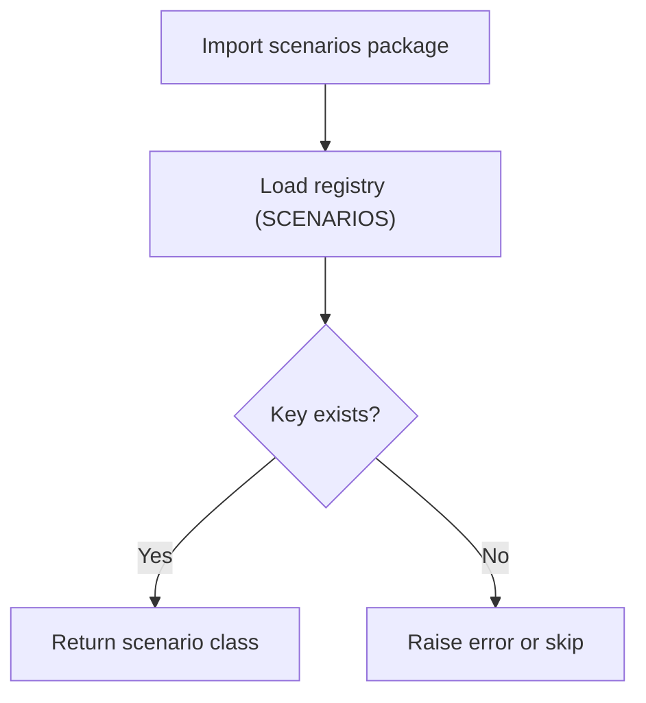
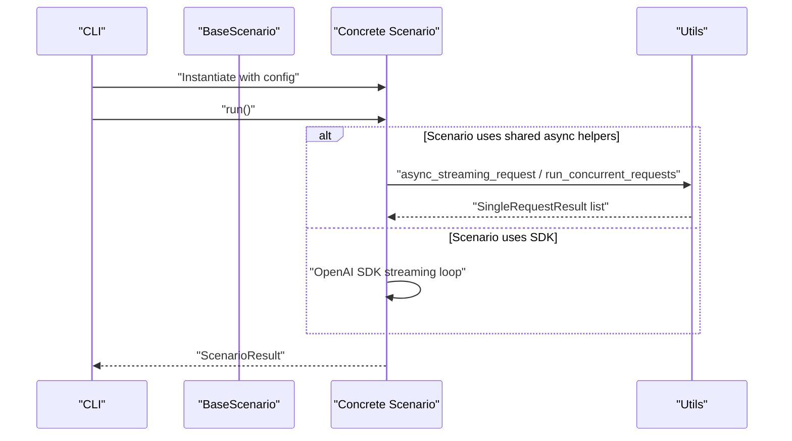
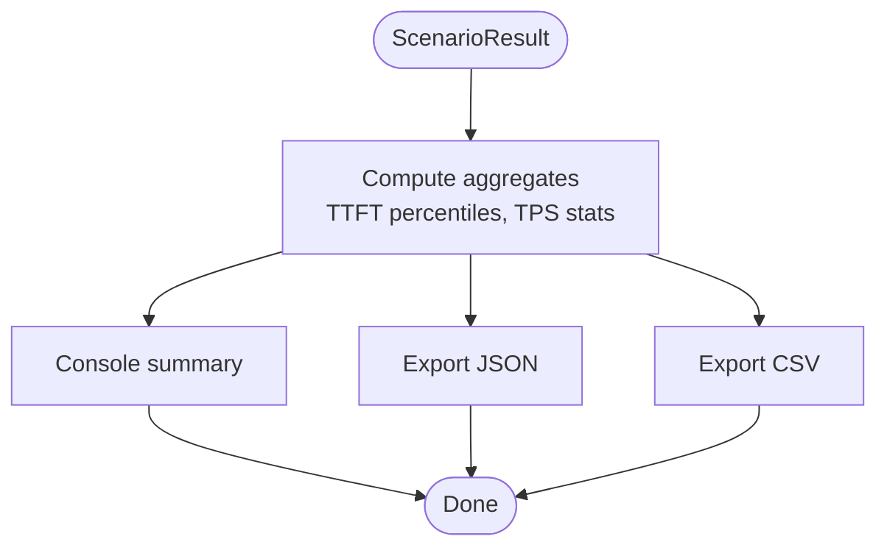
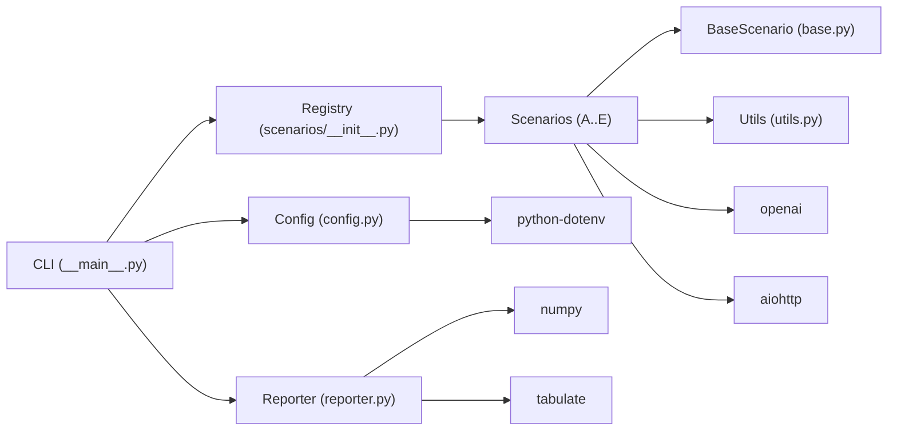

# Development and Extension

<cite>
**Referenced Files in This Document**
- [__main__.py](file://src/ptu_benchmark/__main__.py)
- [config.py](file://src/ptu_benchmark/config.py)
- [reporter.py](file://src/ptu_benchmark/reporter.py)
- [utils.py](file://src/ptu_benchmark/utils.py)
- [scenarios/__init__.py](file://src/ptu_benchmark/scenarios/__init__.py)
- [scenarios/base.py](file://src/ptu_benchmark/scenarios/base.py)
- [scenarios/scenario_a.py](file://src/ptu_benchmark/scenarios/scenario_a.py)
- [scenarios/scenario_b.py](file://src/ptu_benchmark/scenarios/scenario_b.py)
- [scenarios/scenario_c.py](file://src/ptu_benchmark/scenarios/scenario_c.py)
- [scenarios/scenario_d.py](file://src/ptu_benchmark/scenarios/scenario_d.py)
- [scenarios/scenario_e.py](file://src/ptu_benchmark/scenarios/scenario_e.py)
- [test_config.py](file://tests/test_config.py)
- [test_utils.py](file://tests/test_utils.py)
- [pyproject.toml](file://pyproject.toml)
- [requirements.txt](file://requirements.txt)
- [Makefile](file://Makefile)
</cite>

## Table of Contents
1. [Introduction](#introduction)
2. [Project Structure](#project-structure)
3. [Core Components](#core-components)
4. [Architecture Overview](#architecture-overview)
5. [Detailed Component Analysis](#detailed-component-analysis)
6. [Dependency Analysis](#dependency-analysis)
7. [Performance Considerations](#performance-considerations)
8. [Troubleshooting Guide](#troubleshooting-guide)
9. [Contribution Guidelines and Workflow](#contribution-guidelines-and-workflow)
10. [Conclusion](#conclusion)

## Introduction
This document explains how to develop and extend PTU-Benchmark. It focuses on the extensible architecture, plugin-style scenario registration, the BaseScenario class and template method pattern, and how to add new scenarios, integrate custom metrics, and extend the reporting framework. It also covers configuration, utility functions, data containers, and the CLI entry point. Practical guidance is included for maintaining backward compatibility, contributing new scenarios or features, and following the development workflow.

## Project Structure
PTU-Benchmark is organized around a modular scenario framework with a central CLI entry point, configuration management, shared utilities, and a reporting module. Scenarios are registered centrally and executed by the CLI runner.

**Diagram sources**
- [__main__.py:1-150](file://src/ptu_benchmark/__main__.py#L1-L150)
- [config.py:1-106](file://src/ptu_benchmark/config.py#L1-L106)
- [reporter.py:1-189](file://src/ptu_benchmark/reporter.py#L1-L189)
- [utils.py:1-156](file://src/ptu_benchmark/utils.py#L1-L156)
- [scenarios/__init__.py:1-30](file://src/ptu_benchmark/scenarios/__init__.py#L1-L30)
- [scenarios/base.py:1-143](file://src/ptu_benchmark/scenarios/base.py#L1-L143)
- [scenarios/scenario_a.py:1-102](file://src/ptu_benchmark/scenarios/scenario_a.py#L1-L102)
- [scenarios/scenario_b.py:1-51](file://src/ptu_benchmark/scenarios/scenario_b.py#L1-L51)
- [scenarios/scenario_c.py:1-106](file://src/ptu_benchmark/scenarios/scenario_c.py#L1-L106)
- [scenarios/scenario_d.py:1-72](file://src/ptu_benchmark/scenarios/scenario_d.py#L1-L72)
- [scenarios/scenario_e.py:1-103](file://src/ptu_benchmark/scenarios/scenario_e.py#L1-L103)

**Section sources**
- [__main__.py:1-150](file://src/ptu_benchmark/__main__.py#L1-L150)
- [scenarios/__init__.py:1-30](file://src/ptu_benchmark/scenarios/__init__.py#L1-L30)

## Core Components
- CLI entry point orchestrates argument parsing, configuration loading, scenario selection, execution, and optional export.
- Configuration encapsulates environment-driven settings and validation.
- Utilities define shared data containers, timing helpers, and prompt/context generators.
- Reporter prints summaries and exports results to JSON and CSV.
- Scenarios inherit from a common base and implement a template method to run benchmarks.

Key responsibilities:
- CLI: parse arguments, list scenarios, run selected scenarios, export results.
- Config: load environment variables, construct typed configuration, validate required fields.
- Utils: define data models for results, timers, and helpers for prompts and SSE parsing.
- Reporter: compute aggregates, print summaries, export structured artifacts.
- Scenarios: implement run() and reuse shared async helpers.

**Section sources**
- [__main__.py:39-146](file://src/ptu_benchmark/__main__.py#L39-L146)
- [config.py:16-106](file://src/ptu_benchmark/config.py#L16-L106)
- [utils.py:45-156](file://src/ptu_benchmark/utils.py#L45-L156)
- [reporter.py:25-189](file://src/ptu_benchmark/reporter.py#L25-L189)
- [scenarios/base.py:20-143](file://src/ptu_benchmark/scenarios/base.py#L20-L143)

## Architecture Overview
The system follows a plugin-like architecture:
- Central registry maps scenario keys to scenario classes.
- CLI loads configuration, selects scenarios, instantiates each scenario, and invokes run().
- Scenarios depend on shared async helpers and configuration.
- Results are aggregated and reported via reporter utilities.

**Diagram sources**
- [__main__.py:88-118](file://src/ptu_benchmark/__main__.py#L88-L118)
- [scenarios/__init__.py:13-19](file://src/ptu_benchmark/scenarios/__init__.py#L13-L19)
- [scenarios/base.py:47-143](file://src/ptu_benchmark/scenarios/base.py#L47-L143)
- [utils.py:45-156](file://src/ptu_benchmark/utils.py#L45-L156)
- [reporter.py:46-189](file://src/ptu_benchmark/reporter.py#L46-L189)

## Detailed Component Analysis

### BaseScenario and Template Method Pattern
BaseScenario defines the contract and shared infrastructure:
- Abstract run() method to be implemented by concrete scenarios.
- Helper methods for building headers and URLs.
- Shared async helpers for streaming requests and concurrent request execution.

Template method flow:
- CLI constructs scenario instances with configuration.
- CLI calls run(), which executes scenario-specific logic and returns ScenarioResult.
- CLI prints summary and optionally exports results.

**Diagram sources**
- [scenarios/base.py:20-41](file://src/ptu_benchmark/scenarios/base.py#L20-L41)
- [scenarios/base.py:115-143](file://src/ptu_benchmark/scenarios/base.py#L115-L143)
- [utils.py:45-91](file://src/ptu_benchmark/utils.py#L45-L91)

**Section sources**
- [scenarios/base.py:20-41](file://src/ptu_benchmark/scenarios/base.py#L20-L41)
- [scenarios/base.py:47-143](file://src/ptu_benchmark/scenarios/base.py#L47-L143)
- [utils.py:45-91](file://src/ptu_benchmark/utils.py#L45-L91)

### Scenario Registry and Plugin Registration
The registry maps scenario keys to scenario classes and exposes a single import point. Adding a new scenario requires:
- Implementing a new subclass of BaseScenario.
- Adding the class to the registry mapping.
- Optionally exporting the class in __all__.

**Diagram sources**
- [scenarios/__init__.py:13-19](file://src/ptu_benchmark/scenarios/__init__.py#L13-L19)

**Section sources**
- [scenarios/__init__.py:1-30](file://src/ptu_benchmark/scenarios/__init__.py#L1-L30)

### Scenario Implementations
Each scenario implements run() and leverages shared helpers:
- ScenarioA: single-streaming requests with short and long prompts.
- ScenarioB: concurrent requests across configured concurrency levels.
- ScenarioC: sustained throughput over a fixed duration with periodic reporting.
- ScenarioD: burst test with a large number of simultaneous requests.
- ScenarioE: long-context runs with dynamically generated prompts.

**Diagram sources**
- [scenarios/scenario_a.py:32-57](file://src/ptu_benchmark/scenarios/scenario_a.py#L32-L57)
- [scenarios/scenario_b.py:25-50](file://src/ptu_benchmark/scenarios/scenario_b.py#L25-L50)
- [scenarios/scenario_c.py:28-35](file://src/ptu_benchmark/scenarios/scenario_c.py#L28-L35)
- [scenarios/scenario_d.py:26-71](file://src/ptu_benchmark/scenarios/scenario_d.py#L26-L71)
- [scenarios/scenario_e.py:33-60](file://src/ptu_benchmark/scenarios/scenario_e.py#L33-L60)
- [scenarios/base.py:47-143](file://src/ptu_benchmark/scenarios/base.py#L47-L143)
- [utils.py:45-91](file://src/ptu_benchmark/utils.py#L45-L91)

**Section sources**
- [scenarios/scenario_a.py:23-102](file://src/ptu_benchmark/scenarios/scenario_a.py#L23-L102)
- [scenarios/scenario_b.py:19-51](file://src/ptu_benchmark/scenarios/scenario_b.py#L19-L51)
- [scenarios/scenario_c.py:22-106](file://src/ptu_benchmark/scenarios/scenario_c.py#L22-L106)
- [scenarios/scenario_d.py:20-72](file://src/ptu_benchmark/scenarios/scenario_d.py#L20-L72)
- [scenarios/scenario_e.py:25-103](file://src/ptu_benchmark/scenarios/scenario_e.py#L25-L103)

### Reporting and Export Extensibility
Reporter provides:
- Console printing of single results and scenario summaries.
- Aggregation of TTFT percentiles and TPS statistics.
- Export to JSON and CSV with scenario metadata and per-scenario stats.

Extending reporting:
- Add new aggregation functions to ScenarioResult or reporter helpers.
- Extend export functions to include additional metrics.
- Introduce new output formats by adding new exporter functions.

**Diagram sources**
- [reporter.py:46-189](file://src/ptu_benchmark/reporter.py#L46-L189)
- [utils.py:61-91](file://src/ptu_benchmark/utils.py#L61-L91)

**Section sources**
- [reporter.py:25-189](file://src/ptu_benchmark/reporter.py#L25-L189)
- [utils.py:61-91](file://src/ptu_benchmark/utils.py#L61-L91)

### Configuration Management
BenchmarkConfig centralizes environment-driven settings:
- Required fields: API key and model ID.
- Scenario-specific defaults and tunables.
- Validation ensures required fields are present.

Extending configuration:
- Add new fields with sensible defaults.
- Support environment variable overrides with parsing helpers.
- Keep validation strict to fail fast on misconfiguration.

**Section sources**
- [config.py:16-106](file://src/ptu_benchmark/config.py#L16-L106)

### Utility Functions and Data Containers
Utilities include:
- Prompt templates for scenarios.
- Data containers for single and aggregated results.
- Timer context manager for measuring durations.
- Helpers for generating long context and parsing SSE streams.

Extending utilities:
- Add new prompt templates or context generators.
- Extend data containers with new metrics.
- Provide new parsing or aggregation helpers.

**Section sources**
- [utils.py:17-39](file://src/ptu_benchmark/utils.py#L17-L39)
- [utils.py:45-156](file://src/ptu_benchmark/utils.py#L45-L156)

## Dependency Analysis
External dependencies are declared in project configuration and requirements. The CLI, scenarios, and reporters depend on these libraries for networking, data processing, and environment configuration.

**Diagram sources**
- [pyproject.toml:14-26](file://pyproject.toml#L14-L26)
- [requirements.txt:1-6](file://requirements.txt#L1-L6)
- [__main__.py:28-36](file://src/ptu_benchmark/__main__.py#L28-L36)
- [scenarios/__init__.py:5-10](file://src/ptu_benchmark/scenarios/__init__.py#L5-L10)
- [config.py:13-13](file://src/ptu_benchmark/config.py#L13-L13)
- [reporter.py:15-16](file://src/ptu_benchmark/reporter.py#L15-L16)

**Section sources**
- [pyproject.toml:14-26](file://pyproject.toml#L14-L26)
- [requirements.txt:1-6](file://requirements.txt#L1-L6)

## Performance Considerations
- Asynchronous streaming: Prefer async helpers for high concurrency and throughput.
- Connection pooling: Use appropriate TCPConnector limits to avoid resource exhaustion.
- Token estimation: Use context generators judiciously to avoid excessive memory usage.
- Export overhead: CSV/JSON export is I/O bound; consider batching large result sets.
- Percentile computation: Aggregations rely on numpy; ensure sufficient samples for meaningful percentiles.

[No sources needed since this section provides general guidance]

## Troubleshooting Guide
Common issues and resolutions:
- Missing configuration: Ensure required environment variables are set and validated by the configuration loader.
- Rate limiting: Scenarios handle 429 responses; review burst and sustained configurations.
- Network errors: Inspect error fields in SingleRequestResult and adjust concurrency or retry strategies.
- Export failures: Verify output directory permissions and disk space.

**Section sources**
- [config.py:98-106](file://src/ptu_benchmark/config.py#L98-L106)
- [scenarios/base.py:66-78](file://src/ptu_benchmark/scenarios/base.py#L66-L78)
- [reporter.py:125-189](file://src/ptu_benchmark/reporter.py#L125-L189)

## Contribution Guidelines and Workflow
- Fork and branch: Work from a feature branch for new scenarios or extensions.
- Backward compatibility: Do not rename or remove public attributes/methods; add new fields with defaults.
- Tests: Add unit tests for new utilities and configuration parsing.
- Linting and formatting: Keep imports ordered and adhere to Python style standards.
- Documentation: Update README or inline docstrings for new APIs.
- Workflow:
  - Set up environment and copy .env.example to .env.
  - Install dependencies (production and dev).
  - Run tests to validate changes.
  - Use Makefile targets for quick runs and exports.
  - Submit a pull request with clear rationale and test coverage.

Development workflow highlights:
- Environment setup and configuration loading.
- Running individual scenarios or all scenarios.
- Exporting results to JSON and CSV.
- Listing available scenarios.

**Section sources**
- [Makefile:13-22](file://Makefile#L13-L22)
- [Makefile:26-52](file://Makefile#L26-L52)
- [__main__.py:39-78](file://src/ptu_benchmark/__main__.py#L39-L78)
- [test_config.py:8-42](file://tests/test_config.py#L8-L42)
- [test_utils.py:12-80](file://tests/test_utils.py#L12-L80)

## How to Add a New Scenario
Follow these steps to add a new scenario:
1. Create a new scenario file under scenarios/.
2. Define a new class inheriting from BaseScenario with name and description.
3. Implement run() to produce a ScenarioResult with SingleRequestResult entries.
4. Reuse shared helpers (async_streaming_request, run_concurrent_requests) when applicable.
5. Register the new scenario in the scenarios registry mapping and __all__.
6. Add tests for configuration and utilities if needed.
7. Verify CLI listing and execution work as expected.

Best practices:
- Keep run() focused on orchestration; delegate I/O to shared helpers.
- Use configuration fields for tunables (e.g., concurrency, duration).
- Preserve scenario semantics and labels for reproducibility.
- Avoid breaking changes to public APIs.

**Section sources**
- [scenarios/base.py:20-41](file://src/ptu_benchmark/scenarios/base.py#L20-L41)
- [scenarios/base.py:47-143](file://src/ptu_benchmark/scenarios/base.py#L47-L143)
- [scenarios/__init__.py:13-29](file://src/ptu_benchmark/scenarios/__init__.py#L13-L29)

## Extending Result Processing and Metrics
To add new metrics or processing:
- Extend SingleRequestResult or ScenarioResult with computed properties.
- Update reporter functions to include new aggregates or formatted outputs.
- Modify export functions to include new fields in JSON/CSV.
- Ensure backward compatibility by keeping existing fields and adding new ones.

Example extension points:
- New latency metrics beyond TTFT.
- Throughput variants (e.g., tokens per request).
- Error categorization improvements.

**Section sources**
- [utils.py:45-91](file://src/ptu_benchmark/utils.py#L45-L91)
- [reporter.py:46-119](file://src/ptu_benchmark/reporter.py#L46-L119)

## Integrating Custom Metrics
Steps to integrate custom metrics:
1. Define metric computation in ScenarioResult or a dedicated helper.
2. Update print_scenario_summary to include the metric.
3. Extend export functions to persist the metric in JSON/CSV.
4. Add tests verifying metric correctness across scenarios.

Guidelines:
- Use numpy for percentile and aggregate computations.
- Guard against empty samples to avoid division by zero.
- Keep console output concise; reserve detailed logs for debug mode.

**Section sources**
- [reporter.py:64-83](file://src/ptu_benchmark/reporter.py#L64-L83)
- [reporter.py:125-189](file://src/ptu_benchmark/reporter.py#L125-L189)

## Maintaining Backward Compatibility
- Do not rename or delete public attributes in data containers.
- Add new fields with default values in configuration.
- Keep CLI flags and scenario keys stable; deprecate old ones gradually.
- Preserve existing reporter output formats unless documented otherwise.

[No sources needed since this section provides general guidance]

## Submitting New Scenarios or Features
Submission checklist:
- Implement the scenario following the BaseScenario template.
- Register it in the scenarios package.
- Add unit tests for configuration and utilities.
- Verify CLI listing, execution, and export.
- Update documentation and examples as needed.
- Open a pull request with a clear description and rationale.

**Section sources**
- [scenarios/__init__.py:13-29](file://src/ptu_benchmark/scenarios/__init__.py#L13-L29)
- [test_config.py:8-42](file://tests/test_config.py#L8-L42)
- [test_utils.py:12-80](file://tests/test_utils.py#L12-L80)

## Conclusion
PTU-Benchmark offers a clean, extensible architecture centered on BaseScenario and a plugin-style registry. By following the template method pattern, reusing shared async helpers, and leveraging configuration and utilities, contributors can add new scenarios and metrics efficiently. Adhering to backward compatibility, testing rigor, and the documented workflow ensures high-quality contributions.