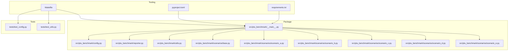
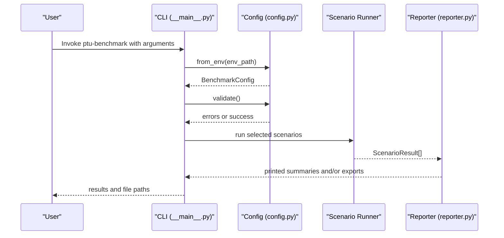
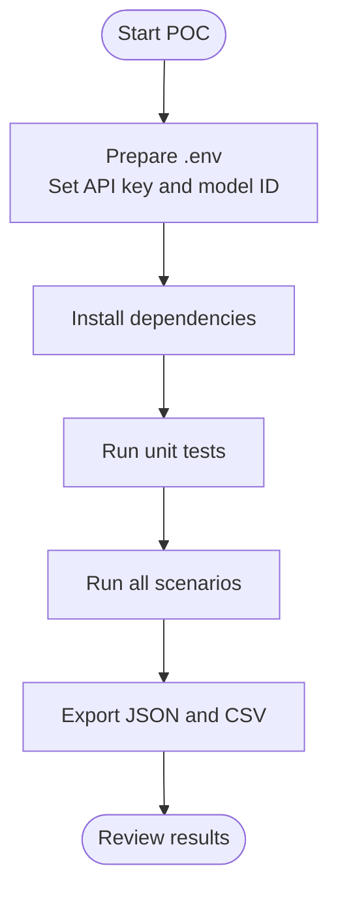
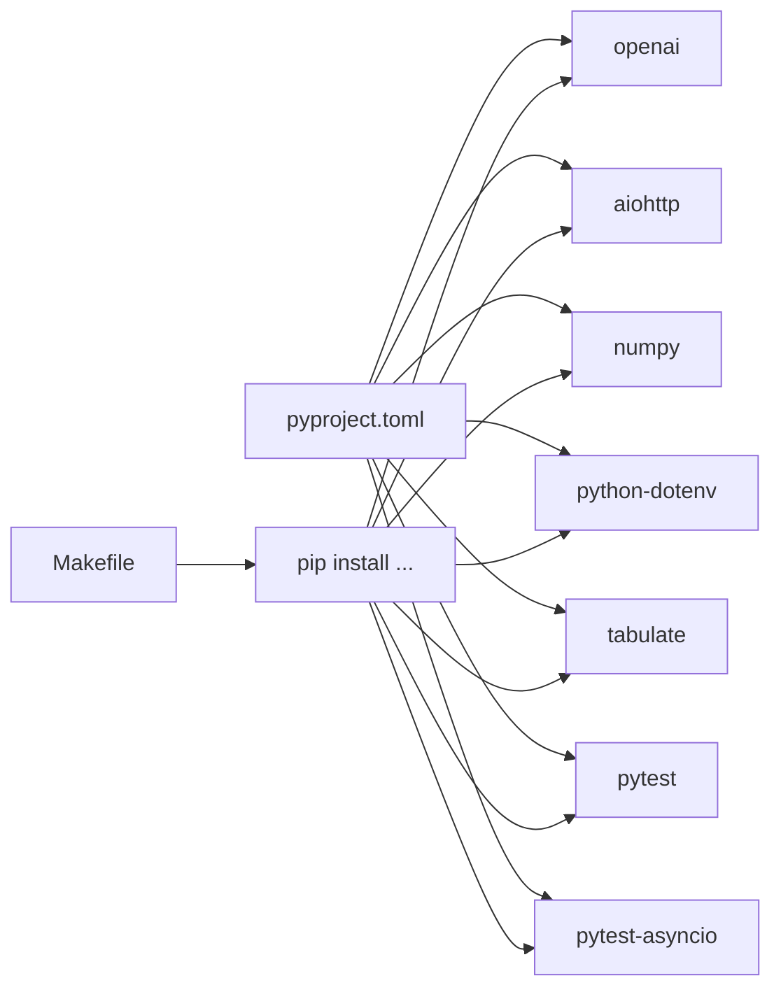

# Installation and Setup

<cite>
**Referenced Files in This Document**
- [pyproject.toml](file://pyproject.toml)
- [requirements.txt](file://requirements.txt)
- [Makefile](file://Makefile)
- [src/ptu_benchmark/__main__.py](file://src/ptu_benchmark/__main__.py)
- [src/ptu_benchmark/config.py](file://src/ptu_benchmark/config.py)
- [src/ptu_benchmark/reporter.py](file://src/ptu_benchmark/reporter.py)
- [src/ptu_benchmark/utils.py](file://src/ptu_benchmark/utils.py)
- [src/ptu_benchmark/scenarios/base.py](file://src/ptu_benchmark/scenarios/base.py)
- [src/ptu_benchmark/scenarios/scenario_a.py](file://src/ptu_benchmark/scenarios/scenario_a.py)
- [src/ptu_benchmark/scenarios/scenario_b.py](file://src/ptu_benchmark/scenarios/scenario_b.py)
- [src/ptu_benchmark/scenarios/scenario_c.py](file://src/ptu_benchmark/scenarios/scenario_c.py)
- [src/ptu_benchmark/scenarios/scenario_d.py](file://src/ptu_benchmark/scenarios/scenario_d.py)
- [src/ptu_benchmark/scenarios/scenario_e.py](file://src/ptu_benchmark/scenarios/scenario_e.py)
- [tests/test_config.py](file://tests/test_config.py)
- [tests/test_utils.py](file://tests/test_utils.py)
</cite>

## Table of Contents
1. [Introduction](#introduction)
2. [Project Structure](#project-structure)
3. [Core Components](#core-components)
4. [Architecture Overview](#architecture-overview)
5. [Detailed Component Analysis](#detailed-component-analysis)
6. [Dependency Analysis](#dependency-analysis)
7. [Performance Considerations](#performance-considerations)
8. [Troubleshooting Guide](#troubleshooting-guide)
9. [Conclusion](#conclusion)
10. [Appendices](#appendices)

## Introduction
This document provides end-to-end installation and setup instructions for PTU-Benchmark, a benchmarking suite designed to evaluate Alibaba Cloud Model Studio PTU (Provisioned Throughput Unit) performance. It covers prerequisites, environment configuration, installation steps, and the complete Proof of Concept (POC) workflow from deployment to results. It also includes troubleshooting guidance for common setup issues and environment variable validation.

## Project Structure
PTU-Benchmark is organized around a Python package with a CLI entry point, configuration management, scenario implementations, and reporting utilities. The Makefile provides convenient targets for installation, development setup, testing, and running benchmarks.

**Diagram sources**
- [Makefile:1-61](file://Makefile#L1-L61)
- [pyproject.toml:1-37](file://pyproject.toml#L1-L37)
- [requirements.txt:1-6](file://requirements.txt#L1-L6)
- [src/ptu_benchmark/__main__.py:1-150](file://src/ptu_benchmark/__main__.py#L1-L150)
- [src/ptu_benchmark/config.py:1-106](file://src/ptu_benchmark/config.py#L1-L106)
- [src/ptu_benchmark/reporter.py:1-189](file://src/ptu_benchmark/reporter.py#L1-L189)
- [src/ptu_benchmark/utils.py:1-156](file://src/ptu_benchmark/utils.py#L1-L156)
- [src/ptu_benchmark/scenarios/base.py:1-143](file://src/ptu_benchmark/scenarios/base.py#L1-L143)
- [src/ptu_benchmark/scenarios/scenario_a.py:1-102](file://src/ptu_benchmark/scenarios/scenario_a.py#L1-L102)
- [src/ptu_benchmark/scenarios/scenario_b.py:1-51](file://src/ptu_benchmark/scenarios/scenario_b.py#L1-L51)
- [src/ptu_benchmark/scenarios/scenario_c.py:1-106](file://src/ptu_benchmark/scenarios/scenario_c.py#L1-L106)
- [src/ptu_benchmark/scenarios/scenario_d.py:1-72](file://src/ptu_benchmark/scenarios/scenario_d.py#L1-L72)
- [src/ptu_benchmark/scenarios/scenario_e.py:1-103](file://src/ptu_benchmark/scenarios/scenario_e.py#L1-L103)
- [tests/test_config.py:1-42](file://tests/test_config.py#L1-L42)
- [tests/test_utils.py:1-80](file://tests/test_utils.py#L1-L80)

**Section sources**
- [Makefile:1-61](file://Makefile#L1-L61)
- [pyproject.toml:1-37](file://pyproject.toml#L1-L37)
- [requirements.txt:1-6](file://requirements.txt#L1-L6)

## Core Components
- CLI entry point: Provides argument parsing, environment loading, scenario selection, and result export.
- Configuration: Loads environment variables and .env files, validates required fields, and exposes scenario-specific parameters.
- Scenarios: Implement five distinct benchmarking scenarios (baseline, concurrent load, sustained throughput, peak burst, long context).
- Reporting: Prints summaries, exports JSON and CSV reports, and computes percentile metrics.
- Utilities: Defines prompts, result data structures, timing helpers, and long-context generation.

Key responsibilities:
- Environment configuration and validation ensure the benchmark can connect to the PTU endpoint with the correct credentials and model.
- Scenarios encapsulate workload logic and use asynchronous HTTP clients for throughput-heavy tests.
- Reporter aggregates and formats results for human-readable and machine-exportable formats.

**Section sources**
- [src/ptu_benchmark/__main__.py:1-150](file://src/ptu_benchmark/__main__.py#L1-L150)
- [src/ptu_benchmark/config.py:1-106](file://src/ptu_benchmark/config.py#L1-L106)
- [src/ptu_benchmark/reporter.py:1-189](file://src/ptu_benchmark/reporter.py#L1-L189)
- [src/ptu_benchmark/utils.py:1-156](file://src/ptu_benchmark/utils.py#L1-L156)
- [src/ptu_benchmark/scenarios/base.py:1-143](file://src/ptu_benchmark/scenarios/base.py#L1-L143)

## Architecture Overview
The benchmarking pipeline starts from the CLI, loads configuration from environment variables or a .env file, executes selected scenarios, and prints/exports results.

**Diagram sources**
- [src/ptu_benchmark/__main__.py:121-146](file://src/ptu_benchmark/__main__.py#L121-L146)
- [src/ptu_benchmark/config.py:47-106](file://src/ptu_benchmark/config.py#L47-L106)
- [src/ptu_benchmark/reporter.py:46-83](file://src/ptu_benchmark/reporter.py#L46-L83)

## Detailed Component Analysis

### Prerequisites
- Python 3.9 or newer.
- An Alibaba Cloud DashScope API key and a PTU model ID provisioned in your account.
- A PTU deployment configured to accept chat completions compatible with the specified base URL.

Environment variables used by the benchmark:
- DASHSCOPE_API_KEY: Your DashScope API key.
- PTU_MODEL_ID: The PTU model identifier.
- BASE_URL: Optional override for the API base URL (defaults to a compatible mode endpoint).
- CONCURRENCY_LEVELS: Comma-separated concurrency levels for Scenario B.
- SUSTAINED_DURATION: Duration in seconds for Scenario C sustained test.
- SUSTAINED_CONCURRENCY: Concurrency level for Scenario C.
- BURST_SIZE: Number of simultaneous requests for Scenario D.
- CONTEXT_SIZES: Comma-separated token counts for Scenario E (parsed into labeled buckets).

**Section sources**
- [pyproject.toml:9](file://pyproject.toml#L9)
- [src/ptu_benchmark/config.py:20-96](file://src/ptu_benchmark/config.py#L20-L96)

### Step-by-Step Installation
1) Install production dependencies
- Use the Makefile target to install dependencies from requirements.txt.
- Alternatively, install dependencies directly with pip.

2) Install development dependencies (optional)
- Use the Makefile target to add pytest and pytest-asyncio for local testing.

3) Prepare environment configuration
- Use the Makefile target to copy .env.example to .env if it does not exist.
- Edit .env to include your API key, model ID, and optional overrides.

4) Verify installation
- Run unit tests to confirm the environment is correctly set up.
- Optionally run a quick scenario to validate connectivity.

**Section sources**
- [Makefile:13-22](file://Makefile#L13-L22)
- [Makefile:16-18](file://Makefile#L16-L18)
- [Makefile:26-27](file://Makefile#L26-L27)
- [tests/test_config.py:16-29](file://tests/test_config.py#L16-L29)

### Environment Configuration (.env)
- Copy .env.example to .env if it does not exist.
- Set DASHSCOPE_API_KEY and PTU_MODEL_ID.
- Optionally set BASE_URL, CONCURRENCY_LEVELS, SUSTAINED_DURATION, SUSTAINED_CONCURRENCY, BURST_SIZE, and CONTEXT_SIZES.

Validation behavior:
- The CLI checks for missing required fields and exits with guidance if validation fails.

**Section sources**
- [Makefile:20-22](file://Makefile#L20-L22)
- [src/ptu_benchmark/__main__.py:129-139](file://src/ptu_benchmark/__main__.py#L129-L139)
- [src/ptu_benchmark/config.py:98-106](file://src/ptu_benchmark/config.py#L98-L106)

### Initial Verification Steps
- List available scenarios to confirm the CLI recognizes all scenarios.
- Run a single scenario (e.g., Scenario A) to validate connectivity and basic streaming.
- Export results to JSON and CSV to verify output generation.

**Section sources**
- [src/ptu_benchmark/__main__.py:81-86](file://src/ptu_benchmark/__main__.py#L81-L86)
- [Makefile:51-52](file://Makefile#L51-L52)
- [Makefile:31-32](file://Makefile#L31-L32)
- [src/ptu_benchmark/reporter.py:125-148](file://src/ptu_benchmark/reporter.py#L125-L148)
- [src/ptu_benchmark/reporter.py:151-188](file://src/ptu_benchmark/reporter.py#L151-L188)

### Complete POC Workflow
- Prepare environment: copy .env and set credentials.
- Run all scenarios: use the Makefile target to execute the full suite.
- Run individual scenarios: use scenario-specific Makefile targets.
- List scenarios: verify available scenarios before running.
- Export results: use the CLI flag to export JSON and CSV.

**Diagram sources**
- [Makefile:20-22](file://Makefile#L20-L22)
- [Makefile:13-14](file://Makefile#L13-L14)
- [Makefile:26-27](file://Makefile#L26-L27)
- [Makefile:31-32](file://Makefile#L31-L32)
- [src/ptu_benchmark/reporter.py:125-148](file://src/ptu_benchmark/reporter.py#L125-L148)
- [src/ptu_benchmark/reporter.py:151-188](file://src/ptu_benchmark/reporter.py#L151-L188)

**Section sources**
- [Makefile:1-61](file://Makefile#L1-L61)
- [src/ptu_benchmark/__main__.py:121-146](file://src/ptu_benchmark/__main__.py#L121-L146)
- [src/ptu_benchmark/reporter.py:125-148](file://src/ptu_benchmark/reporter.py#L125-L148)
- [src/ptu_benchmark/reporter.py:151-188](file://src/ptu_benchmark/reporter.py#L151-L188)

### Scenario Execution Details
- Scenario A (Baseline): Measures TTFT and TPS for short and long prompts.
- Scenario B (Concurrent Load): Runs concurrent requests at configured concurrency levels.
- Scenario C (Sustained Throughput): Maintains sustained load for a configurable duration.
- Scenario D (Peak Burst): Sends a large burst of simultaneous requests.
- Scenario E (Long Context): Tests performance with increasing input context sizes.

Asynchronous infrastructure:
- Scenario B and C use an async HTTP client to issue concurrent requests and parse SSE streams.
- Scenario A and E use the OpenAI SDK for streaming chat completions.

**Section sources**
- [src/ptu_benchmark/scenarios/scenario_a.py:32-57](file://src/ptu_benchmark/scenarios/scenario_a.py#L32-L57)
- [src/ptu_benchmark/scenarios/scenario_b.py:25-50](file://src/ptu_benchmark/scenarios/scenario_b.py#L25-L50)
- [src/ptu_benchmark/scenarios/scenario_c.py:28-105](file://src/ptu_benchmark/scenarios/scenario_c.py#L28-L105)
- [src/ptu_benchmark/scenarios/scenario_d.py:26-71](file://src/ptu_benchmark/scenarios/scenario_d.py#L26-L71)
- [src/ptu_benchmark/scenarios/scenario_e.py:33-60](file://src/ptu_benchmark/scenarios/scenario_e.py#L33-L60)
- [src/ptu_benchmark/scenarios/base.py:47-142](file://src/ptu_benchmark/scenarios/base.py#L47-L142)

## Dependency Analysis
- Core runtime dependencies include the OpenAI client, asynchronous HTTP client, NumPy, environment variable loader, and tabulate for reporting.
- Development dependencies include pytest and pytest-asyncio for testing.
- The CLI registers as a console script for easy invocation.

**Diagram sources**
- [pyproject.toml:14-26](file://pyproject.toml#L14-L26)
- [requirements.txt:1-6](file://requirements.txt#L1-L6)
- [Makefile:13-18](file://Makefile#L13-L18)

**Section sources**
- [pyproject.toml:14-26](file://pyproject.toml#L14-L26)
- [requirements.txt:1-6](file://requirements.txt#L1-L6)
- [Makefile:13-18](file://Makefile#L13-L18)

## Performance Considerations
- Asynchronous execution: Scenarios B and C rely on asynchronous HTTP requests to maximize throughput. Ensure adequate system limits for concurrent connections.
- Token estimation: Scenario E generates long input contexts; consider memory and network bandwidth when scaling context sizes.
- Export overhead: JSON and CSV exports are performed after scenario completion; avoid running extremely large suites without disk space planning.

[No sources needed since this section provides general guidance]

## Troubleshooting Guide
Common issues and resolutions:
- Missing required environment variables:
  - Symptom: Validation errors indicating missing API key or model ID.
  - Resolution: Set DASHSCOPE_API_KEY and PTU_MODEL_ID in .env and rerun.
- Incorrect model ID or API key:
  - Symptom: Authentication or model not found errors.
  - Resolution: Verify credentials and model provisioning in Alibaba Cloud dashscope.
- Rate limiting during sustained or burst scenarios:
  - Symptom: 429 errors observed in scenario outputs.
  - Resolution: Reduce concurrency or burst size; note that PTU capacity applies.
- Network or base URL misconfiguration:
  - Symptom: Connection failures or unexpected base URL behavior.
  - Resolution: Override BASE_URL if using a custom endpoint; otherwise use the default compatible mode URL.
- Dependency conflicts:
  - Symptom: Import errors or incompatible versions.
  - Resolution: Use the provided requirements.txt or pyproject.toml to align versions; avoid mixing system and virtualenv packages.

Validation and testing:
- Use the built-in validation to catch missing fields early.
- Run unit tests to validate configuration parsing and utilities.

**Section sources**
- [src/ptu_benchmark/__main__.py:129-139](file://src/ptu_benchmark/__main__.py#L129-L139)
- [src/ptu_benchmark/config.py:98-106](file://src/ptu_benchmark/config.py#L98-L106)
- [tests/test_config.py:16-29](file://tests/test_config.py#L16-L29)
- [tests/test_utils.py:14-26](file://tests/test_utils.py#L14-L26)

## Conclusion
You now have the complete setup and operational guidance to deploy PTU-Benchmark, configure the environment, run the POC workflow, and interpret results. Use the Makefile targets for convenience and the CLI for flexible execution. Validate your environment with unit tests and the built-in configuration validator before running extended benchmarks.

[No sources needed since this section summarizes without analyzing specific files]

## Appendices

### Environment Variables Reference
- DASHSCOPE_API_KEY: Required. Your DashScope API key.
- PTU_MODEL_ID: Required. The PTU model identifier.
- BASE_URL: Optional. API base URL override.
- CONCURRENCY_LEVELS: Optional. Comma-separated concurrency levels for Scenario B.
- SUSTAINED_DURATION: Optional. Seconds for Scenario C sustained test.
- SUSTAINED_CONCURRENCY: Optional. Concurrency for Scenario C.
- BURST_SIZE: Optional. Number of simultaneous requests for Scenario D.
- CONTEXT_SIZES: Optional. Comma-separated token counts for Scenario E.

**Section sources**
- [src/ptu_benchmark/config.py:20-96](file://src/ptu_benchmark/config.py#L20-L96)

### Example .env Configuration
- DASHSCOPE_API_KEY=your_dashscope_api_key
- PTU_MODEL_ID=your_ptu_model_id
- BASE_URL=https://dashscope-intl.aliyuncs.com/compatible-mode/v1
- CONCURRENCY_LEVELS=10,50,100
- SUSTAINED_DURATION=1800
- SUSTAINED_CONCURRENCY=20
- BURST_SIZE=200
- CONTEXT_SIZES=32000,64000,128000

**Section sources**
- [src/ptu_benchmark/config.py:20-96](file://src/ptu_benchmark/config.py#L20-L96)