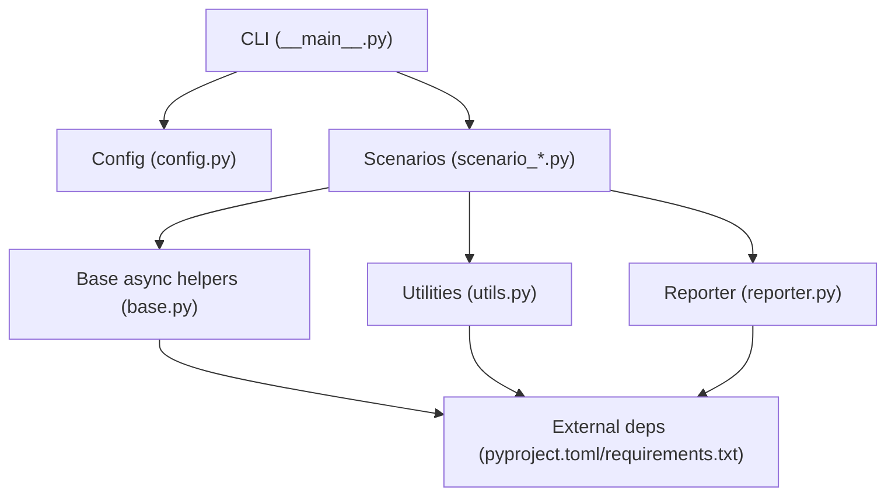
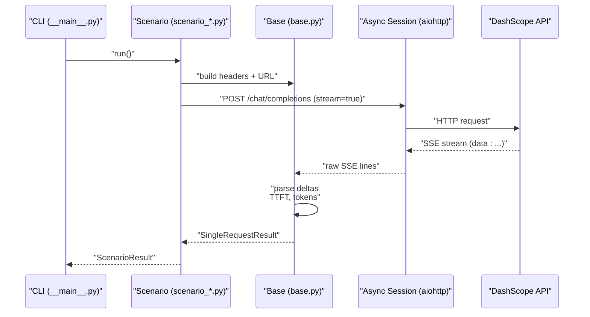
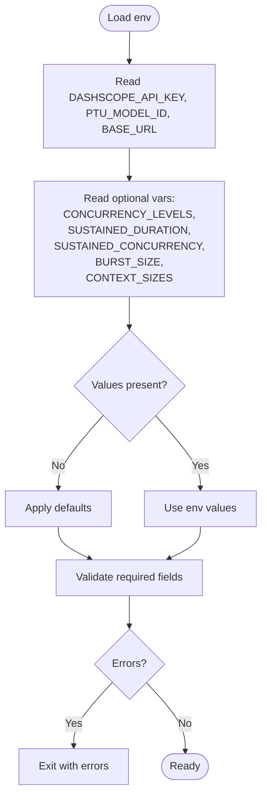
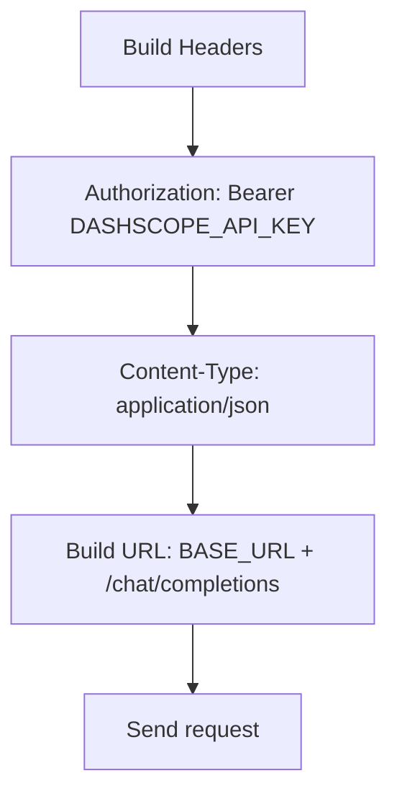
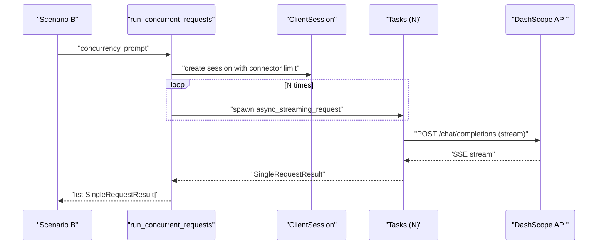
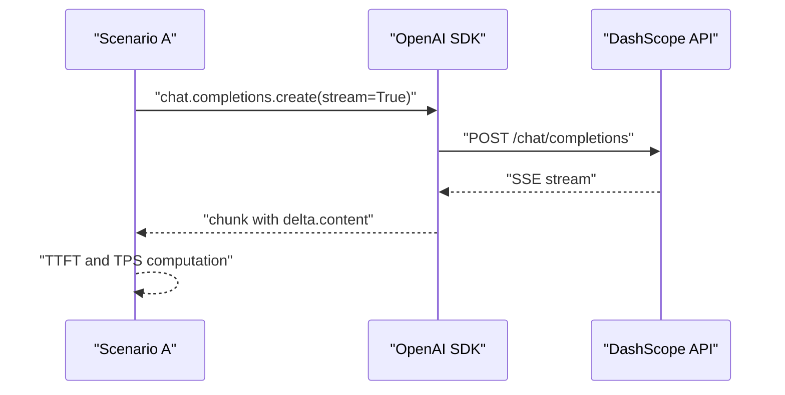
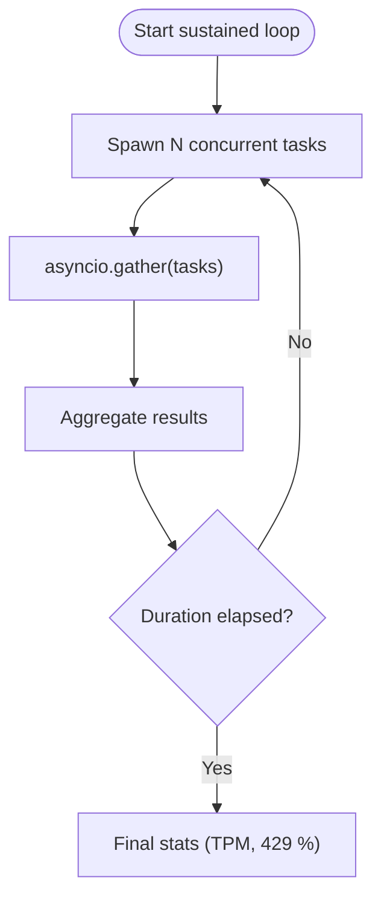
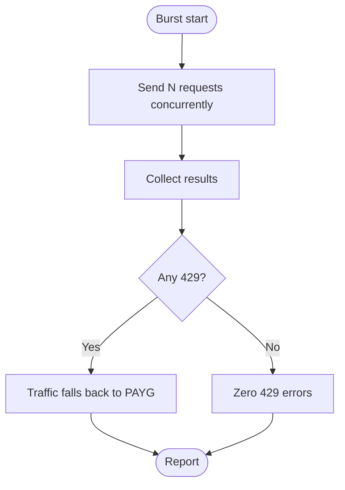
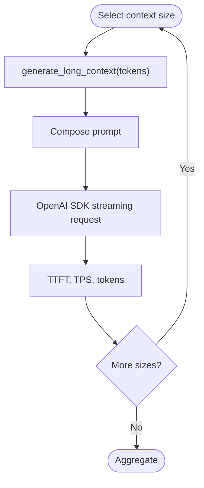
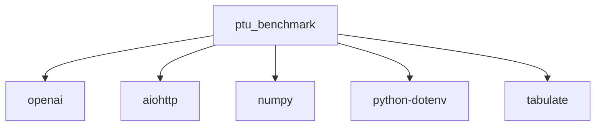

# API Integration

<cite>
**Referenced Files in This Document**
- [__main__.py](file://src/ptu_benchmark/__main__.py)
- [config.py](file://src/ptu_benchmark/config.py)
- [base.py](file://src/ptu_benchmark/scenarios/base.py)
- [scenario_a.py](file://src/ptu_benchmark/scenarios/scenario_a.py)
- [scenario_b.py](file://src/ptu_benchmark/scenarios/scenario_b.py)
- [scenario_c.py](file://src/ptu_benchmark/scenarios/scenario_c.py)
- [scenario_d.py](file://src/ptu_benchmark/scenarios/scenario_d.py)
- [scenario_e.py](file://src/ptu_benchmark/scenarios/scenario_e.py)
- [utils.py](file://src/ptu_benchmark/utils.py)
- [reporter.py](file://src/ptu_benchmark/reporter.py)
- [pyproject.toml](file://pyproject.toml)
- [requirements.txt](file://requirements.txt)
- [test_config.py](file://tests/test_config.py)
- [test_utils.py](file://tests/test_utils.py)
</cite>

## Table of Contents
1. [Introduction](#introduction)
2. [Project Structure](#project-structure)
3. [Core Components](#core-components)
4. [Architecture Overview](#architecture-overview)
5. [Detailed Component Analysis](#detailed-component-analysis)
6. [Dependency Analysis](#dependency-analysis)
7. [Performance Considerations](#performance-considerations)
8. [Troubleshooting Guide](#troubleshooting-guide)
9. [Conclusion](#conclusion)
10. [Appendices](#appendices)

## Introduction
This document explains how the PTU Benchmark integrates with Alibaba Cloud DashScope Model Studio’s Provisioned Throughput Unit (PTU) via an OpenAI-compatible API. It covers:
- OpenAI-compatible API integration and streaming behavior
- Server-Sent Events (SSE) streaming parsing and real-time token counting
- Authentication via DASHSCOPE_API_KEY and endpoint configuration via BASE_URL
- Async HTTP operations using aiohttp, connection pooling, and concurrency controls
- Error handling, rate limiting, and retry strategies
- Differences from shared Token API behavior and practical troubleshooting guidance

## Project Structure
The benchmark is organized around a CLI entry point, configuration management, scenario implementations, shared utilities, and reporting. The scenarios exercise different traffic patterns against the DashScope compatible API.



**Diagram sources**
- [__main__.py:121-149](file://src/ptu_benchmark/__main__.py#L121-L149)
- [config.py:47-96](file://src/ptu_benchmark/config.py#L47-L96)
- [base.py:20-143](file://src/ptu_benchmark/scenarios/base.py#L20-L143)
- [scenario_a.py:23-102](file://src/ptu_benchmark/scenarios/scenario_a.py#L23-L102)
- [scenario_b.py:19-51](file://src/ptu_benchmark/scenarios/scenario_b.py#L19-L51)
- [scenario_c.py:22-106](file://src/ptu_benchmark/scenarios/scenario_c.py#L22-L106)
- [scenario_d.py:20-72](file://src/ptu_benchmark/scenarios/scenario_d.py#L20-L72)
- [scenario_e.py:25-103](file://src/ptu_benchmark/scenarios/scenario_e.py#L25-L103)
- [utils.py:134-156](file://src/ptu_benchmark/utils.py#L134-L156)
- [reporter.py:25-189](file://src/ptu_benchmark/reporter.py#L25-L189)
- [pyproject.toml:14-20](file://pyproject.toml#L14-L20)
- [requirements.txt:1-6](file://requirements.txt#L1-L6)

**Section sources**
- [__main__.py:39-78](file://src/ptu_benchmark/__main__.py#L39-L78)
- [config.py:16-106](file://src/ptu_benchmark/config.py#L16-L106)

## Core Components
- Configuration and environment loading: centralizes API key, model ID, base URL, and scenario-specific tunables.
- Scenario base class and async helpers: provides OpenAI-compatible request building, SSE streaming parsing, and concurrent request orchestration.
- Scenario implementations: define traffic patterns (single, concurrent, sustained, burst, long context).
- Utilities: result models, timing helpers, SSE parsing, and prompt generators.
- Reporter: console summaries, JSON/CSV exports, and comparison views.

Key integration points:
- Authentication header: Authorization Bearer scheme using DASHSCOPE_API_KEY.
- Endpoint: chat/completions under BASE_URL (default compatible-mode endpoint).
- Streaming: SSE parsing for delta content and token counting.
- Concurrency: TCPConnector limits and asyncio Semaphore for sustained loads.

**Section sources**
- [config.py:21-23](file://src/ptu_benchmark/config.py#L21-L23)
- [base.py:33-40](file://src/ptu_benchmark/scenarios/base.py#L33-L40)
- [base.py:47-143](file://src/ptu_benchmark/scenarios/base.py#L47-L143)
- [utils.py:45-91](file://src/ptu_benchmark/utils.py#L45-L91)
- [reporter.py:32-83](file://src/ptu_benchmark/reporter.py#L32-L83)

## Architecture Overview
The benchmark runs scenarios that send OpenAI-compatible chat completions requests to DashScope. Responses are streamed via SSE. The base module parses SSE deltas to compute TTFT and TPS. Concurrency is controlled via aiohttp connectors and semaphores.



**Diagram sources**
- [__main__.py:103-118](file://src/ptu_benchmark/__main__.py#L103-L118)
- [scenario_b.py:31-38](file://src/ptu_benchmark/scenarios/scenario_b.py#L31-L38)
- [scenario_c.py:69-71](file://src/ptu_benchmark/scenarios/scenario_c.py#L69-L71)
- [base.py:47-112](file://src/ptu_benchmark/scenarios/base.py#L47-L112)

## Detailed Component Analysis

### Configuration and Environment
- Loads DASHSCOPE_API_KEY, PTU_MODEL_ID, BASE_URL, and optional tuning variables from environment or .env.
- Validates presence of required keys and provides defaults for optional settings.
- Provides scenario-specific parameters (concurrency levels, sustained duration/concurrency, burst size, context sizes).



**Diagram sources**
- [config.py:47-96](file://src/ptu_benchmark/config.py#L47-L96)
- [config.py:98-106](file://src/ptu_benchmark/config.py#L98-L106)

**Section sources**
- [config.py:47-96](file://src/ptu_benchmark/config.py#L47-L96)
- [config.py:98-106](file://src/ptu_benchmark/config.py#L98-L106)
- [test_config.py:8-42](file://tests/test_config.py#L8-L42)

### Authentication and Endpoint Configuration
- Authentication: Authorization header with Bearer token derived from DASHSCOPE_API_KEY.
- Endpoint: base_url + "/chat/completions" for OpenAI-compatible mode.
- Default base_url targets DashScope international compatible-mode endpoint.



**Diagram sources**
- [base.py:33-40](file://src/ptu_benchmark/scenarios/base.py#L33-L40)
- [config.py:83-86](file://src/ptu_benchmark/config.py#L83-L86)

**Section sources**
- [base.py:33-40](file://src/ptu_benchmark/scenarios/base.py#L33-L40)
- [config.py:21-23](file://src/ptu_benchmark/config.py#L21-L23)
- [config.py:83-86](file://src/ptu_benchmark/config.py#L83-L86)

### SSE Streaming and Real-Time Token Parsing
- Streams SSE responses and counts tokens from delta content.
- Computes TTFT as time from request start to first token.
- Computes TPS as tokens / generation time after first token.
- Handles 429 responses distinctly and records other HTTP errors.

```mermaid
flowchart TD
Start(["Start request"]) --> Stream["Receive SSE lines"]
Stream --> LineCheck{"Line starts with 'data: '?<br/>Skip '[DONE]'"]
LineCheck --> |No| Stream
LineCheck --> |Yes| Parse["Parse JSON payload"]
Parse --> Delta{"Has 'choices[0].delta.content'?"}
Delta --> |Yes| FirstTTFT{"TTFT seen?"}
FirstTTFT --> |No| SetTTFT["Set first_token_time"]
FirstTTFT --> |Yes| IncTok["Increment tokens"]
Delta --> |No| Stream
SetTTFT --> IncTok
IncTok --> Stream
Stream --> Done(["Compute TTFT and TPS"])
```

**Diagram sources**
- [base.py:78-112](file://src/ptu_benchmark/scenarios/base.py#L78-L112)
- [utils.py:134-156](file://src/ptu_benchmark/utils.py#L134-L156)

**Section sources**
- [base.py:47-112](file://src/ptu_benchmark/scenarios/base.py#L47-L112)
- [utils.py:134-156](file://src/ptu_benchmark/utils.py#L134-L156)

### Async HTTP Operations, Connection Pooling, and Concurrency
- Uses aiohttp.ClientSession with TCPConnector limit tuned by concurrency.
- Scenario B: fires N concurrent requests and aggregates results.
- Scenario C: sustained load with a Semaphore to cap concurrent workers over time.
- Scenario D: burst load with N simultaneous requests.



**Diagram sources**
- [scenario_b.py:31-38](file://src/ptu_benchmark/scenarios/scenario_b.py#L31-L38)
- [base.py:115-143](file://src/ptu_benchmark/scenarios/base.py#L115-L143)

**Section sources**
- [base.py:115-143](file://src/ptu_benchmark/scenarios/base.py#L115-L143)
- [scenario_b.py:25-51](file://src/ptu_benchmark/scenarios/scenario_b.py#L25-L51)
- [scenario_c.py:56-77](file://src/ptu_benchmark/scenarios/scenario_c.py#L56-L77)
- [scenario_d.py:30-37](file://src/ptu_benchmark/scenarios/scenario_d.py#L30-L37)

### Scenario A: Single Request Baseline (OpenAI SDK)
- Demonstrates OpenAI-compatible API usage with streaming via the official SDK.
- Measures TTFT and TPS similarly to the async SSE path.



**Diagram sources**
- [scenario_a.py:69-88](file://src/ptu_benchmark/scenarios/scenario_a.py#L69-L88)

**Section sources**
- [scenario_a.py:23-102](file://src/ptu_benchmark/scenarios/scenario_a.py#L23-L102)

### Scenario C: Sustained Throughput (30-min Window)
- Maintains steady concurrency over time using a Semaphore.
- Periodically reports TPM and tracks 429 occurrences.



**Diagram sources**
- [scenario_c.py:73-105](file://src/ptu_benchmark/scenarios/scenario_c.py#L73-L105)

**Section sources**
- [scenario_c.py:28-106](file://src/ptu_benchmark/scenarios/scenario_c.py#L28-L106)

### Scenario D: Peak Burst Test
- Sends a large burst of simultaneous requests to evaluate PTU capacity.
- Reports success rate, 429 errors, and notes fallback behavior.



**Diagram sources**
- [scenario_d.py:26-72](file://src/ptu_benchmark/scenarios/scenario_d.py#L26-L72)

**Section sources**
- [scenario_d.py:20-72](file://src/ptu_benchmark/scenarios/scenario_d.py#L20-L72)

### Scenario E: Long Context Test
- Builds prompts with increasing token counts and measures performance.
- Uses the OpenAI SDK for streaming.



**Diagram sources**
- [scenario_e.py:42-103](file://src/ptu_benchmark/scenarios/scenario_e.py#L42-L103)

**Section sources**
- [scenario_e.py:25-103](file://src/ptu_benchmark/scenarios/scenario_e.py#L25-L103)

### PTU vs Shared Token API Behavior
- PTU guarantees throughput and reduces 429 errors under sustained/burst loads compared to shared Token API.
- The benchmark highlights this difference by measuring 429 rates and TPM consistency.

**Section sources**
- [scenario_d.py:59-65](file://src/ptu_benchmark/scenarios/scenario_d.py#L59-L65)
- [reporter.py:89-119](file://src/ptu_benchmark/reporter.py#L89-L119)

## Dependency Analysis
External dependencies include the OpenAI SDK, aiohttp, numpy, python-dotenv, and tabulate. These enable OpenAI-compatible API usage, async HTTP streaming, numerical statistics, environment variable loading, and formatted reporting.



**Diagram sources**
- [pyproject.toml:14-20](file://pyproject.toml#L14-L20)
- [requirements.txt:1-6](file://requirements.txt#L1-L6)

**Section sources**
- [pyproject.toml:14-20](file://pyproject.toml#L14-L20)
- [requirements.txt:1-6](file://requirements.txt#L1-L6)

## Performance Considerations
- Connection pooling: tune TCPConnector limit based on concurrency to avoid socket exhaustion.
- Concurrency caps: use semaphores for sustained scenarios to prevent overload.
- Payload sizing: adjust max_tokens per scenario to balance measurement fidelity and throughput.
- Reporting overhead: keep SSE parsing minimal to avoid skewing TTFT/TPS.

[No sources needed since this section provides general guidance]

## Troubleshooting Guide
Common issues and remedies:
- Missing credentials: ensure DASHSCOPE_API_KEY and PTU_MODEL_ID are set; validation errors will be printed at startup.
- Wrong base URL: confirm BASE_URL points to the compatible-mode endpoint for OpenAI compatibility.
- 429 errors under load: expected in shared Token API; PTU should reduce 429 frequency; review sustained/burst configurations.
- Network timeouts or non-200 responses: inspect error tagging and logs; verify model availability and quotas.
- SSE parsing failures: ensure server sends valid SSE data lines; the parser ignores non-data and [DONE] lines.

Operational checks:
- Verify environment loading and defaults using the configuration tests.
- Confirm result aggregation filters for success/rate-limited/error states.

**Section sources**
- [config.py:98-106](file://src/ptu_benchmark/config.py#L98-L106)
- [base.py:64-78](file://src/ptu_benchmark/scenarios/base.py#L64-L78)
- [utils.py:77-80](file://src/ptu_benchmark/utils.py#L77-L80)
- [test_config.py:16-29](file://tests/test_config.py#L16-L29)

## Conclusion
The PTU Benchmark integrates with Alibaba Cloud DashScope via an OpenAI-compatible API, leveraging aiohttp for robust async streaming and concurrency control. It measures TTFT and TPS, evaluates sustained and burst behavior, and distinguishes PTU performance from shared Token API limitations. Proper configuration of credentials and endpoints, combined with careful connection pooling and concurrency management, yields reliable and actionable performance insights.

[No sources needed since this section summarizes without analyzing specific files]

## Appendices

### API Integration Checklist
- Set DASHSCOPE_API_KEY and PTU_MODEL_ID.
- Confirm BASE_URL points to the compatible-mode endpoint.
- Choose appropriate max_tokens per scenario.
- Tune concurrency and connector limits for desired load.
- Monitor 429 rates and TPM during sustained tests.

**Section sources**
- [config.py:83-86](file://src/ptu_benchmark/config.py#L83-L86)
- [scenario_c.py:48-50](file://src/ptu_benchmark/scenarios/scenario_c.py#L48-L50)