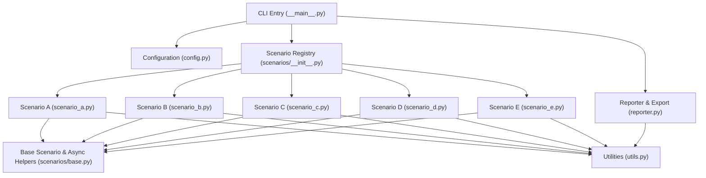
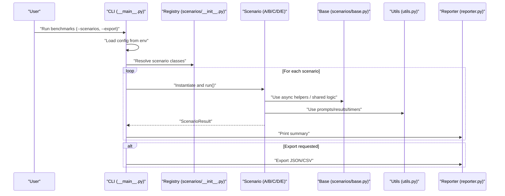
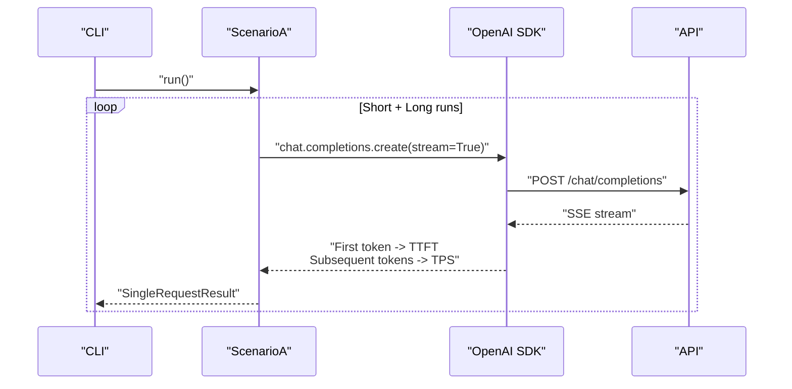
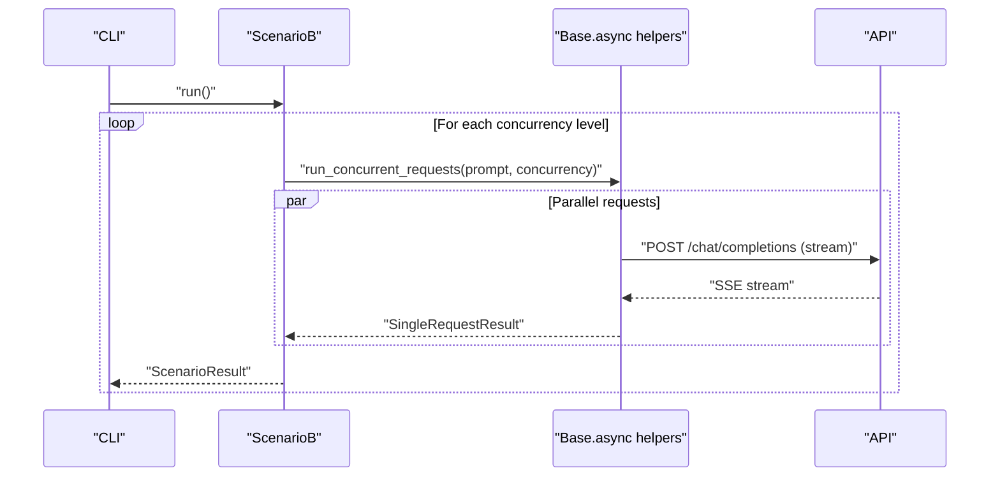
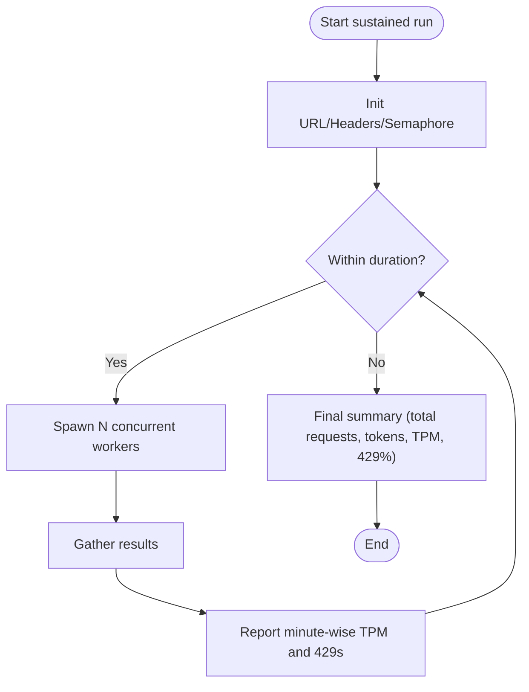
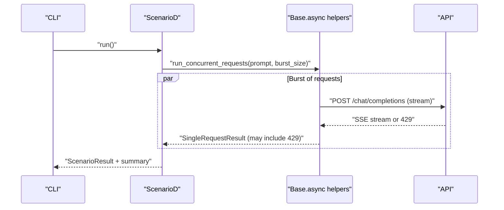
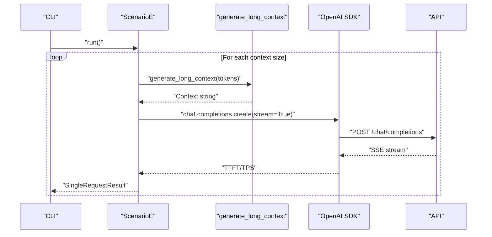
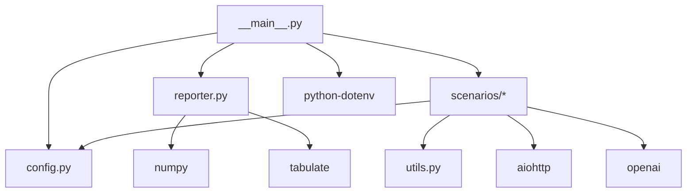

# Benchmark Scenarios Overview

<cite>
**Referenced Files in This Document**
- [__main__.py](file://src/ptu_benchmark/__main__.py)
- [config.py](file://src/ptu_benchmark/config.py)
- [reporter.py](file://src/ptu_benchmark/reporter.py)
- [utils.py](file://src/ptu_benchmark/utils.py)
- [scenarios/__init__.py](file://src/ptu_benchmark/scenarios/__init__.py)
- [scenarios/base.py](file://src/ptu_benchmark/scenarios/base.py)
- [scenarios/scenario_a.py](file://src/ptu_benchmark/scenarios/scenario_a.py)
- [scenarios/scenario_b.py](file://src/ptu_benchmark/scenarios/scenario_b.py)
- [scenarios/scenario_c.py](file://src/ptu_benchmark/scenarios/scenario_c.py)
- [scenarios/scenario_d.py](file://src/ptu_benchmark/scenarios/scenario_d.py)
- [scenarios/scenario_e.py](file://src/ptu_benchmark/scenarios/scenario_e.py)
- [test_config.py](file://tests/test_config.py)
- [test_utils.py](file://tests/test_utils.py)
</cite>

## Table of Contents
1. [Introduction](#introduction)
2. [Project Structure](#project-structure)
3. [Core Components](#core-components)
4. [Architecture Overview](#architecture-overview)
5. [Detailed Component Analysis](#detailed-component-analysis)
6. [Dependency Analysis](#dependency-analysis)
7. [Performance Considerations](#performance-considerations)
8. [Troubleshooting Guide](#troubleshooting-guide)
9. [Conclusion](#conclusion)
10. [Appendices](#appendices)

## Introduction
This document explains the five benchmark scenarios that define PTU (Provisioned Throughput Unit) performance testing. It covers the purpose, methodology, and metrics for each scenario, along with expected outcomes and how they demonstrate PTU’s advantages over shared Token API environments:
- Scenario A: Single Request Baseline (TTFT/TPS)
- Scenario B: Concurrent Load (10/50/100 parallel requests)
- Scenario C: Sustained Throughput (30 minutes)
- Scenario D: Peak Burst (traffic spike validation)
- Scenario E: Long Context (32K/64K/128K token inputs)

It also documents the performance metrics measured (TTFT, TPS, concurrent throughput, sustained TPM, 429 error rates), their business significance, duration estimates, and how each scenario highlights different aspects of PTU reliability and throughput guarantees.

## Project Structure
The benchmark suite is organized around a CLI entry point, configuration management, shared utilities, scenario implementations, and reporting/export capabilities.

**Diagram sources**
- [__main__.py:121-149](file://src/ptu_benchmark/__main__.py#L121-L149)
- [config.py:47-96](file://src/ptu_benchmark/config.py#L47-L96)
- [scenarios/__init__.py:12-19](file://src/ptu_benchmark/scenarios/__init__.py#L12-L19)
- [scenarios/base.py:20-142](file://src/ptu_benchmark/scenarios/base.py#L20-L142)
- [scenarios/scenario_a.py:23-101](file://src/ptu_benchmark/scenarios/scenario_a.py#L23-L101)
- [scenarios/scenario_b.py:19-50](file://src/ptu_benchmark/scenarios/scenario_b.py#L19-L50)
- [scenarios/scenario_c.py:22-105](file://src/ptu_benchmark/scenarios/scenario_c.py#L22-L105)
- [scenarios/scenario_d.py:20-71](file://src/ptu_benchmark/scenarios/scenario_d.py#L20-L71)
- [scenarios/scenario_e.py:25-102](file://src/ptu_benchmark/scenarios/scenario_e.py#L25-L102)
- [utils.py:45-155](file://src/ptu_benchmark/utils.py#L45-L155)
- [reporter.py:25-188](file://src/ptu_benchmark/reporter.py#L25-L188)

**Section sources**
- [__main__.py:39-149](file://src/ptu_benchmark/__main__.py#L39-L149)
- [config.py:16-106](file://src/ptu_benchmark/config.py#L16-L106)
- [scenarios/__init__.py:12-29](file://src/ptu_benchmark/scenarios/__init__.py#L12-L29)
- [utils.py:13-155](file://src/ptu_benchmark/utils.py#L13-L155)
- [reporter.py:21-188](file://src/ptu_benchmark/reporter.py#L21-L188)

## Core Components
- Configuration: Centralized settings loaded from environment variables, including concurrency levels, burst size, sustained duration/concurrency, and token limits.
- Scenario Base: Shared async request helpers and base class for all scenarios, including streaming request parsing and concurrent runner.
- Scenario Implementations: Specialized logic for each scenario, using the base infrastructure and utilities.
- Utilities: Prompt templates, result data models, timing helpers, and long-context generator.
- Reporter: Console summaries, percentile calculations, and JSON/CSV export.

Key metrics and their business significance:
- TTFT (Time To First Token): Measures perceived responsiveness; lower is better.
- TPS (Tokens Per Second): Generation throughput; higher indicates efficient tokenization/generation.
- Concurrent throughput: Validates stability under parallel load; PTU maintains low 429s and stable TTFT/TPS.
- Sustained TPM: Demonstrates long-term throughput guarantees; PTU maintains steady output over 30 minutes.
- 429 error rates: Indicates rate limiting; PTU minimizes 429s compared to shared Token API under similar loads.

**Section sources**
- [config.py:16-106](file://src/ptu_benchmark/config.py#L16-L106)
- [scenarios/base.py:20-142](file://src/ptu_benchmark/scenarios/base.py#L20-L142)
- [utils.py:45-91](file://src/ptu_benchmark/utils.py#L45-L91)
- [reporter.py:46-83](file://src/ptu_benchmark/reporter.py#L46-L83)

## Architecture Overview
The CLI orchestrates scenario execution, validates configuration, prints summaries, and exports results. Each scenario leverages shared async helpers to issue streaming requests and compute metrics.

**Diagram sources**
- [__main__.py:88-145](file://src/ptu_benchmark/__main__.py#L88-L145)
- [scenarios/__init__.py:12-19](file://src/ptu_benchmark/scenarios/__init__.py#L12-L19)
- [scenarios/base.py:47-142](file://src/ptu_benchmark/scenarios/base.py#L47-L142)
- [utils.py:45-155](file://src/ptu_benchmark/utils.py#L45-L155)
- [reporter.py:125-188](file://src/ptu_benchmark/reporter.py#L125-L188)

## Detailed Component Analysis

### Scenario A: Single Request Baseline (TTFT/TPS)
Purpose:
- Establish baseline latency and generation throughput for a single request under minimal contention.

Methodology:
- Executes multiple short and long prompt runs using the OpenAI SDK with streaming enabled.
- Computes TTFT (milliseconds) and TPS (tokens per second) from streamed chunks.

Metrics:
- TTFT percentiles (P50/P95/P99), TPS average/min/max, estimated TPM.

Duration estimate:
- Short runs: few seconds per iteration; long runs: tens of seconds.

Expected outcome:
- Low TTFT and stable TPS; serves as a performance anchor for subsequent scenarios.

**Diagram sources**
- [scenarios/scenario_a.py:32-101](file://src/ptu_benchmark/scenarios/scenario_a.py#L32-L101)
- [utils.py:45-58](file://src/ptu_benchmark/utils.py#L45-L58)

**Section sources**
- [scenarios/scenario_a.py:23-101](file://src/ptu_benchmark/scenarios/scenario_a.py#L23-L101)
- [utils.py:17-23](file://src/ptu_benchmark/utils.py#L17-L23)
- [reporter.py:32-43](file://src/ptu_benchmark/reporter.py#L32-L43)

### Scenario B: Concurrent Load (10/50/100 parallel requests)
Purpose:
- Measure throughput degradation and stability under increasing concurrency.

Methodology:
- Runs concurrent batches at predefined concurrency levels using shared async helpers.
- Each request streams tokens; results aggregated to assess TTFT/TPS and 429 rates.

Metrics:
- TTFT percentiles, TPS distribution, 429 error counts, and pass/fail thresholds per concurrency level.

Duration estimate:
- Seconds to minutes depending on concurrency and network conditions.

Expected outcome:
- PTU maintains stable TTFT/TPS and minimal 429s across 10/50/100 concurrent requests.

**Diagram sources**
- [scenarios/scenario_b.py:25-50](file://src/ptu_benchmark/scenarios/scenario_b.py#L25-L50)
- [scenarios/base.py:115-142](file://src/ptu_benchmark/scenarios/base.py#L115-L142)

**Section sources**
- [scenarios/scenario_b.py:19-50](file://src/ptu_benchmark/scenarios/scenario_b.py#L19-L50)
- [scenarios/base.py:115-142](file://src/ptu_benchmark/scenarios/base.py#L115-L142)
- [config.py:25-27](file://src/ptu_benchmark/config.py#L25-L27)

### Scenario C: Sustained Throughput (30-minute window)
Purpose:
- Demonstrate PTU’s ability to sustain guaranteed throughput over extended periods.

Methodology:
- Maintains a fixed concurrency for a configurable duration, continuously issuing streaming requests.
- Periodically reports cumulative tokens and TPM; tracks 429 errors.

Metrics:
- Average TPM over the window, total tokens, 429 error count and percentage.

Duration estimate:
- 30 minutes by default.

Expected outcome:
- Consistent TPM with minimal 429s; validates long-term throughput guarantees.

**Diagram sources**
- [scenarios/scenario_c.py:37-105](file://src/ptu_benchmark/scenarios/scenario_c.py#L37-L105)
- [scenarios/base.py:47-112](file://src/ptu_benchmark/scenarios/base.py#L47-L112)

**Section sources**
- [scenarios/scenario_c.py:22-105](file://src/ptu_benchmark/scenarios/scenario_c.py#L22-L105)
- [config.py:28-30](file://src/ptu_benchmark/config.py#L28-L30)
- [reporter.py:89-118](file://src/ptu_benchmark/reporter.py#L89-L118)

### Scenario D: Peak Burst (traffic spike validation)
Purpose:
- Validate PTU resilience under sudden spikes of simultaneous requests.

Methodology:
- Sends a large burst of requests concurrently and reports success rates, 429s, and other errors.

Metrics:
- Successful/429/other error counts and percentages.

Duration estimate:
- Seconds to a minute depending on burst size.

Expected outcome:
- Zero 429s up to PTU capacity; excess traffic falls back to PAYG without service interruption.

**Diagram sources**
- [scenarios/scenario_d.py:26-71](file://src/ptu_benchmark/scenarios/scenario_d.py#L26-L71)
- [scenarios/base.py:115-142](file://src/ptu_benchmark/scenarios/base.py#L115-L142)

**Section sources**
- [scenarios/scenario_d.py:20-71](file://src/ptu_benchmark/scenarios/scenario_d.py#L20-L71)
- [config.py:32-33](file://src/ptu_benchmark/config.py#L32-L33)
- [reporter.py:46-78](file://src/ptu_benchmark/reporter.py#L46-L78)

### Scenario E: Long Context (32K/64K/128K token inputs)
Purpose:
- Evaluate performance with large input contexts typical for RAG and summarization workloads.

Methodology:
- Generates synthetic long contexts and runs multiple iterations per size, measuring TTFT/TPS.

Metrics:
- TTFT percentiles, TPS distribution, tokens generated, total time.

Duration estimate:
- Several minutes per size depending on context length and generation limits.

Expected outcome:
- Stable TTFT/TPS across 32K–128K inputs; demonstrates practical applicability for heavy-context tasks.

**Diagram sources**
- [scenarios/scenario_e.py:33-102](file://src/ptu_benchmark/scenarios/scenario_e.py#L33-L102)
- [utils.py:120-131](file://src/ptu_benchmark/utils.py#L120-L131)

**Section sources**
- [scenarios/scenario_e.py:25-102](file://src/ptu_benchmark/scenarios/scenario_e.py#L25-L102)
- [utils.py:120-131](file://src/ptu_benchmark/utils.py#L120-L131)
- [config.py:35-40](file://src/ptu_benchmark/config.py#L35-L40)

## Dependency Analysis
The suite relies on a small set of external libraries and a clean internal dependency graph.

**Diagram sources**
- [__main__.py:27-36](file://src/ptu_benchmark/__main__.py#L27-L36)
- [config.py:13-13](file://src/ptu_benchmark/config.py#L13-L13)
- [reporter.py:9-16](file://src/ptu_benchmark/reporter.py#L9-L16)
- [utils.py:7-10](file://src/ptu_benchmark/utils.py#L7-L10)
- [pyproject.toml:14-19](file://pyproject.toml#L14-L19)

**Section sources**
- [pyproject.toml:14-29](file://pyproject.toml#L14-L29)
- [requirements.txt:1-6](file://requirements.txt#L1-L6)

## Performance Considerations
- Streaming parsing: Both SDK and raw SSE parsing compute TTFT and TPS; ensure consistent max token limits across scenarios.
- Concurrency tuning: Connector limits and semaphores prevent connection exhaustion; adjust based on environment.
- Sustained load: Semaphore-controlled worker pools keep throughput stable; monitor 429s to detect throttling.
- Export and aggregation: Percentiles and averages computed via numpy; ensure sufficient samples per scenario.

[No sources needed since this section provides general guidance]

## Troubleshooting Guide
Common issues and resolutions:
- Missing configuration:
  - Symptoms: Validation errors indicating missing API key or model ID.
  - Resolution: Set environment variables or provide a .env file; see validation and loading logic.
- Network/API errors:
  - Symptoms: Non-200 responses or exceptions during streaming.
  - Resolution: Verify base URL, model ID, and connectivity; inspect error fields in results.
- Rate limiting (429s):
  - Symptoms: Elevated 429 counts under concurrency or burst scenarios.
  - Resolution: Reduce concurrency/burst size or increase PTU allocation; excess traffic falls back to PAYG without interruption.
- Export failures:
  - Symptoms: Missing output files.
  - Resolution: Ensure write permissions in output directory; confirm export flags are set.

**Section sources**
- [config.py:98-105](file://src/ptu_benchmark/config.py#L98-L105)
- [scenarios/base.py:64-78](file://src/ptu_benchmark/scenarios/base.py#L64-L78)
- [reporter.py:125-188](file://src/ptu_benchmark/reporter.py#L125-L188)
- [test_config.py:16-29](file://tests/test_config.py#L16-L29)

## Conclusion
These five scenarios comprehensively evaluate PTU performance across responsiveness, concurrency, sustained throughput, burst handling, and long-context capability. They provide quantifiable metrics (TTFT, TPS, TPM, 429 rates) and demonstrate PTU’s advantages over shared Token API environments by maintaining stable performance and minimizing throttling under realistic workloads.

[No sources needed since this section summarizes without analyzing specific files]

## Appendices

### Metrics Reference
- TTFT: Time to first token (milliseconds); measures initial responsiveness.
- TPS: Tokens per second during generation; measures generation throughput.
- TPM: Tokens per minute; used for sustained throughput reporting.
- 429 errors: HTTP 429 responses indicating rate limiting.

**Section sources**
- [utils.py:45-58](file://src/ptu_benchmark/utils.py#L45-L58)
- [reporter.py:64-78](file://src/ptu_benchmark/reporter.py#L64-L78)
- [scenarios/base.py:101-103](file://src/ptu_benchmark/scenarios/base.py#L101-L103)

### Scenario Execution Notes
- CLI controls scenario selection, environment loading, and export behavior.
- Scenario registry centralizes scenario availability and ordering.
- Tests validate configuration parsing and utility correctness.

**Section sources**
- [__main__.py:39-78](file://src/ptu_benchmark/__main__.py#L39-L78)
- [scenarios/__init__.py:12-19](file://src/ptu_benchmark/scenarios/__init__.py#L12-L19)
- [test_config.py:8-41](file://tests/test_config.py#L8-L41)
- [test_utils.py:12-79](file://tests/test_utils.py#L12-L79)