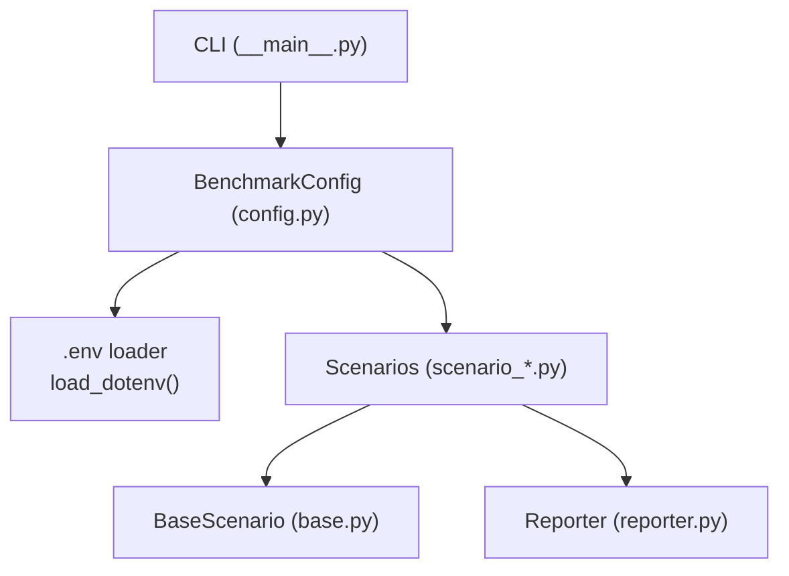
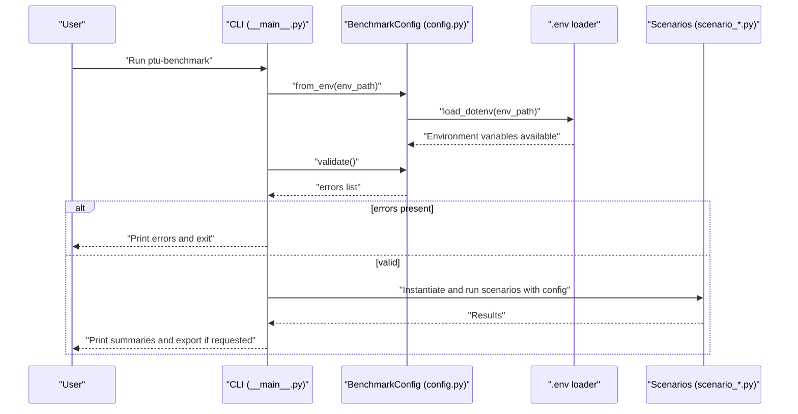
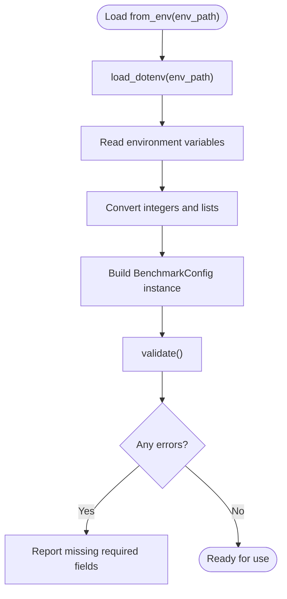
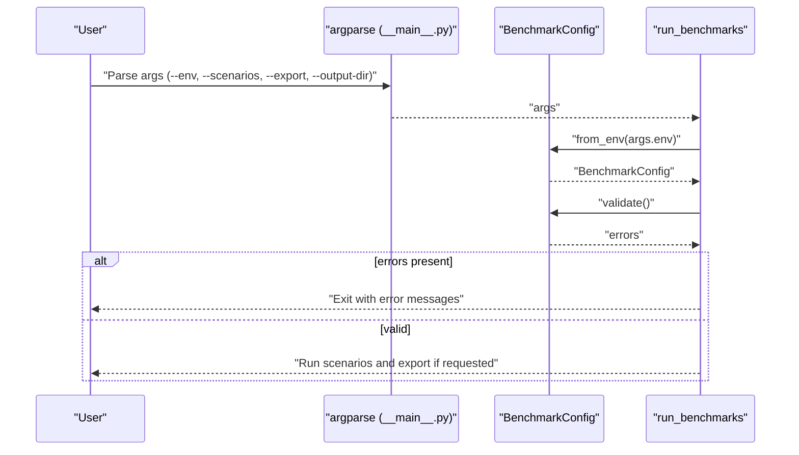
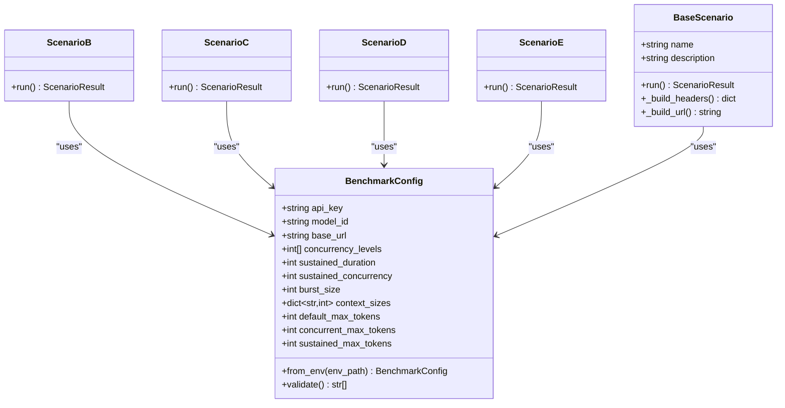
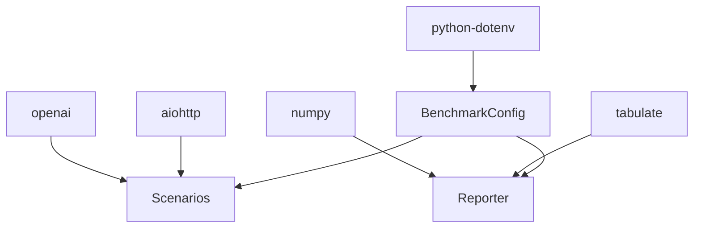

# Configuration Management

<cite>
**Referenced Files in This Document**
- [config.py](file://src/ptu_benchmark/config.py)
- [__main__.py](file://src/ptu_benchmark/__main__.py)
- [test_config.py](file://tests/test_config.py)
- [base.py](file://src/ptu_benchmark/scenarios/base.py)
- [scenario_b.py](file://src/ptu_benchmark/scenarios/scenario_b.py)
- [scenario_c.py](file://src/ptu_benchmark/scenarios/scenario_c.py)
- [scenario_d.py](file://src/ptu_benchmark/scenarios/scenario_d.py)
- [scenario_e.py](file://src/ptu_benchmark/scenarios/scenario_e.py)
- [reporter.py](file://src/ptu_benchmark/reporter.py)
- [pyproject.toml](file://pyproject.toml)
</cite>

## Table of Contents
1. [Introduction](#introduction)
2. [Project Structure](#project-structure)
3. [Core Components](#core-components)
4. [Architecture Overview](#architecture-overview)
5. [Detailed Component Analysis](#detailed-component-analysis)
6. [Dependency Analysis](#dependency-analysis)
7. [Performance Considerations](#performance-considerations)
8. [Troubleshooting Guide](#troubleshooting-guide)
9. [Conclusion](#conclusion)

## Introduction
This document explains the PTU Benchmark configuration management system. It covers how environment variables are loaded, how .env files are detected and processed, and how configuration parameters are validated and used across scenarios. It also documents the CLI argument parsing and configuration override mechanisms, along with best practices for multi-environment setups.

## Project Structure
The configuration system centers around a single configuration class that loads values from environment variables and .env files, and exposes them to all benchmark scenarios.

**Diagram sources**
- [__main__.py:121-146](file://src/ptu_benchmark/__main__.py#L121-L146)
- [config.py:47-96](file://src/ptu_benchmark/config.py#L47-L96)
- [base.py:20-41](file://src/ptu_benchmark/scenarios/base.py#L20-L41)
- [reporter.py:25-83](file://src/ptu_benchmark/reporter.py#L25-L83)

**Section sources**
- [pyproject.toml:14-20](file://pyproject.toml#L14-L20)

## Core Components
- BenchmarkConfig: Centralized configuration dataclass that loads environment variables and .env files, performs validation, and exposes parameters to scenarios.
- CLI: Parses command-line arguments, loads configuration from .env, validates it, and orchestrates scenario execution.
- Scenarios: Access configuration to construct requests, set concurrency, durations, and payload sizes.
- Reporter: Prints summaries and exports results; configuration is indirectly used for model and base URL metadata in logs.

Key responsibilities:
- Environment loading: Loads .env files and sets environment variables for downstream consumption.
- Parameter validation: Ensures required fields are present before running benchmarks.
- Type conversion: Converts string environment values to integers and lists as needed.
- Error handling: Reports configuration errors and exits early if invalid.

**Section sources**
- [config.py:16-106](file://src/ptu_benchmark/config.py#L16-L106)
- [__main__.py:39-78](file://src/ptu_benchmark/__main__.py#L39-L78)
- [reporter.py:25-83](file://src/ptu_benchmark/reporter.py#L25-L83)

## Architecture Overview
The configuration pipeline is straightforward: CLI builds a configuration object from environment variables and .env files, validates it, and passes it to scenarios. Scenarios consume configuration for runtime behavior.

**Diagram sources**
- [__main__.py:121-146](file://src/ptu_benchmark/__main__.py#L121-L146)
- [config.py:47-106](file://src/ptu_benchmark/config.py#L47-L106)

## Detailed Component Analysis

### Configuration Loading and Validation
- Environment variable loading:
  - The configuration loader accepts an explicit .env path or auto-detects from the current working directory and parent directories.
  - It uses a helper to convert comma-separated strings into integer lists for concurrency levels.
  - It parses a special context sizes string into a dictionary mapping labels to token counts.
- Essential configuration variables:
  - DASHSCOPE_API_KEY: Authentication key for the provider.
  - PTU_MODEL_ID: Target model identifier.
  - BASE_URL: Provider base URL for chat completions endpoint.
- Optional tuning parameters:
  - CONCURRENCY_LEVELS: Comma-separated list of concurrency values for Scenario B.
  - SUSTAINED_DURATION: Duration in seconds for Scenario C sustained throughput window.
  - BURST_SIZE: Number of simultaneous requests for Scenario D peak burst test.
  - CONTEXT_SIZES: Comma-separated token counts for Scenario E long context test.
- Validation:
  - Validates presence of required fields and returns a list of missing items.
- Type conversion and defaults:
  - Integer conversions with sensible defaults for durations, concurrency, and sizes.
  - Context sizes support flexible input and produce normalized labels.

**Diagram sources**
- [config.py:47-106](file://src/ptu_benchmark/config.py#L47-L106)

**Section sources**
- [config.py:47-96](file://src/ptu_benchmark/config.py#L47-L96)
- [config.py:98-106](file://src/ptu_benchmark/config.py#L98-L106)

### CLI Argument Parsing and Overrides
- CLI supports:
  - Listing available scenarios.
  - Selecting specific scenarios to run.
  - Exporting results to JSON and CSV.
  - Specifying an explicit .env file path.
  - Setting output directory for exports.
- Override mechanism:
  - The CLI passes the chosen .env path to the configuration loader, enabling explicit override of auto-detected .env files.
  - After loading, the configuration is validated; if invalid, the program prints errors and exits.

**Diagram sources**
- [__main__.py:39-78](file://src/ptu_benchmark/__main__.py#L39-L78)
- [__main__.py:121-146](file://src/ptu_benchmark/__main__.py#L121-L146)

**Section sources**
- [__main__.py:39-78](file://src/ptu_benchmark/__main__.py#L39-L78)
- [__main__.py:121-146](file://src/ptu_benchmark/__main__.py#L121-L146)

### How Scenarios Use Configuration
- Scenario B (Concurrent Load): Uses configured concurrency levels to run multiple concurrent requests and aggregates results.
- Scenario C (Sustained Throughput): Uses sustained duration and concurrency to run requests continuously for a fixed period.
- Scenario D (Peak Burst): Sends a configured number of simultaneous requests to evaluate burst handling.
- Scenario E (Long Context): Uses configured context sizes to generate prompts of varying lengths.
- BaseScenario: Provides shared helpers that rely on configuration for headers, URLs, and payload construction.

**Diagram sources**
- [config.py:16-46](file://src/ptu_benchmark/config.py#L16-L46)
- [base.py:20-41](file://src/ptu_benchmark/scenarios/base.py#L20-L41)
- [scenario_b.py:19-51](file://src/ptu_benchmark/scenarios/scenario_b.py#L19-L51)
- [scenario_c.py:22-106](file://src/ptu_benchmark/scenarios/scenario_c.py#L22-L106)
- [scenario_d.py:20-72](file://src/ptu_benchmark/scenarios/scenario_d.py#L20-L72)
- [scenario_e.py:25-103](file://src/ptu_benchmark/scenarios/scenario_e.py#L25-L103)

**Section sources**
- [scenario_b.py:25-51](file://src/ptu_benchmark/scenarios/scenario_b.py#L25-L51)
- [scenario_c.py:28-106](file://src/ptu_benchmark/scenarios/scenario_c.py#L28-L106)
- [scenario_d.py:26-72](file://src/ptu_benchmark/scenarios/scenario_d.py#L26-L72)
- [scenario_e.py:33-103](file://src/ptu_benchmark/scenarios/scenario_e.py#L33-L103)
- [base.py:33-41](file://src/ptu_benchmark/scenarios/base.py#L33-L41)

### Parameter Validation and Error Handling
- Required fields:
  - DASHSCOPE_API_KEY and PTU_MODEL_ID must be set; otherwise validation fails.
- Error reporting:
  - On validation failure, the CLI prints a list of errors and suggests copying a template .env file.
- Tests confirm:
  - Default values for optional parameters.
  - Validation catches missing required fields.
  - Environment variables override defaults during loading.

**Section sources**
- [config.py:98-106](file://src/ptu_benchmark/config.py#L98-L106)
- [__main__.py:131-139](file://src/ptu_benchmark/__main__.py#L131-L139)
- [test_config.py:8-42](file://tests/test_config.py#L8-L42)

### Environment Variable Loading Mechanism
- .env detection:
  - When no explicit path is provided, the loader searches the current working directory and parent directories for .env files.
- Explicit override:
  - The CLI allows specifying a .env file path, which is passed to the loader to override auto-detection.
- Provider-specific base URL:
  - The default base URL targets the compatible mode endpoint; it can be overridden via environment variable.

**Section sources**
- [config.py:47-58](file://src/ptu_benchmark/config.py#L47-L58)
- [__main__.py:49-54](file://src/ptu_benchmark/__main__.py#L49-L54)

### Parameter Validation, Type Conversion, and Defaults
- Required parameters:
  - DASHSCOPE_API_KEY and PTU_MODEL_ID are validated as non-empty.
- Optional parameters and defaults:
  - CONCURRENCY_LEVELS defaults to [10, 50, 100].
  - SUSTAINED_DURATION defaults to 1800 seconds (30 minutes); SUSTAINED_CONCURRENCY defaults to 20.
  - BURST_SIZE defaults to 200.
  - CONTEXT_SIZES defaults to {"32K": 32000, "64K": 64000, "128K": 128000}.
- Type conversion:
  - Integer lists parsed from comma-separated strings.
  - Context sizes parsed from comma-separated token counts with normalized labels.
- Max tokens:
  - Separate defaults for default, concurrent, and sustained scenarios are exposed for payload sizing.

**Section sources**
- [config.py:20-46](file://src/ptu_benchmark/config.py#L20-L46)
- [config.py:60-78](file://src/ptu_benchmark/config.py#L60-L78)
- [config.py:80-96](file://src/ptu_benchmark/config.py#L80-L96)

### Examples: Customizing Scenarios via Environment Variables
- Scenario B (Concurrent Load):
  - Set CONCURRENCY_LEVELS to customize the concurrency levels tested.
- Scenario C (Sustained Throughput):
  - Adjust SUSTAINED_DURATION to change the test window length.
  - Adjust SUSTAINED_CONCURRENCY to control sustained load level.
- Scenario D (Peak Burst):
  - Set BURST_SIZE to control the number of simultaneous requests.
- Scenario E (Long Context):
  - Set CONTEXT_SIZES to define input sizes in tokens or labels.
- Required for all scenarios:
  - Set DASHSCOPE_API_KEY and PTU_MODEL_ID.
  - Optionally set BASE_URL to target a different provider endpoint.

Best practices:
- Use a dedicated .env file per environment (e.g., dev-staging-prod) and pass it explicitly via CLI.
- Keep defaults for optional parameters aligned with typical use cases; override only when necessary.
- Validate configuration before running benchmarks to catch missing keys early.

**Section sources**
- [config.py:25-40](file://src/ptu_benchmark/config.py#L25-L40)
- [config.py:80-96](file://src/ptu_benchmark/config.py#L80-L96)
- [__main__.py:49-54](file://src/ptu_benchmark/__main__.py#L49-L54)

## Dependency Analysis
- External dependencies:
  - python-dotenv for .env loading.
  - openai and aiohttp for scenario execution.
  - numpy and tabulate for reporting and statistics.
- Internal dependencies:
  - CLI depends on BenchmarkConfig for environment loading and validation.
  - Scenarios depend on BenchmarkConfig for runtime parameters.
  - Reporter consumes scenario results and prints summaries.

**Diagram sources**
- [pyproject.toml:14-20](file://pyproject.toml#L14-L20)
- [config.py:13](file://src/ptu_benchmark/config.py#L13)
- [reporter.py:15-17](file://src/ptu_benchmark/reporter.py#L15-L17)

**Section sources**
- [pyproject.toml:14-20](file://pyproject.toml#L14-L20)

## Performance Considerations
- Environment loading overhead is minimal and occurs once at startup.
- Using explicit .env paths avoids unnecessary parent directory scans.
- Keep CONTEXT_SIZES and CONCURRENCY_LEVELS reasonable to avoid excessive memory or connection overhead.
- Prefer smaller burst sizes initially and scale up to determine PTU limits.

## Troubleshooting Guide
Common issues and resolutions:
- Missing required keys:
  - Symptom: Validation errors indicating missing DASHSCOPE_API_KEY or PTU_MODEL_ID.
  - Resolution: Set both keys in .env or environment and re-run.
- Incorrect .env path:
  - Symptom: Configuration not picked up.
  - Resolution: Use the CLI’s --env option to explicitly point to the desired .env file.
- Unexpected defaults:
  - Symptom: Different concurrency or duration than expected.
  - Resolution: Set the corresponding environment variables to override defaults.
- Rate limiting during sustained or burst tests:
  - Symptom: 429 errors reported.
  - Resolution: Reduce SUSTAINED_CONCURRENCY or BURST_SIZE to fit within PTU capacity.

**Section sources**
- [config.py:98-106](file://src/ptu_benchmark/config.py#L98-L106)
- [__main__.py:131-139](file://src/ptu_benchmark/__main__.py#L131-L139)
- [scenario_c.py:78-104](file://src/ptu_benchmark/scenarios/scenario_c.py#L78-L104)
- [scenario_d.py:59-66](file://src/ptu_benchmark/scenarios/scenario_d.py#L59-L66)

## Conclusion
The PTU Benchmark configuration management system provides a clean, environment-driven approach to configuring benchmarks. It supports robust environment variable loading, explicit .env overrides, and strong validation to prevent runtime failures. By leveraging optional tuning parameters and clear defaults, teams can quickly adapt benchmarks to different environments and use cases while maintaining reliable and reproducible results.