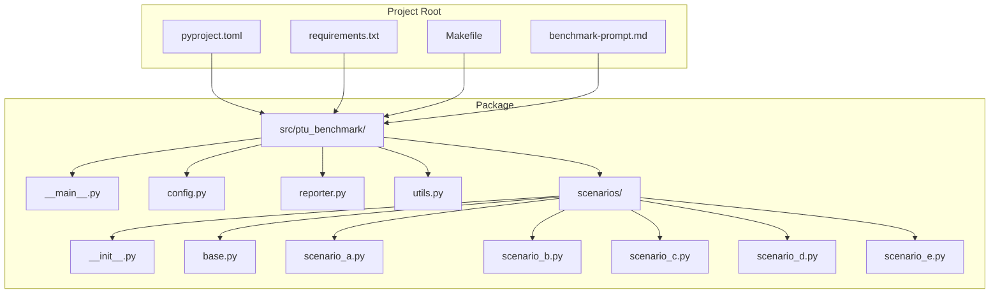
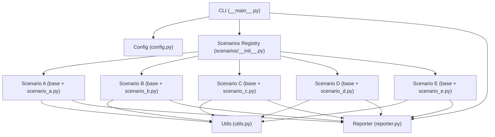
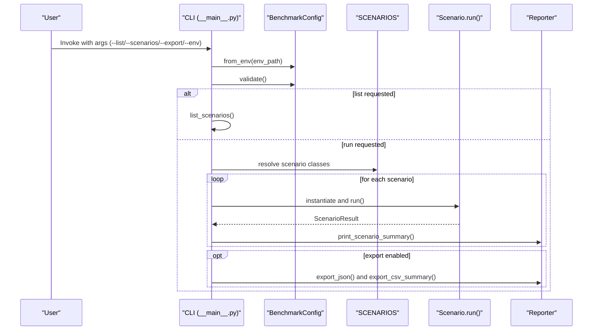
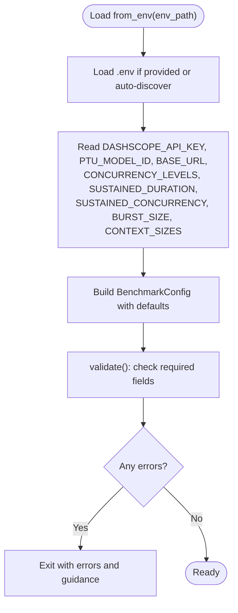
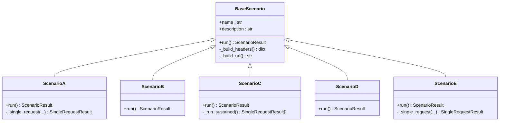
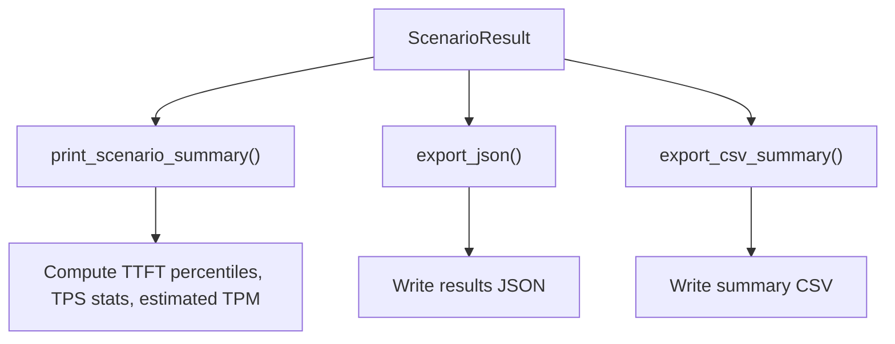
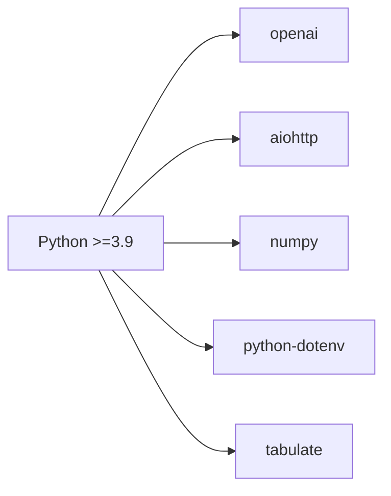

# Getting Started Guide

<cite>
**Referenced Files in This Document**
- [pyproject.toml](file://pyproject.toml)
- [requirements.txt](file://requirements.txt)
- [Makefile](file://Makefile)
- [src/ptu_benchmark/__main__.py](file://src/ptu_benchmark/__main__.py)
- [src/ptu_benchmark/config.py](file://src/ptu_benchmark/config.py)
- [src/ptu_benchmark/reporter.py](file://src/ptu_benchmark/reporter.py)
- [src/ptu_benchmark/utils.py](file://src/ptu_benchmark/utils.py)
- [src/ptu_benchmark/scenarios/__init__.py](file://src/ptu_benchmark/scenarios/__init__.py)
- [src/ptu_benchmark/scenarios/base.py](file://src/ptu_benchmark/scenarios/base.py)
- [src/ptu_benchmark/scenarios/scenario_a.py](file://src/ptu_benchmark/scenarios/scenario_a.py)
- [src/ptu_benchmark/scenarios/scenario_b.py](file://src/ptu_benchmark/scenarios/scenario_b.py)
- [src/ptu_benchmark/scenarios/scenario_c.py](file://src/ptu_benchmark/scenarios/scenario_c.py)
- [src/ptu_benchmark/scenarios/scenario_d.py](file://src/ptu_benchmark/scenarios/scenario_d.py)
- [src/ptu_benchmark/scenarios/scenario_e.py](file://src/ptu_benchmark/scenarios/scenario_e.py)
- [benchmark-prompt.md](file://benchmark-prompt.md)
</cite>

## Table of Contents
1. [Introduction](#introduction)
2. [Project Structure](#project-structure)
3. [Core Components](#core-components)
4. [Architecture Overview](#architecture-overview)
5. [Detailed Component Analysis](#detailed-component-analysis)
6. [Dependency Analysis](#dependency-analysis)
7. [Performance Considerations](#performance-considerations)
8. [Troubleshooting Guide](#troubleshooting-guide)
9. [Conclusion](#conclusion)
10. [Appendices](#appendices)

## Introduction
This Getting Started Guide helps you quickly set up and run the PTU Benchmark Suite for Alibaba Cloud Model Studio PTU (Provisioned Throughput Unit) performance testing. It covers prerequisites, installation, environment configuration, quick start examples, and a typical POC workflow from deployment to delivering a customer report.

Key prerequisites:
- Python 3.9 or newer
- An Alibaba Cloud Model Studio API key
- A PTU deployment with a valid model ID
- Optional: familiarity with environment variables and .env files

## Project Structure
The repository is organized around a Python package named ptu-benchmark. The CLI entry point orchestrates scenario execution, configuration loading, and result reporting. Make targets simplify installation, environment setup, and running scenarios.

**Diagram sources**
- [pyproject.toml:1-37](file://pyproject.toml#L1-L37)
- [requirements.txt:1-6](file://requirements.txt#L1-L6)
- [Makefile:1-61](file://Makefile#L1-L61)
- [src/ptu_benchmark/__main__.py:1-150](file://src/ptu_benchmark/__main__.py#L1-L150)
- [src/ptu_benchmark/config.py:1-106](file://src/ptu_benchmark/config.py#L1-L106)
- [src/ptu_benchmark/reporter.py:1-189](file://src/ptu_benchmark/reporter.py#L1-L189)
- [src/ptu_benchmark/utils.py:1-156](file://src/ptu_benchmark/utils.py#L1-L156)
- [src/ptu_benchmark/scenarios/__init__.py:1-30](file://src/ptu_benchmark/scenarios/__init__.py#L1-L30)
- [src/ptu_benchmark/scenarios/base.py:1-143](file://src/ptu_benchmark/scenarios/base.py#L1-L143)
- [src/ptu_benchmark/scenarios/scenario_a.py:1-102](file://src/ptu_benchmark/scenarios/scenario_a.py#L1-L102)
- [src/ptu_benchmark/scenarios/scenario_b.py:1-51](file://src/ptu_benchmark/scenarios/scenario_b.py#L1-L51)
- [src/ptu_benchmark/scenarios/scenario_c.py:1-106](file://src/ptu_benchmark/scenarios/scenario_c.py#L1-L106)
- [src/ptu_benchmark/scenarios/scenario_d.py:1-72](file://src/ptu_benchmark/scenarios/scenario_d.py#L1-L72)
- [src/ptu_benchmark/scenarios/scenario_e.py:1-103](file://src/ptu_benchmark/scenarios/scenario_e.py#L1-L103)
- [benchmark-prompt.md:1-410](file://benchmark-prompt.md#L1-L410)

**Section sources**
- [pyproject.toml:1-37](file://pyproject.toml#L1-L37)
- [requirements.txt:1-6](file://requirements.txt#L1-L6)
- [Makefile:1-61](file://Makefile#L1-L61)

## Core Components
- CLI entry point: parses arguments, loads configuration, validates environment, runs scenarios, and exports results.
- Configuration loader: reads environment variables and .env files, with sensible defaults.
- Reporter: prints scenario summaries and exports results to JSON and CSV.
- Utilities: prompt templates, result data models, timing helpers, and SSE parsing.
- Scenarios: five benchmark scenarios (A–E) built on a shared async foundation.

**Section sources**
- [src/ptu_benchmark/__main__.py:1-150](file://src/ptu_benchmark/__main__.py#L1-L150)
- [src/ptu_benchmark/config.py:1-106](file://src/ptu_benchmark/config.py#L1-L106)
- [src/ptu_benchmark/reporter.py:1-189](file://src/ptu_benchmark/reporter.py#L1-L189)
- [src/ptu_benchmark/utils.py:1-156](file://src/ptu_benchmark/utils.py#L1-L156)
- [src/ptu_benchmark/scenarios/__init__.py:1-30](file://src/ptu_benchmark/scenarios/__init__.py#L1-L30)

## Architecture Overview
The CLI coordinates configuration loading, scenario execution, and result export. Scenarios use async HTTP clients to stream responses and compute metrics like TTFT and TPS.

**Diagram sources**
- [src/ptu_benchmark/__main__.py:1-150](file://src/ptu_benchmark/__main__.py#L1-L150)
- [src/ptu_benchmark/config.py:1-106](file://src/ptu_benchmark/config.py#L1-L106)
- [src/ptu_benchmark/scenarios/__init__.py:1-30](file://src/ptu_benchmark/scenarios/__init__.py#L1-L30)
- [src/ptu_benchmark/scenarios/base.py:1-143](file://src/ptu_benchmark/scenarios/base.py#L1-L143)
- [src/ptu_benchmark/scenarios/scenario_a.py:1-102](file://src/ptu_benchmark/scenarios/scenario_a.py#L1-L102)
- [src/ptu_benchmark/scenarios/scenario_b.py:1-51](file://src/ptu_benchmark/scenarios/scenario_b.py#L1-L51)
- [src/ptu_benchmark/scenarios/scenario_c.py:1-106](file://src/ptu_benchmark/scenarios/scenario_c.py#L1-L106)
- [src/ptu_benchmark/scenarios/scenario_d.py:1-72](file://src/ptu_benchmark/scenarios/scenario_d.py#L1-L72)
- [src/ptu_benchmark/scenarios/scenario_e.py:1-103](file://src/ptu_benchmark/scenarios/scenario_e.py#L1-L103)
- [src/ptu_benchmark/reporter.py:1-189](file://src/ptu_benchmark/reporter.py#L1-L189)
- [src/ptu_benchmark/utils.py:1-156](file://src/ptu_benchmark/utils.py#L1-L156)

## Detailed Component Analysis

### CLI and Execution Flow
The CLI supports listing scenarios, selecting specific ones, exporting results, and specifying an alternate .env file. It validates configuration and prints a header with model and base URL before running scenarios.

**Diagram sources**
- [src/ptu_benchmark/__main__.py:39-146](file://src/ptu_benchmark/__main__.py#L39-L146)
- [src/ptu_benchmark/config.py:98-106](file://src/ptu_benchmark/config.py#L98-L106)
- [src/ptu_benchmark/scenarios/__init__.py:13-19](file://src/ptu_benchmark/scenarios/__init__.py#L13-L19)
- [src/ptu_benchmark/reporter.py:46-83](file://src/ptu_benchmark/reporter.py#L46-L83)

**Section sources**
- [src/ptu_benchmark/__main__.py:39-146](file://src/ptu_benchmark/__main__.py#L39-L146)

### Configuration Loading and Validation
Configuration is loaded from environment variables and .env files. Required fields include the API key and model ID. Defaults are provided for base URL and scenario-specific parameters.

**Diagram sources**
- [src/ptu_benchmark/config.py:47-96](file://src/ptu_benchmark/config.py#L47-L96)
- [src/ptu_benchmark/config.py:98-106](file://src/ptu_benchmark/config.py#L98-L106)

**Section sources**
- [src/ptu_benchmark/config.py:16-96](file://src/ptu_benchmark/config.py#L16-L96)

### Scenario Execution Details
Each scenario extends a shared async base and uses streaming requests to compute TTFT and TPS. Scenario B and D reuse a concurrent runner; Scenario C uses a semaphore-controlled sustained loop.

**Diagram sources**
- [src/ptu_benchmark/scenarios/base.py:20-41](file://src/ptu_benchmark/scenarios/base.py#L20-L41)
- [src/ptu_benchmark/scenarios/base.py:115-143](file://src/ptu_benchmark/scenarios/base.py#L115-L143)
- [src/ptu_benchmark/scenarios/scenario_a.py:23-102](file://src/ptu_benchmark/scenarios/scenario_a.py#L23-L102)
- [src/ptu_benchmark/scenarios/scenario_b.py:19-51](file://src/ptu_benchmark/scenarios/scenario_b.py#L19-L51)
- [src/ptu_benchmark/scenarios/scenario_c.py:22-106](file://src/ptu_benchmark/scenarios/scenario_c.py#L22-L106)
- [src/ptu_benchmark/scenarios/scenario_d.py:20-72](file://src/ptu_benchmark/scenarios/scenario_d.py#L20-L72)
- [src/ptu_benchmark/scenarios/scenario_e.py:25-103](file://src/ptu_benchmark/scenarios/scenario_e.py#L25-L103)

**Section sources**
- [src/ptu_benchmark/scenarios/base.py:47-143](file://src/ptu_benchmark/scenarios/base.py#L47-L143)
- [src/ptu_benchmark/scenarios/scenario_b.py:25-51](file://src/ptu_benchmark/scenarios/scenario_b.py#L25-L51)
- [src/ptu_benchmark/scenarios/scenario_c.py:37-106](file://src/ptu_benchmark/scenarios/scenario_c.py#L37-L106)
- [src/ptu_benchmark/scenarios/scenario_d.py:26-72](file://src/ptu_benchmark/scenarios/scenario_d.py#L26-L72)
- [src/ptu_benchmark/scenarios/scenario_e.py:33-103](file://src/ptu_benchmark/scenarios/scenario_e.py#L33-L103)

### Reporting and Export
The reporter prints per-scenario summaries and aggregates metrics like TTFT percentiles and TPS averages. It also exports results to JSON and CSV.

**Diagram sources**
- [src/ptu_benchmark/reporter.py:46-83](file://src/ptu_benchmark/reporter.py#L46-L83)
- [src/ptu_benchmark/reporter.py:125-189](file://src/ptu_benchmark/reporter.py#L125-L189)

**Section sources**
- [src/ptu_benchmark/reporter.py:25-189](file://src/ptu_benchmark/reporter.py#L25-L189)

## Dependency Analysis
The project declares Python 3.9+ and core runtime dependencies. Optional dev dependencies support testing. Make targets provide convenient workflows for installation and running scenarios.

**Diagram sources**
- [pyproject.toml:9-20](file://pyproject.toml#L9-L20)
- [requirements.txt:1-6](file://requirements.txt#L1-L6)

**Section sources**
- [pyproject.toml:9-26](file://pyproject.toml#L9-L26)
- [requirements.txt:1-6](file://requirements.txt#L1-L6)

## Performance Considerations
- Streaming requests enable real-time metric computation (TTFT, TPS).
- Async concurrency is tuned per scenario; adjust concurrency levels and durations to match your PTU capacity.
- Exporting results to JSON and CSV enables downstream analysis and reporting.

[No sources needed since this section provides general guidance]

## Troubleshooting Guide
Common setup and runtime issues:
- Missing required environment variables:
  - Ensure DASHSCOPE_API_KEY and PTU_MODEL_ID are set.
  - The CLI will list validation errors and suggest copying the .env.example template.
- Incorrect base URL:
  - Verify BASE_URL matches the Model Studio compatible mode endpoint.
- Rate limiting (429):
  - Scenario D simulates burst traffic; expect 429s if traffic exceeds PTU capacity.
- Network or SSL issues:
  - Confirm outbound connectivity to the BASE_URL and that certificates are valid.
- Version compatibility:
  - Use Python 3.9+ as required by the project metadata.

Verification steps:
- Run the CLI with --list to confirm scenario availability.
- Execute a small subset (e.g., Scenario A) with --export to validate environment and output generation.
- Check results/ directory for exported JSON and CSV files.

**Section sources**
- [src/ptu_benchmark/__main__.py:121-146](file://src/ptu_benchmark/__main__.py#L121-L146)
- [src/ptu_benchmark/config.py:98-106](file://src/ptu_benchmark/config.py#L98-L106)
- [src/ptu_benchmark/scenarios/base.py:64-78](file://src/ptu_benchmark/scenarios/base.py#L64-L78)

## Conclusion
You now have the essentials to install, configure, and run the PTU Benchmark Suite. Use the provided Make targets and CLI flags to execute scenarios, export results, and produce a customer-ready report. For a deeper understanding of scenario intent and expected outcomes, refer to the benchmarking guide included in the repository.

[No sources needed since this section summarizes without analyzing specific files]

## Appendices

### Prerequisites
- Python 3.9+
- Alibaba Cloud Model Studio API key
- Active PTU deployment with a model ID
- Optional: .env file for environment variables

**Section sources**
- [pyproject.toml:9-9](file://pyproject.toml#L9-L9)
- [benchmark-prompt.md:9-16](file://benchmark-prompt.md#L9-L16)

### Installation
Choose one of the following:
- Install runtime dependencies:
  - pip install -r requirements.txt
- Install development dependencies:
  - pip install -r requirements.txt
  - pip install pytest pytest-asyncio
- Or use Make targets:
  - make install
  - make install-dev

**Section sources**
- [requirements.txt:1-6](file://requirements.txt#L1-L6)
- [Makefile:13-18](file://Makefile#L13-L18)

### Environment Configuration
- Copy the .env.example template to .env if it does not exist:
  - make setup
- Essential variables:
  - DASHSCOPE_API_KEY
  - PTU_MODEL_ID
  - BASE_URL

**Section sources**
- [Makefile:20-22](file://Makefile#L20-L22)
- [src/ptu_benchmark/config.py:81-86](file://src/ptu_benchmark/config.py#L81-L86)

### Quick Start Examples
- Run all scenarios and export results:
  - python -m ptu_benchmark --export
  - Or via Make:
    - make run
- Run a specific scenario:
  - python -m ptu_benchmark --scenarios A
  - Or via Make:
    - make run-a
- List available scenarios:
  - python -m ptu_benchmark --list
  - Or via Make:
    - make list

**Section sources**
- [src/ptu_benchmark/__main__.py:39-78](file://src/ptu_benchmark/__main__.py#L39-L78)
- [Makefile:31-52](file://Makefile#L31-L52)

### Typical POC Workflow
- Prepare environment:
  - Set DASHSCOPE_API_KEY, PTU_MODEL_ID, BASE_URL
  - Confirm PTU deployment is active
- Execute benchmarks:
  - Run Scenario A (baseline)
  - Run Scenario B (concurrent load)
  - Run Scenario C (sustained throughput)
  - Run Scenario D (peak burst)
  - Run Scenario E (long context)
- Export results:
  - Use --export to generate JSON and CSV in results/
- Deliver customer report:
  - Use the provided comparison and summary templates to present findings

**Section sources**
- [benchmark-prompt.md:7-25](file://benchmark-prompt.md#L7-L25)
- [src/ptu_benchmark/__main__.py:111-118](file://src/ptu_benchmark/__main__.py#L111-L118)
- [src/ptu_benchmark/reporter.py:125-189](file://src/ptu_benchmark/reporter.py#L125-L189)