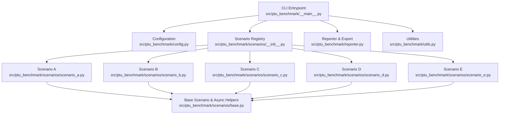
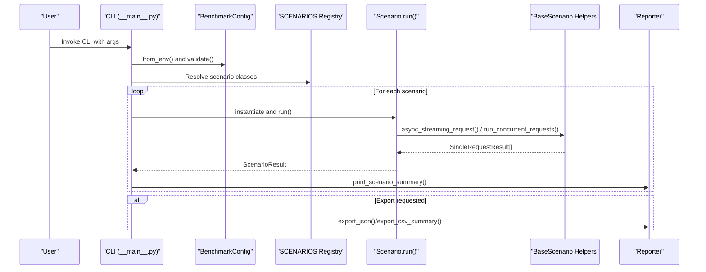
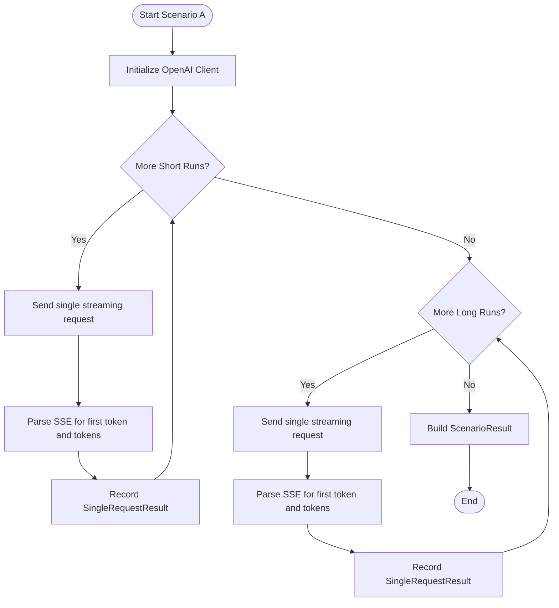
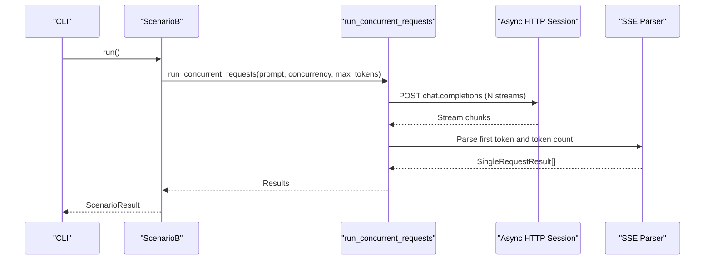
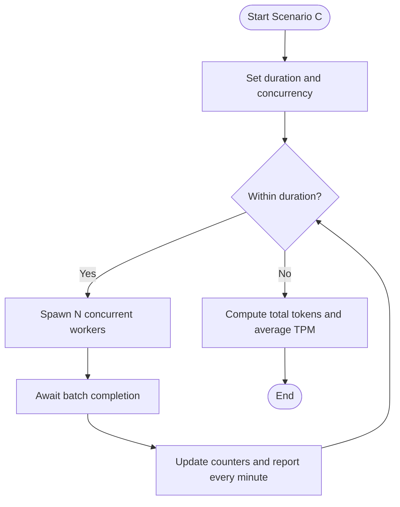
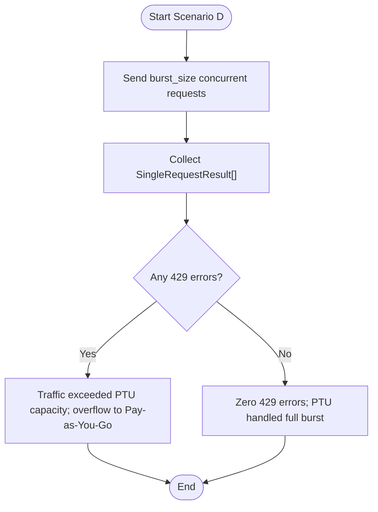
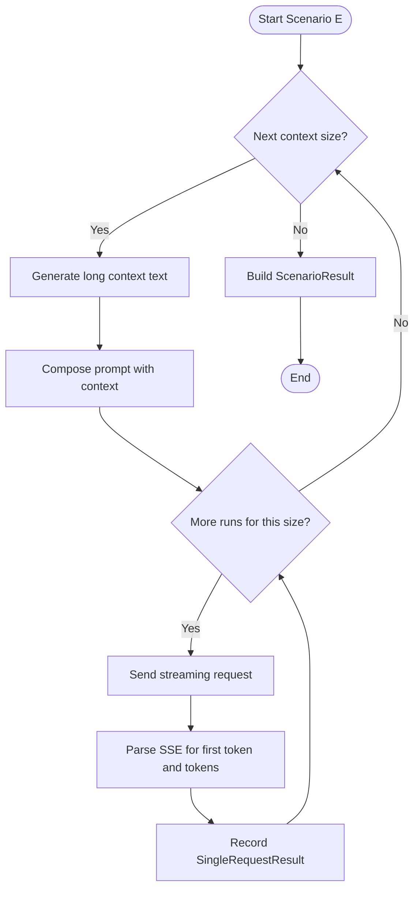
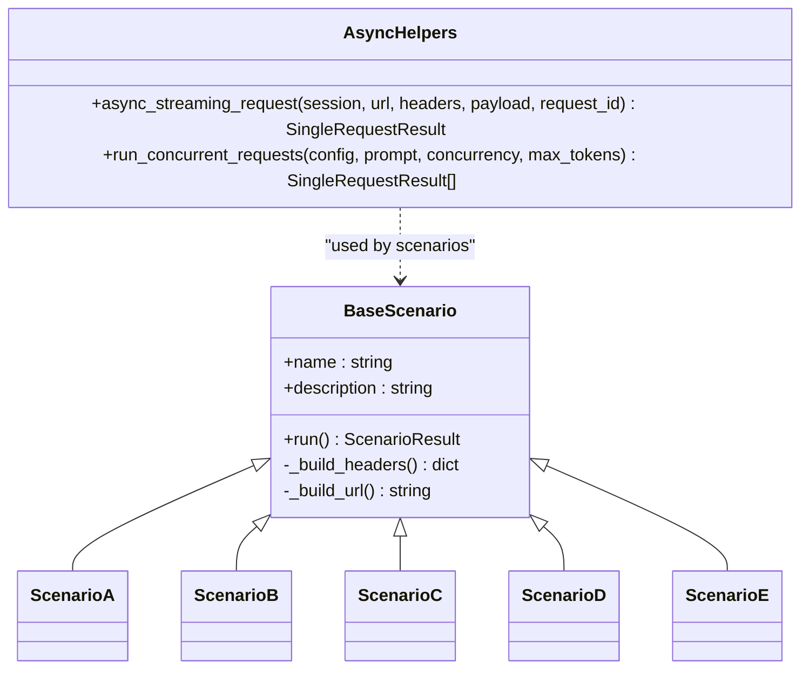
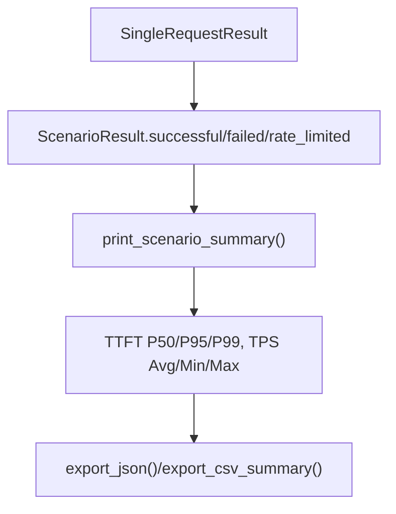
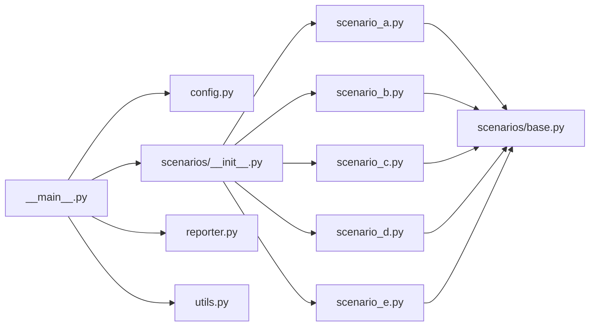

# Project Overview

<cite>
**Referenced Files in This Document**
- [__main__.py](file://src/ptu_benchmark/__main__.py)
- [__init__.py](file://src/ptu_benchmark/__init__.py)
- [config.py](file://src/ptu_benchmark/config.py)
- [reporter.py](file://src/ptu_benchmark/reporter.py)
- [utils.py](file://src/ptu_benchmark/utils.py)
- [scenarios/__init__.py](file://src/ptu_benchmark/scenarios/__init__.py)
- [scenarios/base.py](file://src/ptu_benchmark/scenarios/base.py)
- [scenario_a.py](file://src/ptu_benchmark/scenarios/scenario_a.py)
- [scenario_b.py](file://src/ptu_benchmark/scenarios/scenario_b.py)
- [scenario_c.py](file://src/ptu_benchmark/scenarios/scenario_c.py)
- [scenario_d.py](file://src/ptu_benchmark/scenarios/scenario_d.py)
- [scenario_e.py](file://src/ptu_benchmark/scenarios/scenario_e.py)
</cite>

## Table of Contents
1. [Introduction](#introduction)
2. [Project Structure](#project-structure)
3. [Core Components](#core-components)
4. [Architecture Overview](#architecture-overview)
5. [Detailed Component Analysis](#detailed-component-analysis)
6. [Dependency Analysis](#dependency-analysis)
7. [Performance Considerations](#performance-considerations)
8. [Troubleshooting Guide](#troubleshooting-guide)
9. [Conclusion](#conclusion)
10. [Appendices](#appendices)

## Introduction
The PTU Benchmark Suite is a performance benchmarking toolkit designed for Alibaba Cloud Model Studio PTU (Provisioned Throughput Unit). It enables customers, sales teams, and proof-of-concept (POC) engineers to run repeatable, standardized performance tests against PTU capacity and compare outcomes with shared Token API behavior. The suite focuses on five real-world scenarios that collectively quantify latency (TTFT), generation speed (TPS), concurrent throughput, sustained throughput (TPM), and resilience under burst loads (429 error rates).

Key value propositions:
- Predictable performance guarantees: Demonstrates sustained throughput and low latency under PTU provisioning.
- Repeatable comparisons: Provides structured scenarios and standardized metrics for consistent demos.
- Operational insights: Highlights PTU’s ability to handle bursts gracefully and fall back to Pay-as-You-Go for overflow traffic without service interruption.

## Project Structure
The project is organized around a CLI-driven workflow, a shared scenario framework, and a result reporting/export pipeline. The core modules are:
- CLI entrypoint and orchestration
- Configuration management
- Scenario registry and base classes
- Scenario implementations (A–E)
- Utilities for prompts, timing, and result aggregation
- Reporting and export utilities

**Diagram sources**
- [__main__.py:121-149](file://src/ptu_benchmark/__main__.py#L121-L149)
- [config.py:47-96](file://src/ptu_benchmark/config.py#L47-L96)
- [scenarios/__init__.py:13-19](file://src/ptu_benchmark/scenarios/__init__.py#L13-L19)
- [scenarios/base.py:20-44](file://src/ptu_benchmark/scenarios/base.py#L20-L44)
- [reporter.py:125-188](file://src/ptu_benchmark/reporter.py#L125-L188)
- [utils.py:45-91](file://src/ptu_benchmark/utils.py#L45-L91)

**Section sources**
- [__main__.py:39-78](file://src/ptu_benchmark/__main__.py#L39-L78)
- [__init__.py:8-17](file://src/ptu_benchmark/__init__.py#L8-L17)
- [scenarios/__init__.py:12-29](file://src/ptu_benchmark/scenarios/__init__.py#L12-L29)

## Core Components
- CLI and orchestration: Parses arguments, validates configuration, runs selected scenarios, prints summaries, and exports results.
- Configuration: Centralized settings loaded from environment variables and .env files, including scenario-specific tunables.
- Scenario framework: Base class and shared async helpers for streaming requests, concurrency control, and SSE parsing.
- Scenario implementations: Five scenarios covering baseline latency, concurrent load, sustained throughput, burst handling, and long context.
- Utilities: Prompt templates, result dataclasses, timers, and SSE parsing helpers.
- Reporter: Console summaries, percentile calculations, comparison tables, and JSON/CSV exports.

**Section sources**
- [__main__.py:88-118](file://src/ptu_benchmark/__main__.py#L88-L118)
- [config.py:16-106](file://src/ptu_benchmark/config.py#L16-L106)
- [scenarios/base.py:20-143](file://src/ptu_benchmark/scenarios/base.py#L20-L143)
- [utils.py:45-156](file://src/ptu_benchmark/utils.py#L45-L156)
- [reporter.py:25-188](file://src/ptu_benchmark/reporter.py#L25-L188)

## Architecture Overview
The suite follows a CLI-driven workflow:
- CLI parses arguments and loads configuration.
- For each selected scenario, the CLI constructs a scenario instance and invokes its run method.
- Scenarios use shared async infrastructure to issue streaming requests, parse SSE events, and compute metrics.
- Results are aggregated and printed, then optionally exported to JSON and CSV.

**Diagram sources**
- [__main__.py:121-149](file://src/ptu_benchmark/__main__.py#L121-L149)
- [config.py:47-106](file://src/ptu_benchmark/config.py#L47-L106)
- [scenarios/__init__.py:13-19](file://src/ptu_benchmark/scenarios/__init__.py#L13-L19)
- [scenarios/base.py:47-143](file://src/ptu_benchmark/scenarios/base.py#L47-L143)
- [reporter.py:46-83](file://src/ptu_benchmark/reporter.py#L46-L83)

## Detailed Component Analysis

### Scenario A: Single Request Baseline (TTFT + TPS)
Purpose: Establish baseline latency and generation speed for a single request under no contention.
- Metrics: TTFT (Time To First Token), TPS (Tokens Per Second), total time, and token count.
- Implementation highlights:
  - Uses OpenAI SDK streaming to process incremental content.
  - Computes TTFT as the elapsed time until first content delta.
  - Calculates TPS as tokens divided by generation time after first token.
  - Runs multiple short and long prompt iterations for robustness.

**Diagram sources**
- [scenario_a.py:32-102](file://src/ptu_benchmark/scenarios/scenario_a.py#L32-L102)
- [utils.py:45-58](file://src/ptu_benchmark/utils.py#L45-L58)

**Section sources**
- [scenario_a.py:23-102](file://src/ptu_benchmark/scenarios/scenario_a.py#L23-L102)
- [utils.py:45-58](file://src/ptu_benchmark/utils.py#L45-L58)

### Scenario B: Concurrent Load (10/50/100 parallel requests)
Purpose: Measure throughput degradation under increasing concurrency.
- Metrics: Per-request TTFT, TPS, total time, token counts; aggregated success/error counts.
- Implementation highlights:
  - Executes multiple concurrency levels defined in configuration.
  - Uses shared async runner to fire N concurrent requests simultaneously.
  - Reports per-request results and aggregates statistics.

**Diagram sources**
- [scenario_b.py:25-51](file://src/ptu_benchmark/scenarios/scenario_b.py#L25-L51)
- [scenarios/base.py:115-143](file://src/ptu_benchmark/scenarios/base.py#L115-L143)

**Section sources**
- [scenario_b.py:19-51](file://src/ptu_benchmark/scenarios/scenario_b.py#L19-L51)
- [scenarios/base.py:115-143](file://src/ptu_benchmark/scenarios/base.py#L115-L143)

### Scenario C: Sustained Throughput (30-minute window)
Purpose: Demonstrate sustained TPM over a long-running workload.
- Metrics: Per-minute TPM, total requests, total tokens, average TPM, and 429 error percentage.
- Implementation highlights:
  - Maintains fixed concurrency for a configurable duration.
  - Uses semaphores to cap concurrent workers.
  - Periodically reports cumulative TPM and error counts.
  - Aggregates final statistics for the entire run.

**Diagram sources**
- [scenario_c.py:28-106](file://src/ptu_benchmark/scenarios/scenario_c.py#L28-L106)

**Section sources**
- [scenario_c.py:22-106](file://src/ptu_benchmark/scenarios/scenario_c.py#L22-L106)

### Scenario D: Peak Burst Test
Purpose: Verify PTU resilience under sudden spikes and demonstrate graceful handling of 429 errors.
- Metrics: Success rate, 429 error count, and other error breakdowns.
- Implementation highlights:
  - Sends a large number of simultaneous requests equal to the configured burst size.
  - Summarizes outcomes and explains behavior when PTU capacity is exceeded (overflow to Pay-as-You-Go without interruption).

**Diagram sources**
- [scenario_d.py:26-72](file://src/ptu_benchmark/scenarios/scenario_d.py#L26-L72)

**Section sources**
- [scenario_d.py:20-72](file://src/ptu_benchmark/scenarios/scenario_d.py#L20-L72)

### Scenario E: Long Context Test
Purpose: Evaluate performance with large input contexts (32K, 64K, 128K tokens).
- Metrics: TTFT, TPS, total time, token counts for each context size.
- Implementation highlights:
  - Generates synthetic long context text approximating target token counts.
  - Runs multiple iterations per context size for statistical robustness.

**Diagram sources**
- [scenario_e.py:33-103](file://src/ptu_benchmark/scenarios/scenario_e.py#L33-L103)
- [utils.py:120-132](file://src/ptu_benchmark/utils.py#L120-L132)

**Section sources**
- [scenario_e.py:25-103](file://src/ptu_benchmark/scenarios/scenario_e.py#L25-L103)
- [utils.py:120-132](file://src/ptu_benchmark/utils.py#L120-L132)

### Asynchronous Streaming Infrastructure
Shared async helpers enable efficient SSE parsing and metric computation:
- async_streaming_request: Issues a single streaming request, tracks first token time, counts tokens, computes TTFT and TPS, and records errors (including 429).
- run_concurrent_requests: Spawns N concurrent requests with capped connector limits and collects results.

**Diagram sources**
- [scenarios/base.py:20-143](file://src/ptu_benchmark/scenarios/base.py#L20-L143)

**Section sources**
- [scenarios/base.py:47-143](file://src/ptu_benchmark/scenarios/base.py#L47-L143)

### Result Processing Pipeline
- SingleRequestResult captures per-request metrics and success flags.
- ScenarioResult aggregates per-request results and exposes helpers for successful, failed, and rate-limited subsets.
- Reporter prints scenario summaries, calculates percentiles, and generates comparison tables and exports.

**Diagram sources**
- [utils.py:45-91](file://src/ptu_benchmark/utils.py#L45-L91)
- [reporter.py:46-83](file://src/ptu_benchmark/reporter.py#L46-L83)
- [reporter.py:125-188](file://src/ptu_benchmark/reporter.py#L125-L188)

**Section sources**
- [utils.py:45-91](file://src/ptu_benchmark/utils.py#L45-L91)
- [reporter.py:46-83](file://src/ptu_benchmark/reporter.py#L46-L83)
- [reporter.py:125-188](file://src/ptu_benchmark/reporter.py#L125-L188)

## Dependency Analysis
- CLI depends on configuration, scenario registry, and reporter/export utilities.
- Scenario implementations depend on the shared base class and async helpers.
- Utilities and reporter are used across scenarios for prompts, timing, and output formatting.

**Diagram sources**
- [__main__.py:28-36](file://src/ptu_benchmark/__main__.py#L28-L36)
- [scenarios/__init__.py:6-29](file://src/ptu_benchmark/scenarios/__init__.py#L6-L29)

**Section sources**
- [__main__.py:28-36](file://src/ptu_benchmark/__main__.py#L28-L36)
- [scenarios/__init__.py:6-29](file://src/ptu_benchmark/scenarios/__init__.py#L6-L29)

## Performance Considerations
- Streaming and SSE parsing: Efficiently measures TTFT and token counts by processing incremental deltas.
- Concurrency control: Semaphores and connector limits prevent resource exhaustion and stabilize measurements.
- Statistical reporting: Percentiles and averages provide robust performance insights across runs.
- Export formats: JSON and CSV enable reproducible comparisons and further analysis.

[No sources needed since this section provides general guidance]

## Troubleshooting Guide
Common issues and resolutions:
- Configuration validation failures: Ensure required environment variables are set and .env is properly formatted.
- 429 errors during bursts: Expected when traffic exceeds PTU capacity; indicates overflow to Pay-as-You-Go without service interruption.
- Empty or partial results: Check network connectivity, API key validity, and model availability.

**Section sources**
- [config.py:98-106](file://src/ptu_benchmark/config.py#L98-L106)
- [scenario_d.py:59-65](file://src/ptu_benchmark/scenarios/scenario_d.py#L59-L65)
- [scenarios/base.py:64-78](file://src/ptu_benchmark/scenarios/base.py#L64-L78)

## Conclusion
The PTU Benchmark Suite delivers a repeatable, standardized way to evaluate PTU performance across realistic workloads. By focusing on TTFT, TPS, concurrent throughput, sustained TPM, and burst resilience, it supports customer decisions, sales demos, and POC validations with actionable metrics and consistent outputs.

[No sources needed since this section summarizes without analyzing specific files]

## Appendices

### Five Benchmark Scenarios and Metrics
- Scenario A: Single Request Baseline
  - Metrics: TTFT, TPS, tokens, total time
- Scenario B: Concurrent Load
  - Metrics: Per-request TTFT, TPS, tokens, total time; success/error counts
- Scenario C: Sustained Throughput
  - Metrics: Per-minute TPM, total requests, total tokens, average TPM, 429 error percentage
- Scenario D: Peak Burst Test
  - Metrics: Success rate, 429 error count, other error breakdowns
- Scenario E: Long Context Test
  - Metrics: TTFT, TPS, tokens, total time per context size

**Section sources**
- [scenario_a.py:6-9](file://src/ptu_benchmark/scenarios/scenario_a.py#L6-L9)
- [scenario_b.py:5-7](file://src/ptu_benchmark/scenarios/scenario_b.py#L5-L7)
- [scenario_c.py:5-8](file://src/ptu_benchmark/scenarios/scenario_c.py#L5-L8)
- [scenario_d.py:5-8](file://src/ptu_benchmark/scenarios/scenario_d.py#L5-L8)
- [scenario_e.py:5-7](file://src/ptu_benchmark/scenarios/scenario_e.py#L5-L7)

### Why PTU Performance Matters Compared to Shared Token API
- Predictability: PTU guarantees sustained throughput and lower latency under consistent load.
- Resilience: Burst traffic exceeding PTU capacity is automatically handled by falling back to Pay-as-You-Go without service interruption.
- Demonstrability: The suite enables repeatable, standardized comparisons between PTU and shared Token API behavior.

[No sources needed since this section provides general guidance]