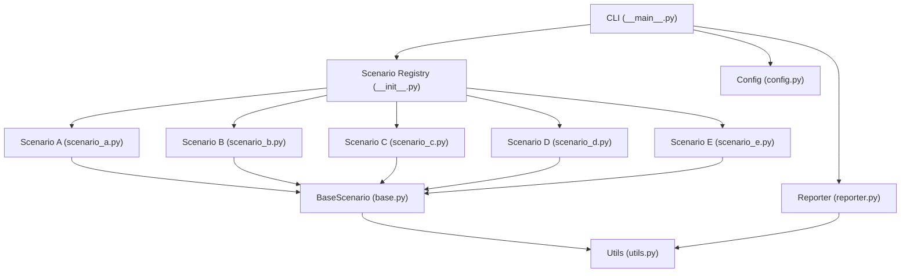
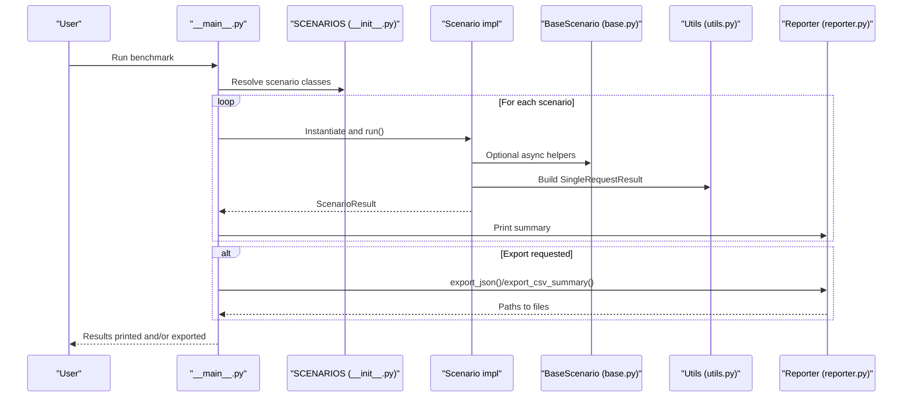
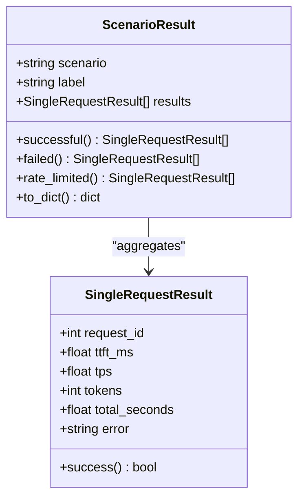
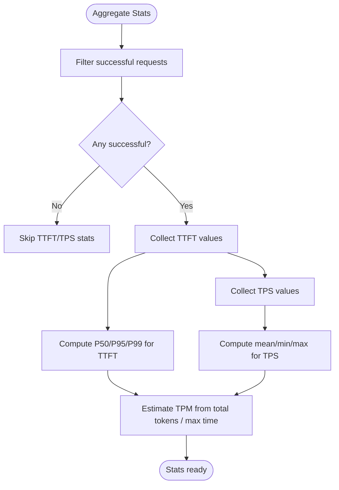
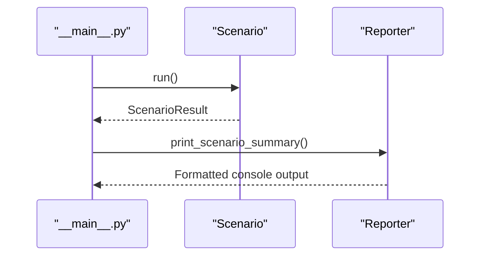
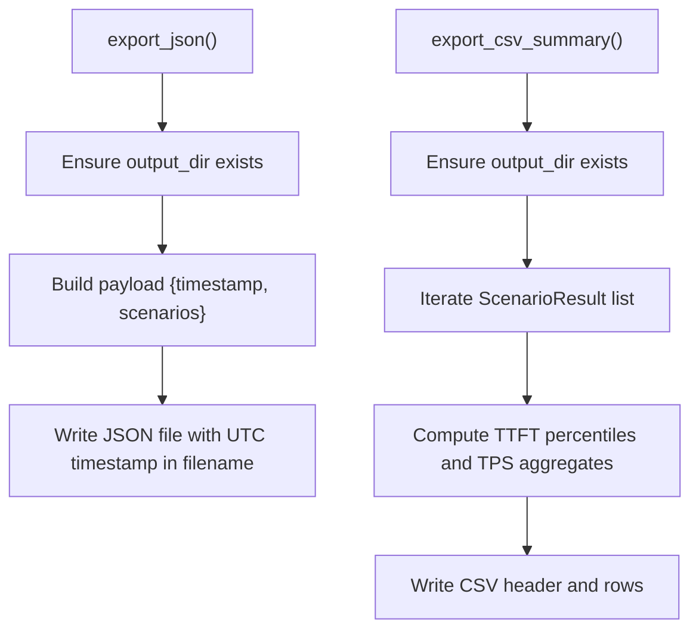
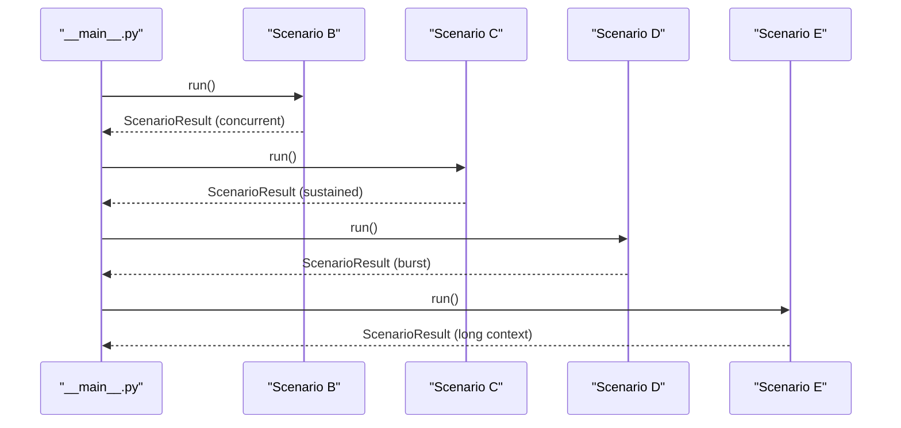
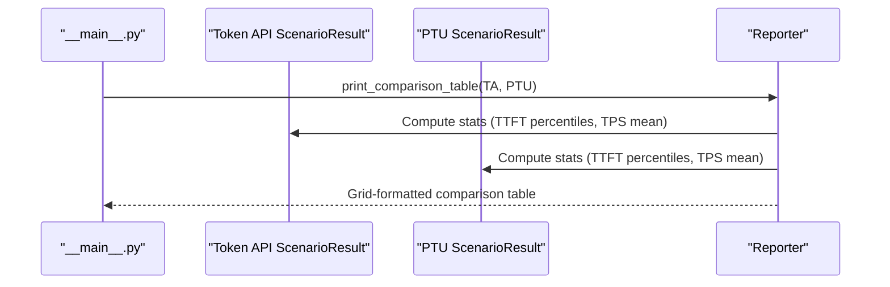
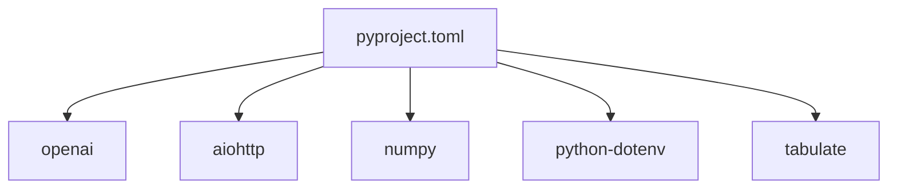

# Result Processing and Export

<cite>
**Referenced Files in This Document**
- [reporter.py](file://src/ptu_benchmark/reporter.py)
- [utils.py](file://src/ptu_benchmark/utils.py)
- [base.py](file://src/ptu_benchmark/scenarios/base.py)
- [__main__.py](file://src/ptu_benchmark/__main__.py)
- [config.py](file://src/ptu_benchmark/config.py)
- [scenario_a.py](file://src/ptu_benchmark/scenarios/scenario_a.py)
- [scenario_b.py](file://src/ptu_benchmark/scenarios/scenario_b.py)
- [scenario_c.py](file://src/ptu_benchmark/scenarios/scenario_c.py)
- [scenario_d.py](file://src/ptu_benchmark/scenarios/scenario_d.py)
- [scenario_e.py](file://src/ptu_benchmark/scenarios/scenario_e.py)
- [__init__.py](file://src/ptu_benchmark/scenarios/__init__.py)
- [pyproject.toml](file://pyproject.toml)
- [test_utils.py](file://tests/test_utils.py)
</cite>

## Table of Contents
1. [Introduction](#introduction)
2. [Project Structure](#project-structure)
3. [Core Components](#core-components)
4. [Architecture Overview](#architecture-overview)
5. [Detailed Component Analysis](#detailed-component-analysis)
6. [Dependency Analysis](#dependency-analysis)
7. [Performance Considerations](#performance-considerations)
8. [Troubleshooting Guide](#troubleshooting-guide)
9. [Conclusion](#conclusion)
10. [Appendices](#appendices)

## Introduction
This document explains the PTU-Benchmark result processing and export pipeline. It covers how benchmark results are collected, aggregated, and presented, including percentile calculations (P50/P95/P99), aggregate metrics, and error detection. It documents the console output formatting, progress reporting, and real-time metrics display. It also details the CSV and JSON export formats, file naming conventions, and output directory structure. Finally, it describes the data models used for result representation (ScenarioResult and SingleRequestResult), and provides guidance for interpreting results, identifying bottlenecks, and comparing PTU versus Token API performance.

## Project Structure
The benchmark suite is organized around a CLI entry point, scenario implementations, shared utilities, and a reporting module. The CLI orchestrates scenario execution, prints summaries, and exports results. Scenarios produce per-request results that are aggregated into ScenarioResult instances. The reporter module computes percentiles, aggregates metrics, and writes JSON and CSV outputs.

**Diagram sources**
- [__main__.py:121-149](file://src/ptu_benchmark/__main__.py#L121-L149)
- [__init__.py:13-19](file://src/ptu_benchmark/scenarios/__init__.py#L13-L19)
- [scenario_a.py:23-57](file://src/ptu_benchmark/scenarios/scenario_a.py#L23-L57)
- [scenario_b.py:19-50](file://src/ptu_benchmark/scenarios/scenario_b.py#L19-L50)
- [scenario_c.py:22-35](file://src/ptu_benchmark/scenarios/scenario_c.py#L22-L35)
- [scenario_d.py:20-71](file://src/ptu_benchmark/scenarios/scenario_d.py#L20-L71)
- [scenario_e.py:25-60](file://src/ptu_benchmark/scenarios/scenario_e.py#L25-L60)
- [base.py:20-42](file://src/ptu_benchmark/scenarios/base.py#L20-L42)
- [utils.py:45-91](file://src/ptu_benchmark/utils.py#L45-L91)
- [reporter.py:25-188](file://src/ptu_benchmark/reporter.py#L25-L188)
- [config.py:16-106](file://src/ptu_benchmark/config.py#L16-L106)

**Section sources**
- [__main__.py:121-149](file://src/ptu_benchmark/__main__.py#L121-L149)
- [__init__.py:13-19](file://src/ptu_benchmark/scenarios/__init__.py#L13-L19)
- [config.py:47-96](file://src/ptu_benchmark/config.py#L47-L96)

## Core Components
- Data models:
  - SingleRequestResult: captures per-request metrics (TTFT, TPS, tokens, total time, error).
  - ScenarioResult: aggregates a list of SingleRequestResult and exposes filters and serialization.
- Reporting and export:
  - Console printing helpers for single results and scenario summaries.
  - Comparison table generator for Token API vs PTU.
  - JSON exporter and CSV summary exporter.
- Scenario orchestration:
  - BaseScenario and shared async helpers for streaming requests and concurrent execution.
- CLI:
  - Parses arguments, validates configuration, runs scenarios, prints summaries, and exports results.

Key behaviors:
- Percentile calculation: P50/P95/P99 for TTFT; averages/min/max for TPS.
- Error detection: categorization of failures and rate-limits (429).
- Real-time metrics: sustained throughput reporting during long-running scenarios.
- Export formats: JSON with scenario metadata and per-request records; CSV with aggregated stats.

**Section sources**
- [utils.py:45-91](file://src/ptu_benchmark/utils.py#L45-L91)
- [reporter.py:32-188](file://src/ptu_benchmark/reporter.py#L32-L188)
- [base.py:47-143](file://src/ptu_benchmark/scenarios/base.py#L47-L143)
- [__main__.py:88-118](file://src/ptu_benchmark/__main__.py#L88-L118)

## Architecture Overview
The system follows a modular design:
- CLI loads configuration and orchestrates scenario execution.
- Scenarios produce SingleRequestResult entries.
- Reporter consumes ScenarioResult to compute percentiles, aggregates, and prints summaries.
- Exporters write JSON and CSV artifacts to the output directory.

**Diagram sources**
- [__main__.py:88-118](file://src/ptu_benchmark/__main__.py#L88-L118)
- [__init__.py:13-19](file://src/ptu_benchmark/scenarios/__init__.py#L13-L19)
- [base.py:20-42](file://src/ptu_benchmark/scenarios/base.py#L20-L42)
- [utils.py:45-91](file://src/ptu_benchmark/utils.py#L45-L91)
- [reporter.py:46-188](file://src/ptu_benchmark/reporter.py#L46-L188)

## Detailed Component Analysis

### Data Models: ScenarioResult and SingleRequestResult
These models define the canonical result representation used across the pipeline.

- Success semantics: a request is considered successful if there is no error and a TTFT value exists.
- Aggregation helpers: filter successful/failed/rate-limited subsets.
- Serialization: ScenarioResult.to_dict nests per-request records for export.

**Diagram sources**
- [utils.py:45-91](file://src/ptu_benchmark/utils.py#L45-L91)

**Section sources**
- [utils.py:45-91](file://src/ptu_benchmark/utils.py#L45-L91)
- [test_utils.py:14-26](file://tests/test_utils.py#L14-L26)
- [test_utils.py:30-51](file://tests/test_utils.py#L30-L51)

### Statistical Analysis Pipeline
- Percentiles:
  - TTFT P50/P95/P99 computed over successful requests only.
  - TPS average/min/max computed over successful requests only.
- Error detection:
  - Rate-limited requests are detected by a specific error marker.
  - Other failures are captured by generic error strings.
- Aggregate metrics:
  - Estimated TPM computed from total tokens divided by max time across successful requests, scaled to per minute.
  - CSV summary includes counts and percentile/aggregation fields.

**Diagram sources**
- [reporter.py:64-82](file://src/ptu_benchmark/reporter.py#L64-L82)
- [reporter.py:164-179](file://src/ptu_benchmark/reporter.py#L164-L179)

**Section sources**
- [reporter.py:64-82](file://src/ptu_benchmark/reporter.py#L64-L82)
- [reporter.py:164-179](file://src/ptu_benchmark/reporter.py#L164-L179)

### Console Output Formatting and Progress Reporting
- Header formatting: consistent separators for scenario sections.
- Single request lines: display TTFT, TPS, total time, and tokens; errors are reported distinctly.
- Scenario summary: total, success, errors, rate-limited counts; percentiles and TPS aggregates; estimated TPM.
- Comparison table: side-by-side TTFT P50/P99, TPS average, max concurrent (non-429), and improvement column.
- Real-time metrics:
  - Scenario C prints per-minute progress with cumulative TPM and 429 counts.
  - Scenario D prints summary with success percentages and 429 observations.

**Diagram sources**
- [__main__.py:103-109](file://src/ptu_benchmark/__main__.py#L103-L109)
- [reporter.py:46-82](file://src/ptu_benchmark/reporter.py#L46-L82)

**Section sources**
- [reporter.py:25-82](file://src/ptu_benchmark/reporter.py#L25-L82)
- [reporter.py:89-118](file://src/ptu_benchmark/reporter.py#L89-L118)
- [scenario_c.py:78-103](file://src/ptu_benchmark/scenarios/scenario_c.py#L78-L103)
- [scenario_d.py:44-65](file://src/ptu_benchmark/scenarios/scenario_d.py#L44-L65)

### Export Formats and File Naming
- JSON export:
  - Writes a top-level payload containing a timestamp and a list of scenario dictionaries.
  - Each scenario dictionary includes counts and nested per-request records.
  - Default filename pattern: benchmark_results_<UTC_TIMESTAMP>.json.
- CSV summary export:
  - Writes aggregated metrics per scenario to a fixed filename: benchmark_summary.csv.
  - Columns include scenario, label, totals, success/error/rate-limited counts, and TTFT percentiles and TPS aggregates.
- Output directory:
  - Both exporters create the output directory if it does not exist.
  - Default output directory: results/.

**Diagram sources**
- [reporter.py:125-148](file://src/ptu_benchmark/reporter.py#L125-L148)
- [reporter.py:151-188](file://src/ptu_benchmark/reporter.py#L151-L188)

**Section sources**
- [reporter.py:125-148](file://src/ptu_benchmark/reporter.py#L125-L148)
- [reporter.py:151-188](file://src/ptu_benchmark/reporter.py#L151-L188)
- [__main__.py:111-117](file://src/ptu_benchmark/__main__.py#L111-L117)

### Scenario Integration and Real-Time Metrics
- Scenario B: concurrent runs at configured concurrency levels; prints per-request results.
- Scenario C: sustained throughput over a configurable duration; prints per-minute TPM and 429 counts.
- Scenario D: burst test; prints summary with success percentage and 429 observations.
- Scenario E: long context runs; prints per-request results.

**Diagram sources**
- [scenario_b.py:25-50](file://src/ptu_benchmark/scenarios/scenario_b.py#L25-L50)
- [scenario_c.py:28-35](file://src/ptu_benchmark/scenarios/scenario_c.py#L28-L35)
- [scenario_d.py:26-71](file://src/ptu_benchmark/scenarios/scenario_d.py#L26-L71)
- [scenario_e.py:33-60](file://src/ptu_benchmark/scenarios/scenario_e.py#L33-L60)

**Section sources**
- [scenario_b.py:25-50](file://src/ptu_benchmark/scenarios/scenario_b.py#L25-L50)
- [scenario_c.py:78-103](file://src/ptu_benchmark/scenarios/scenario_c.py#L78-L103)
- [scenario_d.py:44-65](file://src/ptu_benchmark/scenarios/scenario_d.py#L44-L65)
- [scenario_e.py:33-60](file://src/ptu_benchmark/scenarios/scenario_e.py#L33-L60)

### Comparison Between Token API and PTU
- The comparison table compares Token API vs PTU across:
  - TTFT P50 and P99
  - TPS average
  - Max concurrent (non-429)
- The table is generated from two ScenarioResult inputs and uses the same percentile and aggregation logic applied to successful requests.

**Diagram sources**
- [reporter.py:89-118](file://src/ptu_benchmark/reporter.py#L89-L118)

**Section sources**
- [reporter.py:89-118](file://src/ptu_benchmark/reporter.py#L89-L118)

## Dependency Analysis
External dependencies include OpenAI SDK, aiohttp, NumPy, python-dotenv, and tabulate. These are declared in the project configuration.

**Diagram sources**
- [pyproject.toml:14-20](file://pyproject.toml#L14-L20)

**Section sources**
- [pyproject.toml:14-20](file://pyproject.toml#L14-L20)

## Performance Considerations
- Percentile stability: P50/P95/P99 require sufficient successful samples; consider increasing run counts for stable estimates.
- TPS accuracy: TPS is computed only for successful requests with tokens generated; ensure adequate generation time and token counts.
- Rate limiting impact: 429 errors reduce effective concurrency and skew averages; monitor rate-limited counts and adjust load accordingly.
- Export overhead: JSON serialization includes all per-request records; for large runs, consider CSV-only export to reduce artifact size.
- Real-time reporting: Scenario C’s per-minute updates provide insight into throughput stability; use these signals to tune concurrency and duration.

[No sources needed since this section provides general guidance]

## Troubleshooting Guide
Common issues and resolutions:
- Missing configuration:
  - Validate that required environment variables are set; the CLI checks configuration and exits with explicit errors if missing.
- Rate limiting:
  - 429 errors indicate capacity exceeded; reduce concurrency or duration in sustained scenarios; review burst scenario outcomes.
- Empty successful sets:
  - If no successful requests are recorded, percentile and TPS aggregates will be omitted; inspect error logs and adjust prompt sizes or model settings.
- Export failures:
  - Ensure the output directory is writable; exporters create the directory automatically but may fail if permissions are insufficient.

**Section sources**
- [__main__.py:131-138](file://src/ptu_benchmark/__main__.py#L131-L138)
- [scenario_c.py:96-103](file://src/ptu_benchmark/scenarios/scenario_c.py#L96-L103)
- [scenario_d.py:59-65](file://src/ptu_benchmark/scenarios/scenario_d.py#L59-L65)

## Conclusion
The PTU-Benchmark provides a robust pipeline for collecting, aggregating, and exporting benchmark results. It computes meaningful percentiles and aggregates, detects errors and rate limits, and offers real-time insights for sustained workloads. The JSON and CSV exports enable integration with external reporting systems, while the console output supports quick interpretation of performance characteristics. Use the comparison table to evaluate PTU against Token API behavior and identify bottlenecks through error rates and throughput trends.

[No sources needed since this section summarizes without analyzing specific files]

## Appendices

### Interpreting Benchmark Results
- TTFT P50/P95/P99: Lower percentiles indicate faster initial response; rising P99 suggests tail latency concerns.
- TPS average/min/max: Consistent averages with tight spreads imply stable generation; drops in minimum/average suggest saturation.
- TPM estimation: Reflects sustained throughput; compare across scenarios and configurations.
- Error rates: 429s signal throttling; other errors indicate transient or persistent issues.
- Comparison table: Use differences in TTFT and TPS to quantify improvements or regressions.

[No sources needed since this section provides general guidance]

### Automated Processing and Reporting Integration
- Export artifacts:
  - JSON: full scenario and per-request records for downstream analytics.
  - CSV: aggregated metrics for dashboards and trend analysis.
- File naming and location:
  - JSON filename includes UTC timestamp; CSV uses a fixed name in the output directory.
- CI/CD integration:
  - Invoke the CLI with export enabled and capture the printed export paths for artifact storage.
  - Post-process JSON/CSV with custom scripts to generate reports or alerts.

**Section sources**
- [reporter.py:125-148](file://src/ptu_benchmark/reporter.py#L125-L148)
- [reporter.py:151-188](file://src/ptu_benchmark/reporter.py#L151-L188)
- [__main__.py:111-117](file://src/ptu_benchmark/__main__.py#L111-L117)