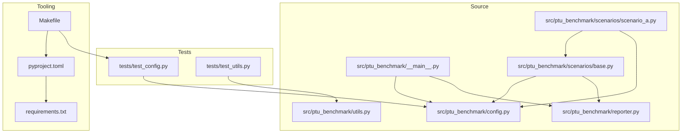
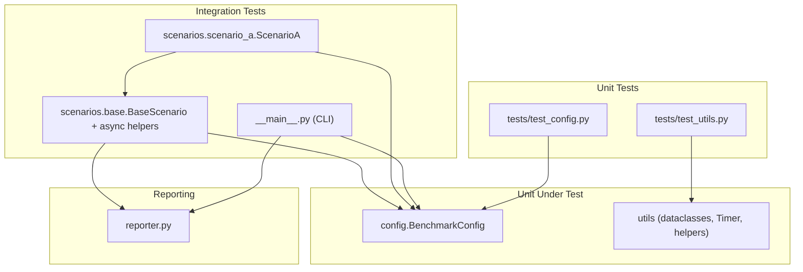
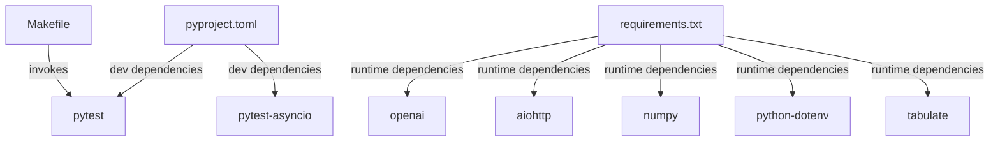

# Testing and Quality Assurance

<cite>
**Referenced Files in This Document**
- [tests/test_config.py](file://tests/test_config.py)
- [tests/test_utils.py](file://tests/test_utils.py)
- [src/ptu_benchmark/config.py](file://src/ptu_benchmark/config.py)
- [src/ptu_benchmark/utils.py](file://src/ptu_benchmark/utils.py)
- [src/ptu_benchmark/__main__.py](file://src/ptu_benchmark/__main__.py)
- [src/ptu_benchmark/scenarios/base.py](file://src/ptu_benchmark/scenarios/base.py)
- [src/ptu_benchmark/scenarios/scenario_a.py](file://src/ptu_benchmark/scenarios/scenario_a.py)
- [src/ptu_benchmark/reporter.py](file://src/ptu_benchmark/reporter.py)
- [pyproject.toml](file://pyproject.toml)
- [Makefile](file://Makefile)
- [requirements.txt](file://requirements.txt)
</cite>

## Table of Contents
1. [Introduction](#introduction)
2. [Project Structure](#project-structure)
3. [Core Components](#core-components)
4. [Architecture Overview](#architecture-overview)
5. [Detailed Component Analysis](#detailed-component-analysis)
6. [Dependency Analysis](#dependency-analysis)
7. [Performance Considerations](#performance-considerations)
8. [Troubleshooting Guide](#troubleshooting-guide)
9. [Conclusion](#conclusion)
10. [Appendices](#appendices)

## Introduction
This document provides comprehensive testing and quality assurance guidance for the PTU-Benchmark framework. It explains the unit test structure, coverage areas, and methodologies used to validate configuration, utilities, and integration behavior. It also covers test execution procedures, continuous integration readiness, and automated workflows. Guidance is included for writing new tests, mocking external dependencies, validating benchmark results, managing test data, assertion strategies, and performance regression testing. Examples of common test scenarios and debugging techniques for test failures are provided to support maintainers and contributors.

## Project Structure
The repository organizes tests under the tests/ directory and source code under src/ptu_benchmark/. The primary modules under test are configuration management, shared utilities, CLI entry point, scenario runners, and result reporting. The Makefile and pyproject.toml define installation, development dependencies, and test execution.

**Diagram sources**
- [tests/test_config.py:1-42](file://tests/test_config.py#L1-L42)
- [tests/test_utils.py:1-80](file://tests/test_utils.py#L1-L80)
- [src/ptu_benchmark/config.py:1-106](file://src/ptu_benchmark/config.py#L1-L106)
- [src/ptu_benchmark/utils.py:1-156](file://src/ptu_benchmark/utils.py#L1-L156)
- [src/ptu_benchmark/__main__.py:1-150](file://src/ptu_benchmark/__main__.py#L1-L150)
- [src/ptu_benchmark/scenarios/base.py:1-143](file://src/ptu_benchmark/scenarios/base.py#L1-L143)
- [src/ptu_benchmark/scenarios/scenario_a.py:1-102](file://src/ptu_benchmark/scenarios/scenario_a.py#L1-L102)
- [src/ptu_benchmark/reporter.py:1-189](file://src/ptu_benchmark/reporter.py#L1-L189)
- [pyproject.toml:1-37](file://pyproject.toml#L1-L37)
- [Makefile:1-61](file://Makefile#L1-L61)
- [requirements.txt:1-6](file://requirements.txt#L1-L6)

**Section sources**
- [pyproject.toml:1-37](file://pyproject.toml#L1-L37)
- [Makefile:1-61](file://Makefile#L1-L61)

## Core Components
This section outlines the core components tested and their roles in the quality assurance framework.

- Configuration Management
  - Centralized configuration loading from environment variables and .env files, with validation and environment-based construction.
  - Tests cover default values, validation failure conditions, and environment variable parsing.

- Shared Utilities
  - Data models for single and scenario-level results, timing utilities, prompt constants, and SSE token parsing helpers.
  - Tests cover result aggregation, filtering, serialization, timing accuracy, and prompt generation scaling.

- CLI and Orchestration
  - Command-line interface builds argument parsers, loads configuration, validates it, lists scenarios, and orchestrates benchmark runs.
  - Tests focus on configuration validation and environment-driven configuration loading.

- Scenario Infrastructure
  - Async request helpers and base scenario class for streaming requests, concurrency orchestration, and result collection.
  - Scenario A demonstrates synchronous OpenAI SDK usage for baseline measurements.

- Reporting and Export
  - Console output formatting, summary statistics, and JSON/CSV export utilities for benchmark results.

**Section sources**
- [src/ptu_benchmark/config.py:1-106](file://src/ptu_benchmark/config.py#L1-L106)
- [src/ptu_benchmark/utils.py:1-156](file://src/ptu_benchmark/utils.py#L1-L156)
- [src/ptu_benchmark/__main__.py:1-150](file://src/ptu_benchmark/__main__.py#L1-L150)
- [src/ptu_benchmark/scenarios/base.py:1-143](file://src/ptu_benchmark/scenarios/base.py#L1-L143)
- [src/ptu_benchmark/scenarios/scenario_a.py:1-102](file://src/ptu_benchmark/scenarios/scenario_a.py#L1-L102)
- [src/ptu_benchmark/reporter.py:1-189](file://src/ptu_benchmark/reporter.py#L1-L189)

## Architecture Overview
The testing architecture aligns with the source module layout. Unit tests validate isolated components, while integration-style tests exercise configuration loading and CLI orchestration. Asynchronous scenario tests rely on real network I/O and are therefore integration-focused.

**Diagram sources**
- [tests/test_config.py:1-42](file://tests/test_config.py#L1-L42)
- [tests/test_utils.py:1-80](file://tests/test_utils.py#L1-L80)
- [src/ptu_benchmark/config.py:1-106](file://src/ptu_benchmark/config.py#L1-L106)
- [src/ptu_benchmark/utils.py:1-156](file://src/ptu_benchmark/utils.py#L1-L156)
- [src/ptu_benchmark/__main__.py:1-150](file://src/ptu_benchmark/__main__.py#L1-L150)
- [src/ptu_benchmark/scenarios/base.py:1-143](file://src/ptu_benchmark/scenarios/base.py#L1-L143)
- [src/ptu_benchmark/scenarios/scenario_a.py:1-102](file://src/ptu_benchmark/scenarios/scenario_a.py#L1-L102)
- [src/ptu_benchmark/reporter.py:1-189](file://src/ptu_benchmark/reporter.py#L1-L189)

## Detailed Component Analysis

### Configuration Validation Tests
Coverage areas:
- Default configuration values for base URL, concurrency levels, sustained duration, and burst size.
- Validation logic for missing required fields (API key and model ID).
- Environment-driven configuration loading and parsing of comma-separated lists and context sizes.
- Monkey-patching environment variables for controlled test scenarios.

Key assertions and strategies:
- Assert default values match expectations.
- Assert validation returns non-empty error list when required fields are missing.
- Assert validation returns empty list when configuration is valid.
- Assert environment variable parsing produces expected data structures.

Common test scenarios:
- Missing API key yields a configuration error mentioning the required environment variable.
- Missing model ID yields a configuration error mentioning the required environment variable.
- Environment variables with comma-separated values produce integer lists.
- Environment variables with context sizes produce normalized dictionary entries.

Debugging tips:
- Verify environment variables are loaded before constructing configuration.
- Confirm .env file presence and correctness when testing environment-driven loading.
- Use pytest monkeypatch fixture to simulate environment conditions deterministically.

**Section sources**
- [tests/test_config.py:1-42](file://tests/test_config.py#L1-L42)
- [src/ptu_benchmark/config.py:47-96](file://src/ptu_benchmark/config.py#L47-L96)
- [src/ptu_benchmark/config.py:98-106](file://src/ptu_benchmark/config.py#L98-L106)

### Utility Function Tests
Coverage areas:
- SingleRequestResult success property and error handling.
- ScenarioResult filtering helpers (successful, failed, rate-limited) and dictionary serialization.
- Timer context manager elapsed time computation.
- Prompt generation helper scales with target token counts and returns non-empty strings.

Key assertions and strategies:
- Validate success property reflects presence of error and TTFT.
- Validate filtering produces correct counts for different categories.
- Validate dictionary serialization includes expected fields and counts.
- Validate Timer elapsed and elapsed_ms properties meet minimum thresholds.
- Validate generate_long_context returns strings and respects minimum repetition guarantees.

Common test scenarios:
- Successful request produces success=True and non-null TTFT.
- Requests with errors produce success=False.
- Rate-limited responses are categorized separately.
- Timer measures a positive elapsed time window around sleep durations.
- Larger token targets produce proportionally larger contexts.

Debugging tips:
- Inspect SingleRequestResult fields to confirm TTFT, TPS, and token counts.
- Verify ScenarioResult.to_dict includes nested result dictionaries.
- Confirm Timer context manager exits properly and computes differences.

**Section sources**
- [tests/test_utils.py:1-80](file://tests/test_utils.py#L1-L80)
- [src/ptu_benchmark/utils.py:45-58](file://src/ptu_benchmark/utils.py#L45-L58)
- [src/ptu_benchmark/utils.py:60-90](file://src/ptu_benchmark/utils.py#L60-L90)
- [src/ptu_benchmark/utils.py:97-117](file://src/ptu_benchmark/utils.py#L97-L117)
- [src/ptu_benchmark/utils.py:120-131](file://src/ptu_benchmark/utils.py#L120-L131)

### Integration Testing Strategies
Coverage areas:
- CLI argument parsing, scenario listing, and export behavior.
- Scenario orchestration and result aggregation.
- Async request execution and SSE parsing for streaming responses.
- Reporter utilities for console output and file exports.

Methodologies:
- Environment-driven configuration loading for realistic integration tests.
- Controlled scenario runs with deterministic prompts and token limits.
- Export verification to ensure JSON and CSV outputs are generated and structured correctly.

Common test scenarios:
- CLI validates configuration and exits with errors when required fields are missing.
- CLI lists available scenarios when requested.
- Scenario A executes single requests and aggregates results.
- Async helpers handle HTTP errors and rate-limiting responses appropriately.
- Reporter prints summaries and exports files to the expected output directory.

Debugging tips:
- Capture and inspect printed outputs for scenario summaries.
- Verify exported files exist and contain expected metrics.
- Validate that async tasks resolve within reasonable time bounds.

**Section sources**
- [src/ptu_benchmark/__main__.py:39-78](file://src/ptu_benchmark/__main__.py#L39-L78)
- [src/ptu_benchmark/__main__.py:88-118](file://src/ptu_benchmark/__main__.py#L88-L118)
- [src/ptu_benchmark/__main__.py:121-145](file://src/ptu_benchmark/__main__.py#L121-L145)
- [src/ptu_benchmark/scenarios/base.py:47-112](file://src/ptu_benchmark/scenarios/base.py#L47-L112)
- [src/ptu_benchmark/scenarios/base.py:115-142](file://src/ptu_benchmark/scenarios/base.py#L115-L142)
- [src/ptu_benchmark/scenarios/scenario_a.py:32-57](file://src/ptu_benchmark/scenarios/scenario_a.py#L32-L57)
- [src/ptu_benchmark/reporter.py:125-148](file://src/ptu_benchmark/reporter.py#L125-L148)
- [src/ptu_benchmark/reporter.py:151-188](file://src/ptu_benchmark/reporter.py#L151-L188)

### Writing New Tests
Guidance:
- Place new tests under tests/ following existing naming conventions.
- Use pytest fixtures (e.g., monkeypatch) for environment manipulation.
- Prefer deterministic inputs (fixed prompts, token counts) for repeatability.
- Validate both success and failure paths for functions with branching logic.
- For async code, leverage pytest-asyncio and run with asyncio mode enabled.

Mocking external dependencies:
- Use monkeypatch to inject environment variables for configuration tests.
- For network-dependent tests, consider isolating HTTP calls behind interfaces or using local echo servers in higher-level integration suites.

Validation of benchmark results:
- Confirm ScenarioResult aggregations (successful, failed, rate-limited) match expectations.
- Validate reporter outputs and exported files contain expected metrics and headers.

**Section sources**
- [pyproject.toml:22-26](file://pyproject.toml#L22-L26)
- [pyproject.toml:34-37](file://pyproject.toml#L34-L37)
- [Makefile:26-27](file://Makefile#L26-L27)

### Test Execution Procedures
Execution commands:
- Run unit tests: make test
- Install development dependencies: make install-dev
- Install production dependencies: make install
- Set up .env from example: make setup

Continuous integration setup:
- Configure CI to install dependencies using requirements.txt and dev dependencies from pyproject.toml.
- Enable pytest with asyncio mode and run tests against the tests/ directory.
- Optionally cache dependencies and artifacts for faster builds.

Automated testing workflows:
- Pre-commit hooks can run pytest locally.
- CI jobs can run pytest, lint checks, and export results to artifacts.

**Section sources**
- [Makefile:13-22](file://Makefile#L13-L22)
- [Makefile:26-27](file://Makefile#L26-L27)
- [pyproject.toml:22-26](file://pyproject.toml#L22-L26)
- [requirements.txt:1-6](file://requirements.txt#L1-L6)

### Test Data Management
Strategies:
- Use deterministic prompts and token counts for reproducible results.
- Manage environment variables via .env files and monkeypatching for isolation.
- Store expected outputs (JSON/CSV) in version control for snapshot-style validation when appropriate.

Assertion strategies:
- Compare computed metrics (TTFT percentiles, TPS averages) with tolerance ranges when applicable.
- Validate dictionary serialization includes expected keys and counts.
- Assert file existence and basic content structure for exports.

**Section sources**
- [src/ptu_benchmark/utils.py:17-38](file://src/ptu_benchmark/utils.py#L17-L38)
- [src/ptu_benchmark/reporter.py:125-148](file://src/ptu_benchmark/reporter.py#L125-L148)
- [src/ptu_benchmark/reporter.py:151-188](file://src/ptu_benchmark/reporter.py#L151-L188)

### Performance Regression Testing Approaches
Approaches:
- Track key metrics (TTFT percentiles, TPS averages, TPM estimates) over time.
- Export results to JSON/CSV and compare against baselines using external scripts or CI dashboards.
- Use statistical significance tests to detect meaningful regressions.

Guidance:
- Establish baselines for each scenario and metric.
- Monitor trends across PRs and releases.
- Flag anomalies in rate-limiting or error rates alongside latency and throughput.

**Section sources**
- [src/ptu_benchmark/reporter.py:46-82](file://src/ptu_benchmark/reporter.py#L46-L82)
- [src/ptu_benchmark/reporter.py:125-148](file://src/ptu_benchmark/reporter.py#L125-L148)
- [src/ptu_benchmark/reporter.py:151-188](file://src/ptu_benchmark/reporter.py#L151-L188)

## Dependency Analysis
The testing stack relies on pytest and pytest-asyncio for test execution and asynchronous support. Development dependencies are declared in pyproject.toml under dev extras. The Makefile integrates pytest invocation. Runtime dependencies are listed in requirements.txt.

**Diagram sources**
- [pyproject.toml:22-26](file://pyproject.toml#L22-L26)
- [pyproject.toml:34-37](file://pyproject.toml#L34-L37)
- [Makefile:26-27](file://Makefile#L26-L27)
- [requirements.txt:1-6](file://requirements.txt#L1-L6)

**Section sources**
- [pyproject.toml:22-26](file://pyproject.toml#L22-L26)
- [pyproject.toml:34-37](file://pyproject.toml#L34-L37)
- [Makefile:26-27](file://Makefile#L26-L27)
- [requirements.txt:1-6](file://requirements.txt#L1-L6)

## Performance Considerations
- Asynchronous tests should avoid long sleeps; use timeouts and deterministic waits.
- Export operations should write to temporary directories to prevent disk contention.
- Keep test data minimal but representative to reduce runtime and memory footprint.

## Troubleshooting Guide
Common issues and resolutions:
- Configuration errors on startup: ensure required environment variables are set and validated by the CLI.
- Missing .env file: use the setup target to copy the example file and edit credentials.
- Rate-limiting responses: expect rate-limited results to be categorized correctly in ScenarioResult.
- Async test hangs: verify pytest-asyncio is installed and configured, and that async tasks are awaited.

Debugging techniques:
- Add verbose logging to CLI and reporter outputs.
- Inspect exported JSON/CSV for completeness and correctness.
- Use smaller concurrency levels and token counts for initial debugging.

**Section sources**
- [src/ptu_benchmark/__main__.py:129-138](file://src/ptu_benchmark/__main__.py#L129-L138)
- [Makefile:20-22](file://Makefile#L20-L22)
- [src/ptu_benchmark/utils.py:77-79](file://src/ptu_benchmark/utils.py#L77-L79)
- [pyproject.toml:22-26](file://pyproject.toml#L22-L26)

## Conclusion
The PTU-Benchmark testing framework combines focused unit tests for configuration and utilities with integration-style tests for CLI orchestration and scenario execution. By leveraging pytest, environment-driven configuration, and structured result reporting, the framework ensures reliable validation of benchmark outcomes. The guidance provided here supports contributors in extending coverage, maintaining quality, and integrating automated workflows effectively.

## Appendices
- Example test scenarios:
  - Configuration validation with missing API key and model ID.
  - Environment-driven configuration parsing for concurrency levels and context sizes.
  - ScenarioResult aggregation and serialization.
  - Timer elapsed time measurement.
  - Scenario A single-request execution and result collection.

[No sources needed since this section summarizes without analyzing specific files]