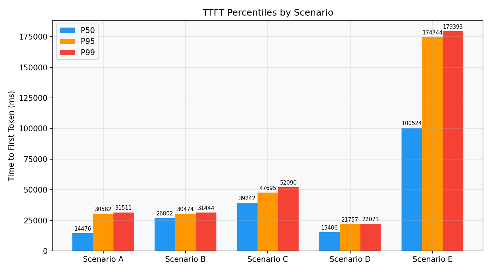
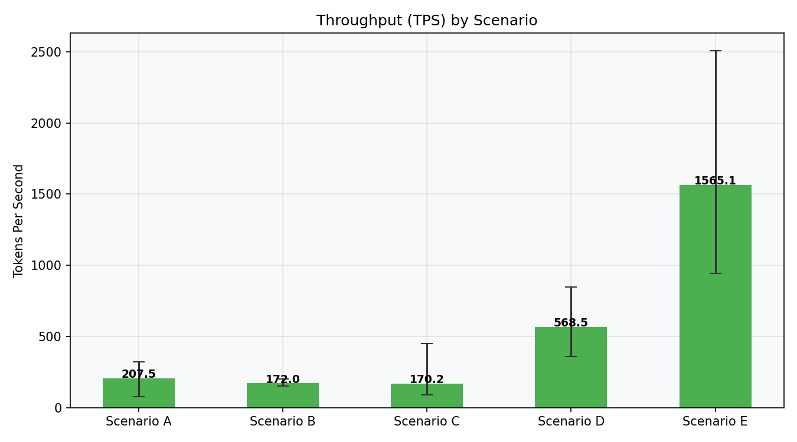
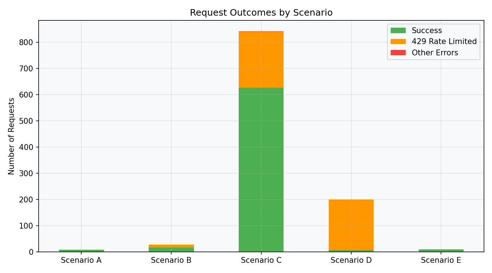

# PTU Benchmark — Executive Report

**Date:** 2026-06-09 12:52 UTC
**Service:** ptu-benchmark
**Model:** Qwen3.6-Plus-2026-04-02 (qwen3.6-plus-2026-04-02)
**Deployment:** qwen3.6-plus-2026-04-02-d1839645ee95
**Quota:** 500,000 input TPM / 100,000 output TPM
**Billing:** Provisioned Throughput Unit / Pay-as-you-go
**Hourly Price:** $132.00/hour
**Base URL:** https://llm-ij1s9au4y9ke51gb.ap-southeast-1.maas.aliyuncs.com/compatible-mode/v1

---

## TL;DR

> ❌ **Verdict: THROTTLED** — 419 of 1087 requests rate-limited (39%) — capacity exceeded.

- **Latency:** TTFT P50 = 38987 ms, P95 = 48211 ms, P99 = 74732 ms (across 667 successful requests).
- **Throughput:** Avg 193.7 tok/s per request; peak aggregate 1,222,671 TPM (in Scenario C).
- **Reliability:** 667/1087 succeeded (61%); 419 rate-limited (429), 1 other errors.
- **Quota:** Peak utilization 1223% of 100,000 provisioned output TPM (0 TPM headroom).
- **Cost:** $132.00/hour (~$3168/day, ~$95,040/month); effective ~$1.80 per M output tokens at peak throughput.
- **Total volume:** 2,067,372 tokens generated across 5 scenarios.

---

## 1. Summary

| Scenario                                         |   Total |   Success |   Errors |   429s | TTFT P50   | TTFT P99   |   TPS Avg |   Est. TPM |
|:-------------------------------------------------|--------:|----------:|---------:|-------:|:-----------|:-----------|----------:|-----------:|
| A: Single Request Baseline (TTFT + TPS)          |       8 |         8 |        0 |      0 | 14476 ms   | 31511 ms   |     207.5 |     12,483 |
| B: Concurrent Load (10/50/100 parallel requests) |      28 |        16 |       12 |     12 | 26802 ms   | 31444 ms   |     172   |     41,430 |
| C: Sustained Throughput (30-minute window)       |     842 |       627 |      215 |    214 | 39242 ms   | 52090 ms   |     170.2 |  1,222,671 |
| D: Peak Burst Test                               |     200 |         7 |      193 |    193 | 15406 ms   | 22073 ms   |     568.5 |     15,265 |
| E: Long Context Test                             |       9 |         9 |        0 |      0 | 100524 ms  | 179393 ms  |    1565.1 |     18,077 |

---

## 2. Performance Overview

### Time to First Token (TTFT)

TTFT measures perceived responsiveness — how quickly the first token appears. Lower is better. P50 represents the median experience; P99 shows worst-case latency.

### Throughput (TPS)

Tokens Per Second measures generation speed after the first token arrives. Higher is better. Error bars show min/max range across requests.

### Request Outcomes

Breakdown of successful requests, rate-limited (HTTP 429) responses, and other errors per scenario. PTU should show zero 429s within provisioned capacity.

---

## 3. Quota Utilization Analysis

This section compares achieved aggregate throughput against the provisioned **100,000 output TPM** quota for this deployment. The status thresholds are: ✅ OK (<80%), ⚠️ NEAR QUOTA (80–100%), ❌ OVER QUOTA (≥100%), ❌ THROTTLED (any 429 responses).

| Scenario                                         |   Achieved TPM |   Quota TPM | Util %   |   429s | Status      |
|:-------------------------------------------------|---------------:|------------:|:---------|-------:|:------------|
| A: Single Request Baseline (TTFT + TPS)          |         12,483 |     100,000 | 12.5%    |      0 | ✅ OK        |
| B: Concurrent Load (10/50/100 parallel requests) |         41,430 |     100,000 | 41.4%    |     12 | ❌ THROTTLED |
| C: Sustained Throughput (30-minute window)       |      1,222,671 |     100,000 | 1222.7%  |    214 | ❌ THROTTLED |
| D: Peak Burst Test                               |         15,265 |     100,000 | 15.3%    |    193 | ❌ THROTTLED |
| E: Long Context Test                             |         18,077 |     100,000 | 18.1%    |      0 | ✅ OK        |

**Peak observed:** 1,222,671 TPM in Scenario C (1222.7% of quota).  
**Headroom:** 0 TPM (0.0%) unused at peak.

---

## 4. Scenario Details

### Scenario A: Single Request Baseline (TTFT + TPS)

- **Total requests:** 8
- **Successful:** 8 (100.0%)
- **Errors:** 0
- **Rate limited (429):** 0
- **Total tokens generated:** 14,497
- **Wall-clock duration (slowest request):** 69.68 s
- **Aggregate TPM achieved:** 12,483
- **Quota utilization:** 12.5% of 100,000 provisioned output TPM
- **Estimated cost (this scenario):** $2.5550 ($176.24 per M tokens)

**Time to First Token (TTFT):**

| Percentile | Value |
|------------|-------|
| Min | 11376 ms |
| P50 (median) | 14476 ms |
| P75 | 26535 ms |
| P90 | 29421 ms |
| P95 | 30582 ms |
| P99 | 31511 ms |
| Max | 31743 ms |
| Mean | 18897 ms |
| Std Dev | 7808 ms |

**Throughput (Tokens/Second per request):**

| Metric | Value |
|--------|-------|
| Min | 78.2 tok/s |
| Median | 247.8 tok/s |
| Average | 207.5 tok/s |
| P95 | 315.2 tok/s |
| Max | 321.3 tok/s |
| Std Dev | 94.3 tok/s |

**Request Duration (end-to-end):**

| Percentile | Value |
|------------|-------|
| Min | 14.00 s |
| P50 | 17.06 s |
| P95 | 69.49 s |
| P99 | 69.64 s |
| Max | 69.68 s |
| Mean | 35.56 s |

**Tokens per Request:**

| Metric | Value |
|--------|-------|
| Min | 708 |
| Median | 814 |
| Mean | 1,812 |
| Max | 3,737 |

---

### Scenario B: Concurrent Load (10/50/100 parallel requests)

- **Total requests:** 28
- **Successful:** 16 (57.1%)
- **Errors:** 12
- **Rate limited (429):** 12
- **Total tokens generated:** 28,989
- **Wall-clock duration (slowest request):** 41.98 s
- **Aggregate TPM achieved:** 41,430
- **Quota utilization:** 41.4% of 100,000 provisioned output TPM
- **Estimated cost (this scenario):** $1.5394 ($53.10 per M tokens)

**Time to First Token (TTFT):**

| Percentile | Value |
|------------|-------|
| Min | 24033 ms |
| P50 (median) | 26802 ms |
| P75 | 28572 ms |
| P90 | 29483 ms |
| P95 | 30474 ms |
| P99 | 31444 ms |
| Max | 31686 ms |
| Mean | 27075 ms |
| Std Dev | 2037 ms |

**Throughput (Tokens/Second per request):**

| Metric | Value |
|--------|-------|
| Min | 152.9 tok/s |
| Median | 171.1 tok/s |
| Average | 172.0 tok/s |
| P95 | 191.9 tok/s |
| Max | 202.3 tok/s |
| Std Dev | 13.7 tok/s |

**Request Duration (end-to-end):**

| Percentile | Value |
|------------|-------|
| Min | 33.61 s |
| P50 | 37.09 s |
| P95 | 40.90 s |
| P99 | 41.77 s |
| Max | 41.98 s |
| Mean | 37.64 s |

**Tokens per Request:**

| Metric | Value |
|--------|-------|
| Min | 1,656 |
| Median | 1,822 |
| Mean | 1,812 |
| Max | 2,083 |

**Error Breakdown:**

| Error type | Count |
|------------|-------|
| `429_rate_limited` | 12 |

---

### Scenario C: Sustained Throughput (30-minute window)

- **Total requests:** 842
- **Successful:** 627 (74.5%)
- **Errors:** 215
- **Rate limited (429):** 214
- **Total tokens generated:** 1,962,221
- **Wall-clock duration (slowest request):** 96.29 s
- **Aggregate TPM achieved:** 1,222,671
- **Quota utilization:** 1222.7% of 100,000 provisioned output TPM
- **Estimated cost (this scenario):** $3.5307 ($1.80 per M tokens)

**Time to First Token (TTFT):**

| Percentile | Value |
|------------|-------|
| Min | 25840 ms |
| P50 (median) | 39242 ms |
| P75 | 42512 ms |
| P90 | 45400 ms |
| P95 | 47695 ms |
| P99 | 52090 ms |
| Max | 65977 ms |
| Mean | 39304 ms |
| Std Dev | 5067 ms |

**Throughput (Tokens/Second per request):**

| Metric | Value |
|--------|-------|
| Min | 89.9 tok/s |
| Median | 169.5 tok/s |
| Average | 170.2 tok/s |
| P95 | 198.8 tok/s |
| Max | 452.1 tok/s |
| Std Dev | 22.6 tok/s |

**Request Duration (end-to-end):**

| Percentile | Value |
|------------|-------|
| Min | 44.23 s |
| P50 | 57.64 s |
| P95 | 66.91 s |
| P99 | 70.18 s |
| Max | 96.29 s |
| Mean | 57.83 s |

**Tokens per Request:**

| Metric | Value |
|--------|-------|
| Min | 2,411 |
| Median | 3,131 |
| Mean | 3,130 |
| Max | 4,535 |

**Error Breakdown:**

| Error type | Count |
|------------|-------|
| `429_rate_limited` | 214 |
| `unknown` | 1 |

---

### Scenario D: Peak Burst Test

- **Total requests:** 200
- **Successful:** 7 (3.5%)
- **Errors:** 193
- **Rate limited (429):** 193
- **Total tokens generated:** 6,058
- **Wall-clock duration (slowest request):** 23.81 s
- **Aggregate TPM achieved:** 15,265
- **Quota utilization:** 15.3% of 100,000 provisioned output TPM
- **Estimated cost (this scenario):** $0.8731 ($144.12 per M tokens)

**Time to First Token (TTFT):**

| Percentile | Value |
|------------|-------|
| Min | 13183 ms |
| P50 (median) | 15406 ms |
| P75 | 18453 ms |
| P90 | 21362 ms |
| P95 | 21757 ms |
| P99 | 22073 ms |
| Max | 22152 ms |
| Mean | 16480 ms |
| Std Dev | 3322 ms |

**Throughput (Tokens/Second per request):**

| Metric | Value |
|--------|-------|
| Min | 358.5 tok/s |
| Median | 566.2 tok/s |
| Average | 568.5 tok/s |
| P95 | 812.0 tok/s |
| Max | 847.1 tok/s |
| Std Dev | 159.5 tok/s |

**Request Duration (end-to-end):**

| Percentile | Value |
|------------|-------|
| Min | 14.43 s |
| P50 | 17.14 s |
| P95 | 23.33 s |
| P99 | 23.71 s |
| Max | 23.81 s |
| Mean | 18.03 s |

**Tokens per Request:**

| Metric | Value |
|--------|-------|
| Min | 622 |
| Median | 761 |
| Mean | 865 |
| Max | 1,211 |

**Error Breakdown:**

| Error type | Count |
|------------|-------|
| `429_rate_limited` | 193 |

---

### Scenario E: Long Context Test

- **Total requests:** 9
- **Successful:** 9 (100.0%)
- **Errors:** 0
- **Rate limited (429):** 0
- **Total tokens generated:** 55,607
- **Wall-clock duration (slowest request):** 184.57 s
- **Aggregate TPM achieved:** 18,077
- **Quota utilization:** 18.1% of 100,000 provisioned output TPM
- **Estimated cost (this scenario):** $6.7675 ($121.70 per M tokens)

**Time to First Token (TTFT):**

| Percentile | Value |
|------------|-------|
| Min | 67533 ms |
| P50 (median) | 100524 ms |
| P75 | 139521 ms |
| P90 | 168934 ms |
| P95 | 174744 ms |
| P99 | 179393 ms |
| Max | 180555 ms |
| Mean | 113237 ms |
| Std Dev | 39818 ms |

**Throughput (Tokens/Second per request):**

| Metric | Value |
|--------|-------|
| Min | 944.8 tok/s |
| Median | 1508.3 tok/s |
| Average | 1565.1 tok/s |
| P95 | 2347.7 tok/s |
| Max | 2506.1 tok/s |
| Std Dev | 484.3 tok/s |

**Request Duration (end-to-end):**

| Percentile | Value |
|------------|-------|
| Min | 69.79 s |
| P50 | 104.69 s |
| P95 | 178.81 s |
| P99 | 183.42 s |
| Max | 184.57 s |
| Mean | 117.20 s |

**Tokens per Request:**

| Metric | Value |
|--------|-------|
| Min | 3,397 |
| Median | 5,581 |
| Mean | 6,179 |
| Max | 10,060 |

---

## 5. Key Findings

- **Scenario A (Single Request Baseline (TTFT + TPS)):** TTFT P50=14476ms, avg TPS=207.5, 8/8 succeeded.
- **Scenario B (Concurrent Load (10/50/100 parallel requests)):** TTFT P50=26802ms, avg TPS=172.0, 16/28 succeeded, 12 rate-limited (429).
- **Scenario C (Sustained Throughput (30-minute window)):** TTFT P50=39242ms, avg TPS=170.2, 627/842 succeeded, 214 rate-limited (429).
- **Scenario D (Peak Burst Test):** TTFT P50=15406ms, avg TPS=568.5, 7/200 succeeded, 193 rate-limited (429).
- **Scenario E (Long Context Test):** TTFT P50=100524ms, avg TPS=1565.1, 9/9 succeeded.

---

## 6. Cost Analysis

Provisioned cost is fixed at **$132.00/hour** regardless of utilization. Effective per-token cost depends on how fully the quota is used — higher utilization yields better unit economics.

**Fixed costs:**

| Period | Cost |
|--------|------|
| Hourly | $132.00 |
| Daily | $3,168.00 |
| Weekly | $22,176.00 |
| Monthly (30d) | $95,040.00 |
| Annual | $1,156,320.00 |

**Effective unit cost (output tokens) by utilization:**

| Utilization | Effective TPM | $/hour | $/M tokens |
|-------------|---------------|--------|------------|
| 25% | 25,000 | $132.00 | $88.00 |
| 50% | 50,000 | $132.00 | $44.00 |
| 75% | 75,000 | $132.00 | $29.33 |
| 100% | 100,000 | $132.00 | $22.00 |

> _Lower $/M-tokens = better unit economics. PTU pricing favors high-utilization workloads — under-utilization wastes provisioned capacity._

**Observed (this run):** Peak 1,222,671 TPM ⇒ effective **$1.80 / M output tokens**.

---

## 7. Recommendations

- **Capacity:** 419 requests were rate-limited. Either reduce concurrency, batch requests more aggressively, or request a higher TPM quota for this deployment.

---

## 8. Test Configuration

| Setting | Value |
|---------|-------|
| Service | ptu-benchmark |
| Model | Qwen3.6-Plus-2026-04-02 |
| Model Code | qwen3.6-plus-2026-04-02 |
| Deployment | qwen3.6-plus-2026-04-02-d1839645ee95 |
| Input TPM Quota | 500,000 |
| Output TPM Quota | 100,000 |
| Billing Method | Provisioned Throughput Unit / Pay-as-you-go |
| Hourly Price | $132.00 |
| Model ID | `qwen3.6-plus-2026-04-02` |
| Base URL | `https://llm-ij1s9au4y9ke51gb.ap-southeast-1.maas.aliyuncs.com/compatible-mode/v1` |
| Concurrent Max Tokens | 512 |
| Sustained Duration (s) | 1800 |
| Sustained Concurrency | 20 |
| Burst Size | 200 |
| Concurrency Levels (auto-derived) | [4, 8, 16] |
| Report generated | 2026-06-09 12:52 UTC |
| Total scenarios | 5 |
| Total requests | 1,087 |
| Total tokens | 2,067,372 |

---

*Report generated by PTU Benchmark Suite.*